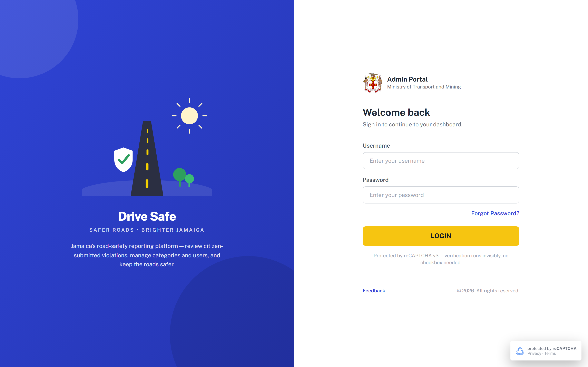

# SCR-00 · Login

## Purpose
First screen of the portal and the boot route. A portal user enters a username and password and presses LOGIN to start a two-step sign-in (credentials, then one-time code on SCR-02). It is also the landing point after logout and after a password-reset flow.

## Entry and exit
**Reached from:** application boot (`go("login")` on load); SCR-04 Logout modal, **Sign out** button; SCR-01 Forgot password, **← Back to sign in**; SCR-02 OTP (reset done state) **Back to sign in** button; SCR-02 OTP (login mode) **← Back to sign in**.

**Leaves to:** SCR-01 via **Forgot Password?**; SCR-02 (login mode) via **LOGIN**; SCR-03 Feedback modal via **Feedback**.

## States
### Default (only state captured)

| State | When | What the user sees |
|---|---|---|
| Default | Page load, after logout | Empty Username and Password, placeholders "Enter your username" / "Enter your password" |
| Error | Wrong credentials | **Undefined, OQ-A-01.** The prototype never checks credentials; LOGIN always proceeds |
| Loading | Sign-in in flight | **Undefined, OQ-A-02** |
| Locked / throttled | Too many attempts | **Undefined, OQ-A-03** |
| Empty-submit | LOGIN pressed with blank fields | Proceeds to SCR-02 anyway (see OQ-A-01) |

The brand panel (illustration, "Drive Safe", "SAFER ROADS • BRIGHTER JAMAICA", blurb) is hidden below the `lg` (1024px) breakpoint, leaving only the form. No mobile capture exists; the layout rule is from source.

## Layout
| # | Region | Content |
|---|---|---|
| 1 | Brand panel (left half, lg and up) | Road-safety SVG, "Drive Safe", tagline, blurb "Jamaica's road-safety reporting platform — review citizen-submitted violations, manage categories and users, and keep the roads safer." |
| 2 | Form header | Jamaica coat of arms, "Admin Portal", badge line (default "Ministry of Transport and Mining", replaceable from the Config screen, key `drivesafe_badge_name` in localStorage) |
| 3 | Heading | "Welcome back" / "Sign in to continue to your dashboard." |
| 4 | Fields | Username, Password |
| 5 | Links/CTA | Forgot Password? (right-aligned), LOGIN (full width, yellow) |
| 6 | Notice | "Protected by reCAPTCHA v3 — verification runs invisibly, no checkbox needed." |
| 7 | Footer | Feedback link, "© 2026. All rights reserved." |
| 8 | Floating | reCAPTCHA badge bottom-right ("protected by reCAPTCHA, Privacy · Terms") |

## Elements
| Element | Type | Behaviour | Requirement |
|---|---|---|---|
| Badge line | Text | Shows configured Badge Name on every auth screen (class `badge-name`); owned by Config screen | none |
| reCAPTCHA notice | Text | Static copy | none |
| reCAPTCHA badge | Fixed badge | Visible on login, forgot, OTP only; hidden once the shell shows. "Privacy · Terms" are plain text, not links | none |
| © 2026 line | Text | Hard-coded year | none |
| Brand panel | Decorative | `aria-label="Road safety illustration"` on SVG | none |

## Actions
| Control | Type | What happens | Goes to | Who may | Disabled when |
|---|---|---|---|---|---|
| Username | Text input | Free text accepted, `autocomplete="username"` | — | anyone (pre-login) | — |
| Password | Password input (masked) | Free text, `autocomplete="current-password"`. There is no show/hide eye on this field (unlike the Profile screen) | — | anyone (pre-login) | — |
| Forgot Password? | Text button (`data-go="forgot"`) | Switches the visible section to the Reset-your-password form and clears its field | SCR-01 | anyone (pre-login) | never |
| LOGIN (`aria-label="Sign in"`) | Primary button | Calls invisible reCAPTCHA v3 stub (action `login`, fixed score 0.9, console log only), sets OTP mode to *login*, stores the Username (trimmed; the literal text "your email" if blank) as the address echoed on the OTP screen, switches to the OTP screen. No credential check occurs | SCR-02 login mode | anyone (pre-login) | never, even with both fields empty |
| Feedback | Text button | Clears and shows the Feedback modal over the login page | SCR-03 | anyone (pre-login) | never |

**Wired to nothing**
The capture flagged no dead control on this screen (it was not in the route capture). Source check: all five controls are wired (delegated `data-go` or `data-action`). "Privacy · Terms" in the reCAPTCHA badge look like links but are plain text, see OQ-A-04.

## Validation
| Field | Rule | Source | When | Message |
|---|---|---|---|---|
| Username | Required, trimmed, 3-254 chars (email or username accepted: format undecided, OQ-A-05) | **PROPOSED** (prototype has no rule at all) | on submit | "Username is required." |
| Username | Characters `<` and `>` are stripped as typed | declared (global input filter in app.js) | on input | silent |
| Password | Required, 1-128 chars (128 mirrors PASSWORD_MAX in the password policy) | **PROPOSED** | on submit | "Password is required." |
| Password | Not trimmed, not stripped; `type=password` | declared | — | — |
| Credentials | Must match an account | **PROPOSED, server-side** | on submit | "Incorrect username or password." (generic, must not reveal which) |

**Cross-field:** none.

**Server-side only:** credential check, account lockout, reCAPTCHA v3 score threshold (prototype hard-codes 0.9 "human"; production threshold undecided, OQ-A-06).

**Unruled and undecided**

| Field | What is missing | Open question |
|---|---|---|
| Username | Is it an email, a handle or either? Forgot-password asks for an email, so they are probably the same | OQ-A-05 |
| Attempt limit | No lockout or throttling | OQ-A-03 |

## Screen communication
| Direction | With | What passes | Contract |
|---|---|---|---|
| Sends | SCR-02 OTP | OTP mode `login` and the typed Username as `pendingEmail` | Module-level variables; production must pass a server-issued challenge id instead |
| Sends | SCR-01 | Navigation only | — |
| Receives | SCR-04 Logout | Returns here, but Username/Password fields are not cleared by logout | OQ-A-07 |
| Receives | Config screen ([SCR-12](../03-catalogue/SCR-12-config.md)) | Badge Name text on the header line | Owner: SCR-12 |
| Shares | SCR-03 Feedback | Same modal reachable only from here | Owner: SCR-03 |

If this screen changes (e.g. username becomes email), SCR-01 wording and SCR-02 "code sent to ..." echo change with it.

## Acceptance criteria
**ST-SCR-00-01 — Login page renders**
- Given I open the portal without a session
- When the page loads
- Then I see "Welcome back", empty Username and Password fields and a LOGIN button
- And the shell (sidebar, header) is hidden

**ST-SCR-00-02 — LOGIN proceeds to code entry**
- Given I typed Username "ronald" and any Password
- When I press LOGIN
- Then the OTP screen appears reading "Enter the 6-digit code sent to ronald"
- And its back link reads "← Back to sign in"

**ST-SCR-00-03 — Forgot password link**
- Given I am on the login page
- When I press Forgot Password?
- Then SCR-01 appears with an empty Email address field

**ST-SCR-00-04 — Feedback link**
- Given I am on the login page
- When I press Feedback
- Then the Feedback modal appears and focus moves to its first control (the × button)

**ST-SCR-00-05 — Empty submit (as built, flagged)**
- Given Username and Password are both empty
- When I press LOGIN
- Then the OTP screen appears reading "sent to your email" (defect, OQ-A-01)

**ST-SCR-00-06 — Proposed required-field behaviour**
- Given Username is empty (PROPOSED rule)
- When I press LOGIN
- Then "Username is required." shows under the field and no navigation occurs

## Data
- **Reads:** Badge Name from localStorage `drivesafe_badge_name`.
- **Writes:** none (prototype). Production: authentication attempt, reCAPTCHA token, OTP challenge issuance.
- **Services required:** authentication, OTP issuance and delivery, reCAPTCHA v3 verification.

## Accessibility and keyboard
- Skip link "Skip to content" exists at page top (visible on focus).
- Fields have visible labels; Enter does **not** submit (the form uses `onsubmit="return false"` and the button is `type=button`), so keyboard users must Tab to LOGIN, see OQ-A-08.
- Toasts and `#live-region` announce transient messages.

## Open questions
| ID | Question | Affects | Why it matters |
|---|---|---|---|
| OQ-A-00 | Is there a spec or an existing production portal (drivesafe.ta.org.jm per data.js) whose login is the reference? | whole module | No spec, so everything is "what was built" |
| OQ-A-01 | What are the credential and empty-field behaviours? Prototype never validates | LOGIN | Developers will invent either no check or a different one |
| OQ-A-02 | Is there a loading state while credentials and reCAPTCHA are verified? | LOGIN | Double-submit risk |
| OQ-A-03 | Lockout/throttle policy after failed attempts? | LOGIN | Security |
| OQ-A-04 | Should "Privacy · Terms" link somewhere? | badge | Looks clickable, is not |
| OQ-A-05 | Is Username an email address or free handle? | Username, SCR-01 | Decides field type, uniqueness and the database column |
| OQ-A-06 | reCAPTCHA v3 score threshold and failure UX? | LOGIN, SCR-01, SCR-02 | Prototype fakes 0.9 |
| OQ-A-07 | Should logout clear the entered Username/Password and OTP state? | SCR-04 | Prototype leaves previous text in fields |
| OQ-A-08 | Should Enter submit the form? | LOGIN | Accessibility and expected behaviour |
