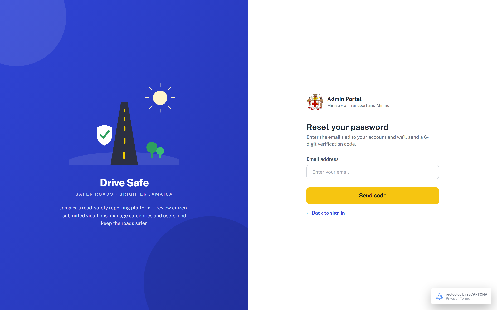
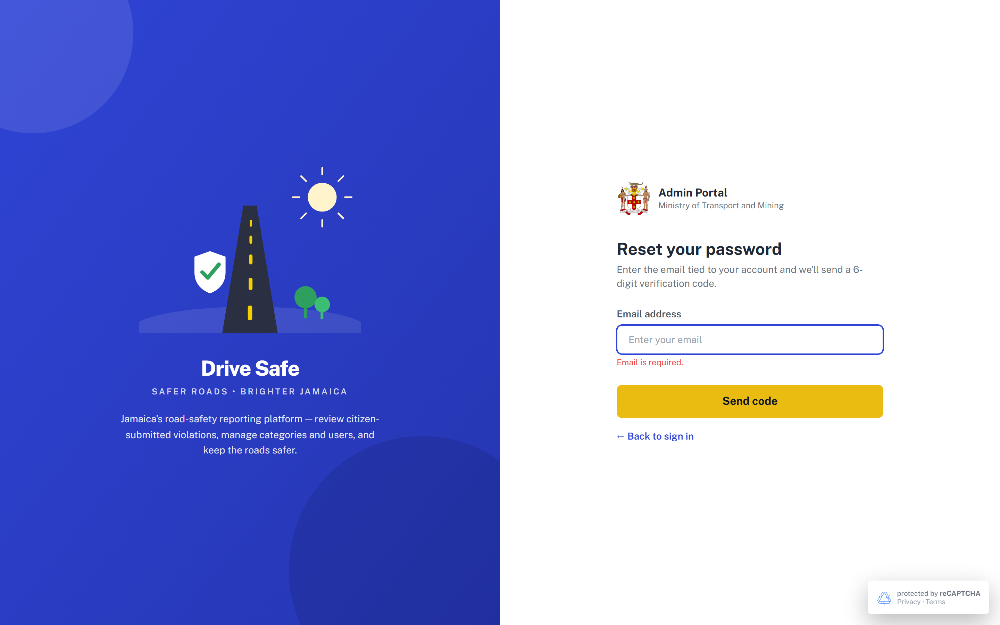

# SCR-01 · Forgot password

## Purpose
A portal user who cannot sign in enters the email tied to their account to receive a 6-digit verification code (SCR-02, reset mode). They leave with a code on its way.

## Entry and exit
**Reached from:** SCR-00 **Forgot Password?**; SCR-02 (reset mode) **← Change email**.

**Leaves to:** SCR-02 (reset mode) via **Send code** (only when valid); SCR-00 via **← Back to sign in**.

## States
### Default

### Validation error (submitted empty)

| State | When | What the user sees |
|---|---|---|
| Default | Entering the screen (field cleared, errors cleared every time) | Heading "Reset your password", help text, empty field |
| Error | Send code with blank or malformed email | Red message under the field, focus returned to the field (the capture shows the blue focus ring over the red invalid outline) |
| Sent | A `#forgot-sent` block "Check your email" exists in the markup (with `#fp-echo` and a Back to sign in button) but **no code ever shows it**: Send code goes straight to SCR-02 | Unreachable, see OQ-A-09 |
| Loading | Send in flight | **Undefined, OQ-A-02** |

## Layout
| # | Region | Content |
|---|---|---|
| 1 | Brand panel | Same as SCR-00 (hidden below 1024px) |
| 2 | Form header | Coat of arms, "Admin Portal", badge line |
| 3 | Heading + help | "Reset your password"; "Enter the email tied to your account and we'll send a 6-digit verification code." |
| 4 | Field | Email address, placeholder "Enter your email", error line below |
| 5 | CTA | Send code (yellow, full width) |
| 6 | Back link | "← Back to sign in" |

## Elements
| Element | Type | Behaviour | Requirement |
|---|---|---|---|
| Error line `#err-fp-email` | Inline message | Hidden until a rule fails; cleared as the user types | none |
| "Check your email" block | Hidden markup | Never displayed (dead markup) | none |
| Toast | Success toast | After a valid Send: "A 6-digit code was sent to <email>." shown on SCR-02, 3.5 s, dismissible × | none |

## Actions
| Control | Type | What happens | Goes to | Who may | Disabled when |
|---|---|---|---|---|---|
| Email address | Email input | Validated on blur and on Send; error clears on typing | — | anyone | — |
| Send code | Primary button | Validates the form; if valid calls reCAPTCHA stub (`forgot_password`), sets OTP mode *reset*, stores trimmed email, shows SCR-02 and a toast. No request checks that the account exists | SCR-02 reset mode | anyone | never |
| ← Back to sign in | Text button | Returns to the login screen; typed email is discarded on the next visit | SCR-00 | anyone | never |

**Wired to nothing:** none on this screen (verified in source). The capture did not list it because it was not a registry route.

## Validation
| Field | Rule | Source | When | Message |
|---|---|---|---|---|
| Email address | Required (trimmed, whitespace-only counts as empty) | declared (`data-req`) | blur, submit | "Email is required." |
| Email address | Shape `^\S+@\S+\.\S+$` | declared (`type=email` plus regex in code) | blur, submit | "Please enter a valid email address." |
| Email address | Length 5-254 characters | **PROPOSED** (no maxlength declared; 254 is the RFC practical limit; 5 = `a@b.c`) | blur, submit | "Please enter a valid email address." |
| Email address | `<` `>` stripped as typed | declared (global filter) | input | silent |

**Cross-field:** none.

**Server-side only:** whether an account exists for the email. The copy in the unreachable block ("If an account exists for ...") implies the server must not disclose existence; the live flow does not say so. Rate limit on code requests, OQ-A-03.

**Unruled and undecided:** none beyond the above.

## Screen communication
| Direction | With | What passes | Contract |
|---|---|---|---|
| Receives | SCR-00 | Navigation | — |
| Receives | SCR-02 **← Change email** | Navigation; field is blank again | Entered email not preserved |
| Sends | SCR-02 | `otpMode="reset"` and trimmed email | Echoed in "code sent to" text and in the done state |
| Shares | Portal-user email | Must match Admin user email on the Admin user List ([SCR-20](../05-users/SCR-20-admin-user-list.md)) | Owner: SCR-20 |

## Acceptance criteria
**ST-SCR-01-01 — Required email**
- Given I am on Reset your password with an empty field
- When I press Send code
- Then "Email is required." shows under the field and I stay on this screen
- And focus is in the field

**ST-SCR-01-02 — Malformed email**
- Given I typed "abc"
- When I press Send code
- Then "Please enter a valid email address." shows

**ST-SCR-01-03 — Valid email**
- Given I typed user@example.com
- When I press Send code
- Then the OTP screen shows "Enter the 6-digit code sent to user@example.com."
- And a green toast reads "A 6-digit code was sent to user@example.com."

**ST-SCR-01-04 — Error clears while typing**
- Given the error is showing
- When I type a character
- Then the message and red outline disappear

**ST-SCR-01-05 — Back**
- Given I am on this screen
- When I press ← Back to sign in
- Then SCR-00 shows

## Data
- **Reads:** none.
- **Writes:** none in prototype. Production: password-reset challenge for the account, delivery of code.
- **Services required:** account lookup, OTP issue and email delivery, reCAPTCHA v3.

## Accessibility and keyboard
- Email has `aria-required="true"` and `aria-describedby` pointing at the error line; invalid state sets `aria-invalid`.
- Failed submit moves focus to the field. The error line is not a live region (`role="alert"` exists only on the OTP error), see OQ-A-10.
- Enter does not submit.

## Open questions
| ID | Question | Affects | Why it matters |
|---|---|---|---|
| OQ-A-09 | Is the "Check your email" block (never shown) wanted? It describes a link-only flow, contradicting the code flow | SCR-01 | Two flows built in one prototype; developers will not know which is real |
| OQ-A-10 | Should the error line be announced (`role=alert`)? | SCR-01 | Screen-reader users miss the failure |
| OQ-A-11 | Email unknown to the system: does the user still advance to SCR-02? | SCR-01, SCR-02 | Account enumeration |
