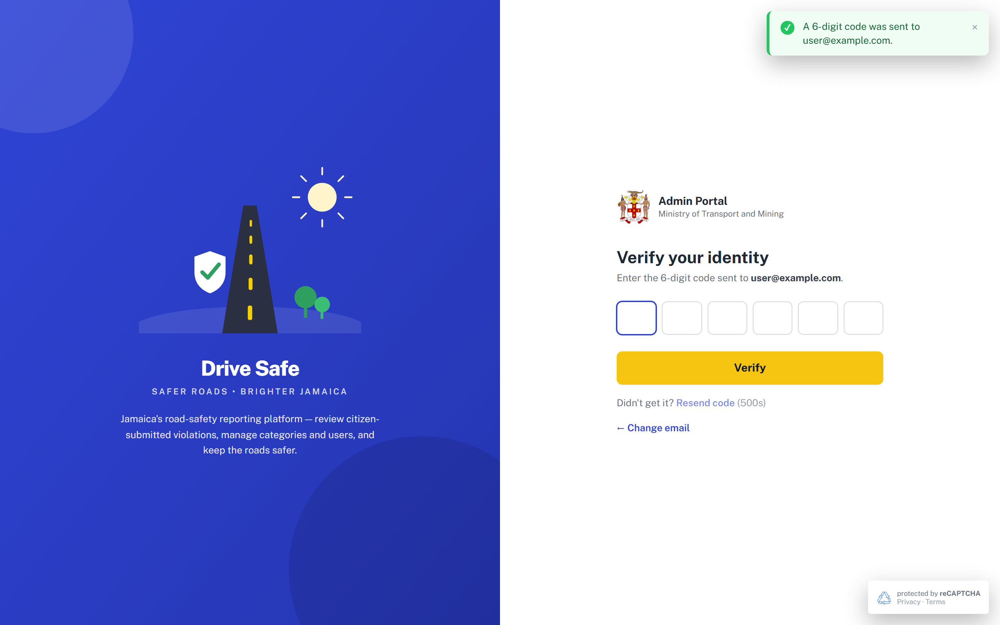
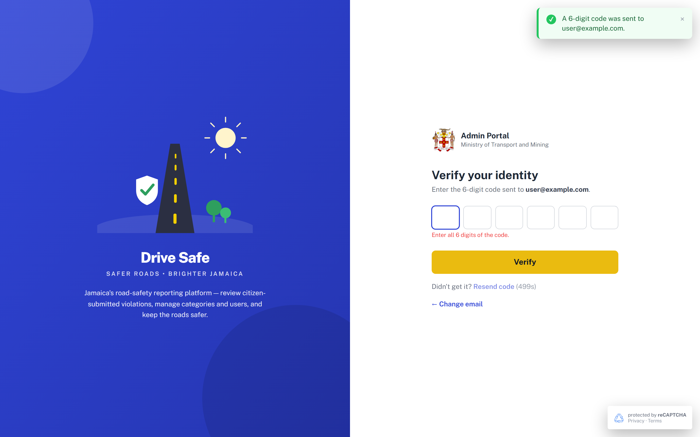
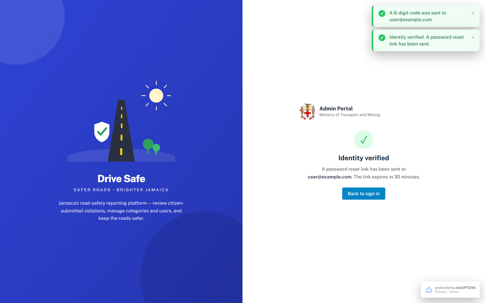
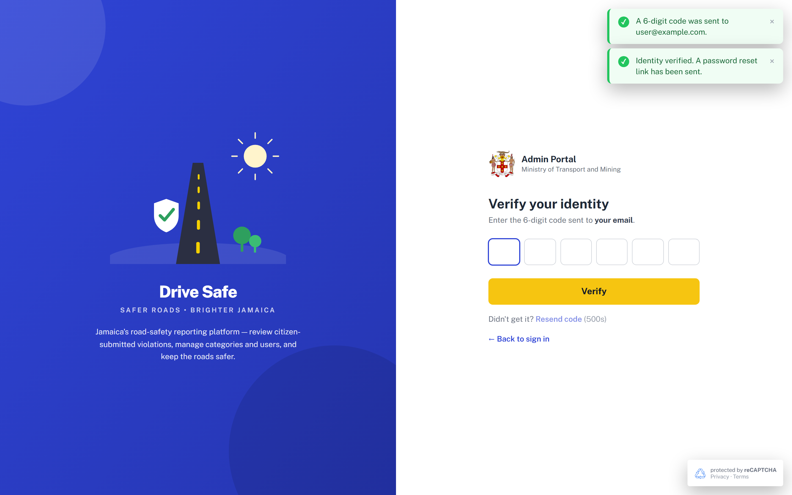

# SCR-02 · OTP verification

## Purpose
Second step of two flows. In **login mode** a correct 6-digit code completes sign-in and lands on the Dashboard. In **reset mode** (reached from Forgot password) a correct code shows "Identity verified" and states that a reset link has been sent. One screen, two behaviours, chosen by a module variable `otpMode`.

## Entry and exit
**Reached from:** SCR-00 **LOGIN** (login mode); SCR-01 **Send code** (reset mode).

**Leaves to:** SCR-05 Dashboard via **Verify** in login mode; SCR-00 via **← Back to sign in** (login mode), **Back to sign in** button on the done state (reset mode); SCR-01 via **← Change email** (reset mode).

## States
### Reset mode, awaiting code

### Error: fewer than 6 digits

### Reset mode, verified (done)

### Login mode, awaiting code

| State | When | What the user sees |
|---|---|---|
| Awaiting code (reset) | Arrived from SCR-01 | Echo = the email typed; back link "← Change email"; Resend disabled with "(500s)" countdown |
| Awaiting code (login) | Arrived from SCR-00 | Echo = typed Username, or "your email" if blank; back link "← Back to sign in" |
| Error | Verify with <6 digits | "Enter all 6 digits of the code." (role=alert), focus to box 1 |
| Done (reset only) | Valid 6 digits | Form hidden; "Identity verified" panel; toast "Identity verified. A password reset link has been sent." |
| Signed in (login only) | Valid 6 digits | Immediately the Dashboard with toast "Signed in successfully." |
| Wrong code | Code incorrect | **Undefined**: any 6 digits are accepted, OQ-A-12 |
| Expired code | Code too old | **Undefined**, OQ-A-13 |
| Resend available | Timer reaches 0 | "Resend code" enabled, countdown text empty |

The capture screenshots show stale toasts from earlier steps stacked top right (the capture ran several steps in one session); each toast lives 3.5 s in the live prototype.

## Layout
| # | Region | Content |
|---|---|---|
| 1 | Brand panel / form header | As SCR-00 |
| 2 | Heading | "Verify your identity"; "Enter the 6-digit code sent to **<address>**." |
| 3 | Code group | Six single-digit boxes (`role=group`, "One-time passcode, 6 digits") |
| 4 | Error line | Under the boxes |
| 5 | CTA | Verify |
| 6 | Resend row | "Didn't get it? Resend code (Ns)" |
| 7 | Back link | "← Change email" or "← Back to sign in" |
| 8 | Done panel | tick, "Identity verified", message, Back to sign in |

## Elements
| Element | Type | Behaviour | Requirement |
|---|---|---|---|
| Address echo `#otp-echo` | Bold text | Shows the stored address | none |
| Countdown `#otp-timer` | Text | "(500s)" counts down 1 per second; empty at 0. 500 s (8 min 20 s) looks like a typo for 30 or 60, OQ-A-14 | none |
| Toast "A 6-digit code was sent to X." | Success toast | Raised on arrival from SCR-01 only; not raised on arrival from LOGIN | none |
| Toast "A new code has been sent." | Success toast | After Resend | none |
| Done panel text | Text | Says "link expires in 30 minutes"; unrelated to the code lifetime | none |

## Actions
| Control | Type | What happens | Goes to | Who may | Disabled when |
|---|---|---|---|---|---|
| Digit boxes 1-6 (`aria-label` Digit 1..6) | Numeric inputs, maxlength 1 | Non-digits removed on input; a digit auto-advances to the next box; Backspace on an empty box and ArrowLeft move back; ArrowRight moves forward; paste fills all boxes from the first 6 digits found | — | anyone | — |
| Verify | Primary button | Joins the boxes. If not exactly 6 digits: shows error, focuses box 1. Else calls reCAPTCHA stub (`verify_otp`), stops the timer, then: login mode shows the Dashboard and a toast; reset mode shows the done panel | SCR-05 (login) / done state (reset) | anyone | never |
| Resend code | Text button | Calls reCAPTCHA stub (`resend_otp`), restarts the 500 s countdown, disables itself again, toast "A new code has been sent." Boxes are not cleared | — | anyone | during the countdown |
| ← Change email (reset) | Text button (`data-go="forgot"`) | Returns to the email form (field emptied) | SCR-01 | anyone | never |
| ← Back to sign in (login) | Text button (`data-go="login"`) | Returns to login. The timer keeps running in the background until the next reset | SCR-00 | anyone | never |
| Back to sign in (done panel) | Button | Returns to login | SCR-00 | anyone | never |

**Wired to nothing:** none (verified in source). The back link's label and destination are rewritten at run time from the mode.

## Validation
| Field | Rule | Source | When | Message |
|---|---|---|---|---|
| Code (6 boxes) | Exactly 6 characters, each 0-9 (min 6, max 6) | declared (regex `^[0-9]{6}$`, `maxlength=1`, `inputmode=numeric`) | on Verify | "Enter all 6 digits of the code." |
| Each box | One digit, non-digits removed on input | declared | on input | silent |
| Code correctness | Must equal the issued code | **PROPOSED, server-side** (prototype accepts any 6 digits) | on Verify | "That code is incorrect." |
| Code lifetime | Valid for a limited time, e.g. 10 minutes | **PROPOSED**, OQ-A-13 | on Verify | "That code has expired. Request a new one." |
| Attempts | Maximum 5 wrong entries per code | **PROPOSED**, OQ-A-03 | on Verify | "Too many attempts. Request a new code." |
| Resend interval | Minimum wait before resend: 500 s as built (min 500, max 500, fixed) | declared in source (odd value, OQ-A-14) | — | countdown text |

**Cross-field:** none (the six boxes form one value).

**Server-side only:** code match, expiry, attempt count, resend rate, reset-link generation (30 minute expiry as stated on the done panel).

**Unruled and undecided**

| Field | What is missing | Open question |
|---|---|---|
| Code lifetime vs resend interval vs reset-link lifetime | Three different timers (code ?, resend 500 s, link 30 min) | OQ-A-14 |

## Screen communication
| Direction | With | What passes | Contract |
|---|---|---|---|
| Receives | SCR-00 | `otpMode=login`, Username as address | — |
| Receives | SCR-01 | `otpMode=reset`, email as address | — |
| Sends | SCR-05 Dashboard | A signed-in session (prototype: only the screen switch; there is no session object) | Owner: authentication service |
| Sends | SCR-00 | Back navigation | — |
| Sends (production) | Password reset link | Email containing a link valid 30 minutes | Landing page for the link is **not in the prototype**, OQ-A-15 |

The mode flag `otpMode` is set at both entry points (SCR-00 LOGIN sets login, SCR-01 Send code sets reset) and read by SCR-02. Production must carry the mode in the server-issued challenge, not in a client variable.

## Acceptance criteria
**ST-SCR-02-01 — Login mode completes sign-in**
- Given I pressed LOGIN on SCR-00 and I am on OTP
- When I type 123456 and press Verify
- Then the Dashboard shows and a toast reads "Signed in successfully."

**ST-SCR-02-02 — Incomplete code**
- Given the boxes are empty
- When I press Verify
- Then "Enter all 6 digits of the code." shows and focus is in box 1

**ST-SCR-02-03 — Reset mode done state**
- Given I came from Forgot password with user@example.com
- When I enter 6 digits and press Verify
- Then "Identity verified" shows with "A password reset link has been sent to user@example.com. The link expires in 30 minutes."

**ST-SCR-02-04 — Paste fills the boxes**
- Given the boxes are empty
- When I paste "123 456"
- Then the boxes read 1,2,3,4,5,6 and focus is on box 6

**ST-SCR-02-05 — Resend lock**
- Given the screen just appeared
- Then Resend code is disabled and the label reads "(500s)"
- And pressing nothing for 500 s enables it

**ST-SCR-02-06 — Back link depends on mode**
- Given I arrived in reset mode
- Then the back link reads "← Change email" and leads to SCR-01
- And in login mode it reads "← Back to sign in" and leads to SCR-00

## Data
- **Reads:** pending address (variable), OTP mode (variable).
- **Writes:** none in prototype. Production: OTP verification, session creation (login), reset token issuance (reset).
- **Services required:** OTP validation, session/token service, email delivery, reCAPTCHA v3.

## Accessibility and keyboard
- Box group `role=group` with label; each box `aria-label` "Digit n"; first box has `autocomplete=one-time-code`.
- Error line `role=alert`. Toasts announced via polite live region.
- Focus goes to box 1 on arrival (40 ms delay).
- Arrow keys and Backspace move between boxes; no Enter-to-verify (OQ-A-08).

## Open questions
| ID | Question | Affects | Why it matters |
|---|---|---|---|
| OQ-A-12 | What happens on a wrong code? Prototype accepts any 6 digits | Verify | Core security behaviour is absent |
| OQ-A-13 | Code lifetime, expiry message, attempt limit | Verify | Not specified |
| OQ-A-14 | Is the 500 s resend countdown intended? Code lifetime vs 30 min link lifetime | Resend, done panel | One of these is probably a typo |
| OQ-A-15 | Where does the reset link land, and what does the set-new-password page look like? The password policy (12-128 chars, upper, lower, digit, symbol) exists on the Profile screen only | Reset flow | A whole screen is missing from the prototype |
| OQ-A-16 | Should login send the code to the account's registered email rather than echo the typed Username? | Login mode | Echo shows whatever was typed (or "your email") |
| OQ-A-17 | Toast "A 6-digit code was sent" shows only for reset, not login | Login mode | Inconsistent feedback |
