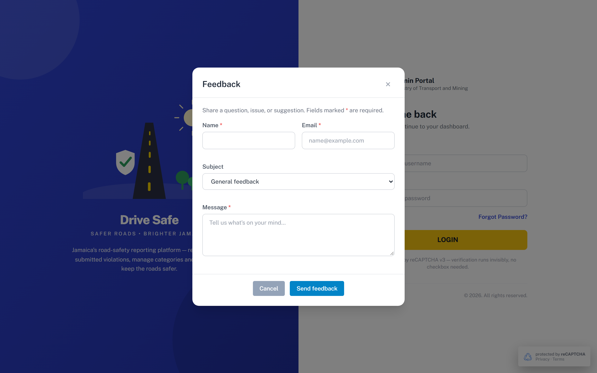

# SCR-03 · Feedback modal

## Purpose
Lets someone who cannot or will not sign in send a question, issue or suggestion. Reachable only from the Login screen footer. It has two internal states, form and sent. Derived: the README does not mention it.

## Entry and exit
**Reached from:** SCR-00 **Feedback** link.

**Leaves to:** back to SCR-00 (modal closes) via **×**, **Cancel**, Escape, or a mouse-down on the dark backdrop. There is no Close button in the sent state, so the user must use ×, Escape or the backdrop.

## States
### Form

The validation-error and sent states were not photographed by the capture, so they are described from source only (OQ-A-18).

| State | When | What the user sees |
|---|---|---|
| Form | Each time it opens (Name, Email and Message cleared, errors cleared; **Subject is not reset**: it keeps the last choice, see defect OQ-A-28) | Title "Feedback", intro "Share a question, issue, or suggestion. Fields marked * are required." |
| Validation error | Send feedback with a rule failing | Red message under each failing field, red outline, focus to the first failing field; modal stays |
| Sent | All rules pass | Form and footer hidden; green tick, "Thanks for your feedback!", "We've received your message and will get back to you if a reply is needed."; toast "Feedback sent. Thank you!" |
| Loading / failure | Send in flight or failing | **Undefined, OQ-A-02** |

Nothing is stored: the prototype does not add the message to the Contact Us list (which has its own data).

## Layout
| # | Region | Content |
|---|---|---|
| 1 | Head | "Feedback" and × (`aria-label="Close dialog"`) |
| 2 | Intro | One sentence plus required-star legend |
| 3 | Row | Name \*, Email \* (two columns on sm and up) |
| 4 | Subject | Select, full width |
| 5 | Message \* | Textarea, 4 rows |
| 6 | Footer | Cancel (grey), Send feedback (blue) |

## Elements
| Element | Type | Behaviour | Requirement |
|---|---|---|---|
| Error lines `#err-fb-*` | Inline | One per required field | none |
| Sent panel | Status block (`role=status`) | Replaces the form | none |
| Toast | Success | "Feedback sent. Thank you!" 3.5 s | none |

## Actions
| Control | Type | What happens | Goes to | Who may | Disabled when |
|---|---|---|---|---|---|
| × | Icon button, "Close dialog" | Hides the modal and discards typed text; focus returns to the Feedback link | SCR-00 | anyone (pre-login) | never |
| Name | Text input | Free text | — | anyone (pre-login) | — |
| Email | Email input | Placeholder name@example.com | — | anyone (pre-login) | — |
| Subject | Select | Choose one of 4 subjects | — | anyone (pre-login) | — |
| Message | Textarea | Free text, 1000 max | — | anyone (pre-login) | — |
| Cancel | Button (grey) | Hides the modal, discards input | SCR-00 | anyone (pre-login) | never |
| Send feedback | Primary button | Validates; on success hides form and footer, shows the sent panel and a toast. Nothing is transmitted or saved | sent state | anyone (pre-login) | never (validates on press; unlike Save buttons elsewhere it is not disabled while empty) |
| Escape key | Keyboard | Closes any open modal | SCR-00 | anyone (pre-login) | — |
| Backdrop | Mouse-down on dark area | Closes the modal, input discarded, no confirmation | SCR-00 | anyone (pre-login) | — |

**Wired to nothing:** none (verified in source).

## Validation
| Field | Rule | Source | When | Message |
|---|---|---|---|---|
| Name | Required, trimmed | declared (`data-req`) | blur, submit | "Name is required." |
| Name | Length 2-100 characters, any letters including accents and apostrophes | **PROPOSED** (no maxlength declared) | blur, submit | "Name must be 2 to 100 characters." |
| Email | Required | declared | blur, submit | "Email is required." |
| Email | Shape `^\S+@\S+\.\S+$` | declared (type=email + regex) | blur, submit | "Please enter a valid email address." |
| Email | Length 5-254 | **PROPOSED** | blur, submit | "Please enter a valid email address." |
| Subject | One of: General feedback, Report a problem, Feature request, Account / login issue; default General feedback | declared (select) | — | — |
| Message | Required, trimmed | declared | blur, submit | "Message is required." |
| Message | Max 1000 characters | declared (`maxlength=1000`) | on input (browser stops typing) | silent |
| Message | Minimum 10 characters | **PROPOSED** (avoid one-letter messages) | blur, submit | "Message must be at least 10 characters." |
| All text | `<` `>` stripped as typed | declared (global filter) | input | silent |

**Cross-field:** none.

**Server-side only:** spam/abuse throttling for an unauthenticated form, reCAPTCHA (prototype has none on this form), OQ-A-19.

**Unruled and undecided**

| Field | What is missing | Open question |
|---|---|---|
| Subject | Where each subject is routed | OQ-A-20 |

## Screen communication
| Direction | With | What passes | Contract |
|---|---|---|---|
| Receives | SCR-00 | Open request | — |
| Sends (production) | Contact Us list (Manage Contact Us, [SCR-13](../04-contact/SCR-13-contact-us.md)) | Name, Email, Message, created-at, probably Subject | The Contact Us list has no Subject column; OQ-A-20 |
| Shares | Contact entity | Same fields (name, email, message) as ContactMessage in data.js | Owner: SCR-13 |

If the Contact Us record gains a Subject column this modal's field set changes.

## Acceptance criteria
**ST-SCR-03-01 — Opens clean**
- Given I typed in a previous session of this modal and closed it
- When I press Feedback on the login page
- Then Name, Email and Message are empty
- And Subject still shows the option I last chose (as built; the code `openFeedback()` looks for an element id `feedback-subject` that does not exist, the select is `fb-subject`; the intended behaviour, reset to "General feedback", is OQ-A-28)

**ST-SCR-03-02 — Required fields**
- Given the form is empty
- When I press Send feedback
- Then "Name is required.", "Email is required." and "Message is required." show and focus is in Name

**ST-SCR-03-03 — Bad email**
- Given Email holds "abc"
- When I leave the field
- Then "Please enter a valid email address." shows

**ST-SCR-03-04 — Successful send**
- Given all three required fields are valid
- When I press Send feedback
- Then "Thanks for your feedback!" shows and the form and footer buttons are gone
- And a toast reads "Feedback sent. Thank you!"

**ST-SCR-03-05 — Escape discards**
- Given I typed a message
- When I press Escape
- Then the modal closes and the login page shows; reopening shows an empty form

**ST-SCR-03-06 — Message cap**
- Given I paste 1200 characters into Message
- Then only the first 1000 remain

## Data
- **Reads:** none.
- **Writes:** none in prototype. Production: a feedback/contact record.
- **Services required:** persistence, notification to staff, spam protection.

## Accessibility and keyboard
- `role=dialog`, `aria-modal=true`, labelled by the title. First focusable control (the × button) receives focus 30 ms after opening; there is no real focus trap (Tab can leave the dialog); on close focus returns to the previously focused element (not on Escape or backdrop dismissal, which skip the restore), OQ-A-21.
- Errors: `aria-invalid`, `aria-describedby`, not live regions. Sent panel is `role=status`.
- Escape closes.

## Open questions
| ID | Question | Affects | Why it matters |
|---|---|---|---|
| OQ-A-18 | Capture the error and sent states of this modal; none was photographed | SCR-03 | Described from source only |
| OQ-A-19 | Abuse protection for an anonymous form | Send | Spam into staff inbox |
| OQ-A-20 | Where does feedback go, and is Subject stored? Contact Us list has no Subject | Data model | Decides whether Feedback and Contact are one entity |
| OQ-A-21 | Builder requirement for every modal: trap Tab inside the dialog; on any dismissal (Close, ×, Cancel, Escape, backdrop, Save) return focus to the control that opened it, or its replacement if that control was re-rendered or hidden. As built: Escape and backdrop never restore; SCR-04 Cancel loses focus (the recorded element is the hidden Logout item); SCR-05/07 Save review loses focus (the table is rebuilt before the modal closes, so the recorded button is detached); the same loss occurs on Save of an Edit dialog on SCR-10, SCR-11, SCR-13, SCR-20 and SCR-21 (the row is rebuilt first; measured on SCR-10: focus lands on body), whereas Add-Save returns to the static Add button | all modals | Keyboard and screen-reader users lose their place |
| OQ-A-28 | **Defect:** Subject is not reset on reopen because `openFeedback()` tests `#feedback-subject` but the select is `#fb-subject`. Builder should reset Subject to "General feedback" each time | Subject | The previous visitor's choice leaks into the next form |
| OQ-A-22 | Is feedback only for pre-login users, or also inside the shell? Prototype has no entry inside | SCR-03 | Scope |
