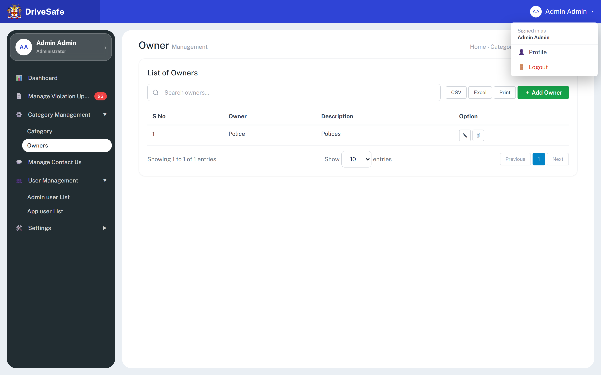
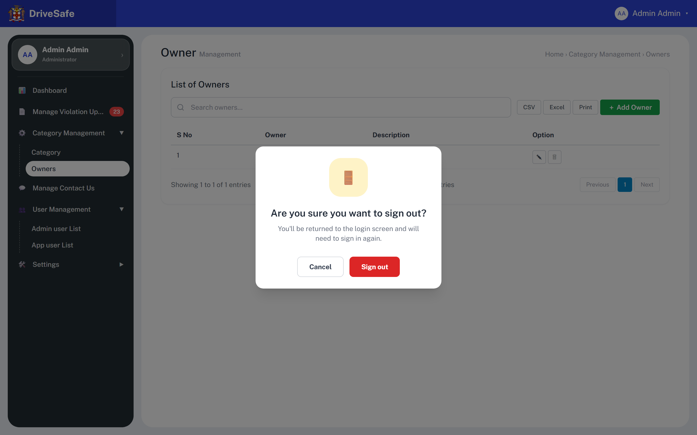
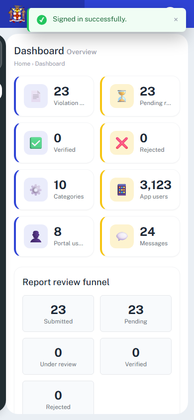
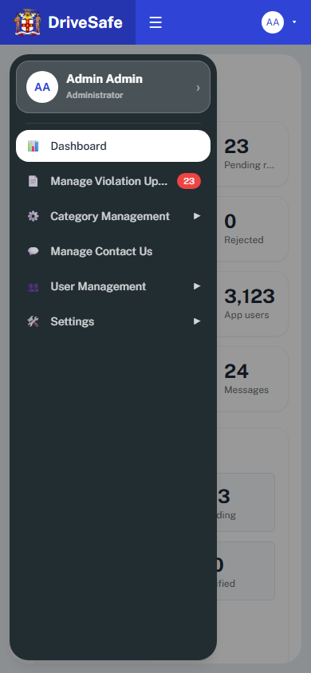

# SCR-04 · Account menu and logout confirmation

## Purpose
The header account dropdown is the only route to the Profile screen from the header and the only route to sign out. It is part of the application shell and appears on every screen after login; it is specified once here and referenced by the others. Logout is guarded by a confirmation dialog.

## Entry and exit
**Reached from:** any shell screen (SCR-05, SCR-06, and all other post-login screens), header button "AA Admin Admin ▾".

**Leaves to:** Profile ([SCR-22](../05-users/SCR-22-profile-change-password.md)) via **Profile**; SCR-04 logout dialog via **Logout**; SCR-00 via **Sign out**.

## States
### Menu open

### Logout confirmation

| State | When | What the user sees |
|---|---|---|
| Menu closed | Default | Header shows avatar "AA", name "Admin Admin" (name hidden below 640px), caret ▾ |
| Menu open | Press the header button | 208 px card: "Signed in as Admin Admin", Profile, Logout (red) |
| Confirm | Press Logout | Menu closes; modal over dimmed page |
| Signed out | Press Sign out | SCR-00; shell hidden |

The captures were taken over the Owners screen; the menu and dialog are identical on every shell screen. User name "Admin Admin" and role "Administrator" are hard-coded; the profile card in the sidebar and the header both read them (OQ-A-23).

## Layout
| # | Region | Content |
|---|---|---|
| 1 | Header trigger | Round "AA" initials, "Admin Admin", ▾ |
| 2 | Menu | "Signed in as" caption + name; Profile (person icon); Logout (door icon, red) |
| 3 | Dialog | Door icon in amber square, heading, body, Cancel, Sign out |

## Elements
| Element | Type | Behaviour | Requirement |
|---|---|---|---|
| Signed-in caption | Text | "Signed in as Admin Admin" hard-coded | none |
| Dialog heading | Text | "Are you sure you want to sign out?" | none |
| Dialog body | Text | "You'll be returned to the login screen and will need to sign in again." | none |
| Sidebar profile card (shell, related) | Button `title="Open my profile"` | Same effect as the menu's Profile: goes to SCR-22 Profile; shows "Admin Admin" and "Administrator" | none |

## Actions
| Control | Type | What happens | Goes to | Who may | Disabled when |
|---|---|---|---|---|---|
| AA Admin Admin ▾ (`aria-haspopup`, `aria-expanded`) | Header button | Toggles the dropdown; `aria-expanded` flips | menu | any signed-in user (prototype enforces nothing; Administrator-only is PROPOSED, OQ-A-27) | never |
| Profile | Menu item | Closes the menu, shows the Profile screen and resets its password form | SCR-22 Profile | any signed-in user (prototype enforces nothing; Administrator-only is PROPOSED, OQ-A-27) | never |
| Logout | Menu item (red) | Closes the menu and shows the confirmation dialog; nothing ends yet | dialog | any signed-in user (prototype enforces nothing; Administrator-only is PROPOSED, OQ-A-27) | never |
| Cancel | Dialog button | Hides the dialog and stays signed in. Focus is **lost**: the dialog recorded the (now hidden) Logout menu item as the element to refocus, see OQ-A-21 | previous screen | any signed-in user (prototype enforces nothing; Administrator-only is PROPOSED, OQ-A-27) | never |
| Sign out | Dialog button (red, destructive) | Switches to the login screen and hides the shell. In the prototype nothing else happens: no session is cleared, typed login fields keep their text, SCR-02 state is unchanged | SCR-00 | any signed-in user (prototype enforces nothing; Administrator-only is PROPOSED, OQ-A-27) | never |
| Click outside / Escape | Dismissal of the menu | Closes the menu only | — | — | — |
| Escape / backdrop mouse-down (dialog) | Dismissal | Closes the dialog without signing out | — | — | — |

**Wired to nothing:** none (verified in source). The capture's `wiring=none` flags do not apply: delegated listeners and `data-action` attributes carry these.

Confirmation is proportionate: sign-out loses only the session, and unsaved edits in a modal are already discarded by `go()`. However note that signing out from a screen with unsaved page edits (e.g. Profile change-password form) discards them silently, OQ-A-24.

## Validation
The screen has no inputs. Nothing to validate; stated explicitly so the section is not mistaken for an omission.

| Field | Rule | Source | When | Message |
|---|---|---|---|---|
| (none) | No input fields on the menu or dialog | n/a | n/a | n/a |
| Session (not a field) | Idle timeout of 30 minutes ends the session and returns to SCR-00 | **PROPOSED**, OQ-A-25 | on inactivity | "Your session has expired. Please sign in again." |

**Cross-field:** none. **Server-side only:** session invalidation and token revocation on Sign out (production). **Unruled and undecided:** idle timeout (OQ-A-25).

## Shell navigation

The sidebar and header are shared by every post-login screen and are specified here once. Behaviour below was measured on the running prototype with Playwright.

**Sidebar items, in order:** profile card (Admin Admin, Administrator; goes to SCR-22); Dashboard (SCR-05); Manage Violation Uploads (SCR-06) with a red **Pending badge**; **Category Management** group (Category SCR-10, Owners SCR-11); Manage Contact Us (SCR-13); **User Management** group (Admin user List SCR-20, App user List SCR-21); **Settings** group (Config SCR-12).

- **Groups:** all three start collapsed. A group header (`aria-expanded`, `aria-controls`, caret rotating ▶ to ▼) toggles its sub-list; opening one does not close the others, and a group stays open when another screen is chosen. Arriving at a child screen (SCR-10, 11, 12, 20, 21) auto-expands its group.
- **Pending badge:** shows the Pending count (23), hidden at 0; same number as the SCR-05 Pending tile.
- **Active item:** the current screen's item gets the white pill and `aria-current="page"`; exactly one sidebar item carries it. The Profile screen has no sidebar item, so none is active there.
- **Below 1024 px:** the sidebar is an off-canvas drawer, hidden by default. The header **☰** button (`aria-label` "Open navigation menu", `aria-expanded`) slides it in over a dimmed backdrop; focus stays on ☰ (not moved into the drawer). The drawer closes on a backdrop click, on Escape, or on any navigation click. Escape closes layers in this order: open modal, then the account menu, then the drawer (confirmed with the menu and drawer both open: the first Escape closes the menu only). From 1024 px up the sidebar is permanent and ☰ is hidden. The header account name is hidden below 640 px, leaving only the "AA" initials.

*These two 390 px images are supplementary: taken by the analyst with Playwright, not part of the original capture manifest, and show the Dashboard behind the drawer.*

## Screen communication
| Direction | With | What passes | Contract |
|---|---|---|---|
| Sends | SCR-00 | Return to login | Production: server session ended first |
| Sends | SCR-22 Profile | Navigation | — |
| Receives | Every shell screen | Header and menu are shared chrome | Owner: this story |
| Shares | Sidebar profile card | Same name and role strings | Both must come from the session user, OQ-A-23 |

Change to the signed-in user name or role affects the header, the menu caption and the sidebar card.

## Acceptance criteria
**ST-SCR-04-01 — Menu contents**
- Given I am signed in
- When I press the header button "Admin Admin"
- Then a menu shows "Signed in as Admin Admin", Profile and Logout

**ST-SCR-04-02 — Outside click closes**
- Given the menu is open
- When I click elsewhere on the page
- Then the menu closes

**ST-SCR-04-03 — Logout asks first**
- Given the menu is open
- When I press Logout
- Then the dialog "Are you sure you want to sign out?" shows and the menu is closed
- And I am still signed in

**ST-SCR-04-04 — Cancel**
- Given the dialog shows
- When I press Cancel
- Then it closes and the page I was on is unchanged

**ST-SCR-04-05 — Sign out**
- Given the dialog shows
- When I press Sign out
- Then the Welcome back login screen shows and the sidebar and header are hidden

**ST-SCR-04-06 — Escape**
- Given the dialog shows
- When I press Escape
- Then the dialog closes and I stay signed in

## Data
- **Reads:** signed-in user name and role (hard-coded in the prototype).
- **Writes:** none in prototype. Production: end session, audit entry.
- **Services required:** session service.

## Accessibility and keyboard
- Menu has `role=menu`, items `role=menuitem`; trigger has `aria-expanded` and `aria-controls`. Arrow-key navigation inside the menu is not implemented.
- Escape closes the dialog first, then the menu, then the mobile sidebar.
- Dialog `role=dialog`, `aria-modal`, labelled by its heading; first button (Cancel) takes focus on open; no true focus trap. On Cancel the focus is lost (see Actions); builders must return focus to the header account button, OQ-A-21.

## Open questions
| ID | Question | Affects | Why it matters |
|---|---|---|---|
| OQ-A-23 | Signed-in name and role are hard-coded "Admin Admin"/"Administrator"; source of truth? Also every review is stamped "Admin Admin" | header, sidebar, SCR-07 | Audit trail would attribute every action to one person |
| OQ-A-24 | Warn before sign-out when a form has unsaved input? | Sign out | Silent loss |
| OQ-A-25 | Idle timeout and session lifetime? | Whole portal | None in prototype |
| OQ-A-26 | Should Sign out clear login fields and pending OTP data? | SCR-00 | Residual data on shared computer |
| OQ-A-27 | Role differences: README names Administrator and Violation manager (data.js) but the shell shows the same menu and nav for both | Shell | Permissions undefined (the prototype has no role gating) |
