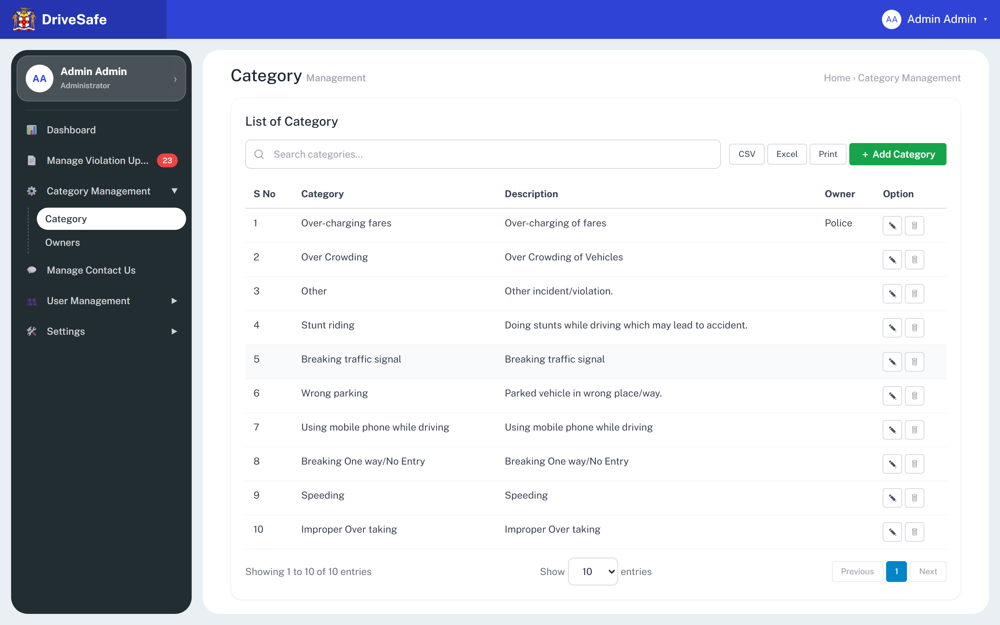
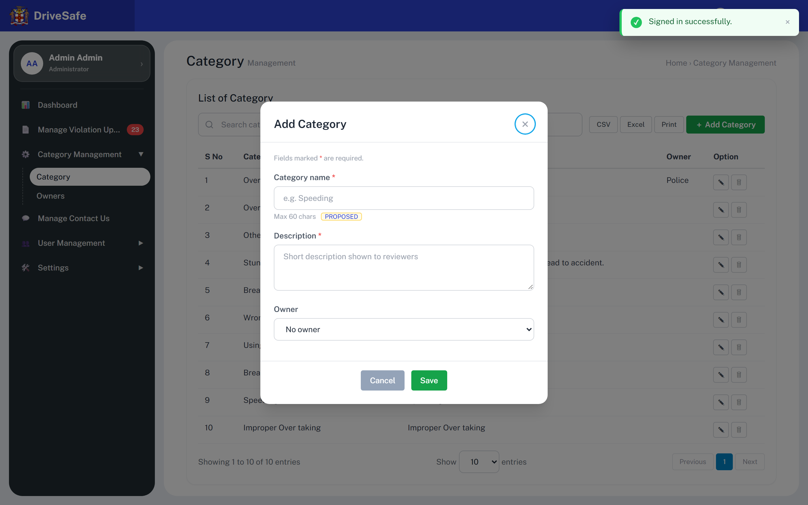
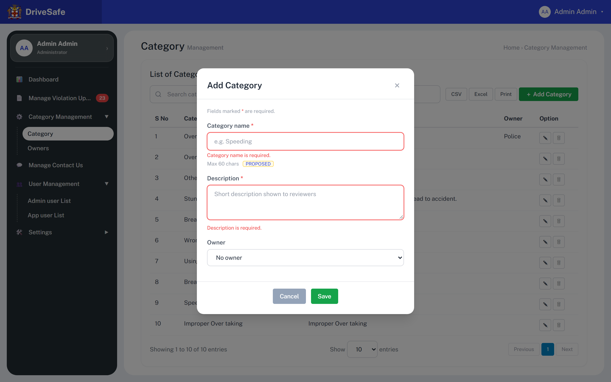
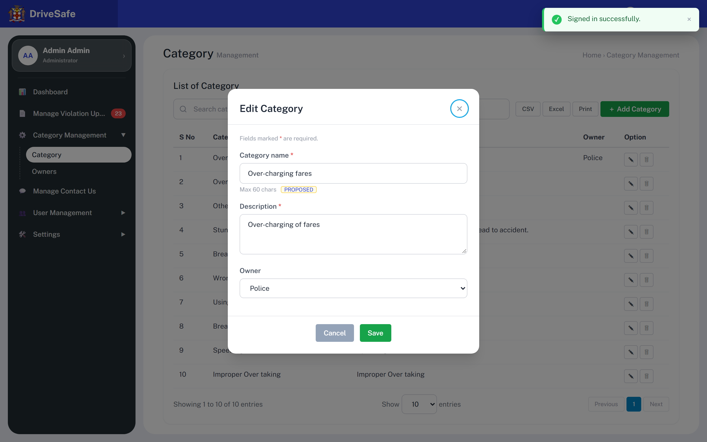

# SCR-10 · Category management

## Purpose

Maintains the list of violation categories a citizen can pick when reporting, and optionally assigns each category to an Owner (an enforcement agency, see SCR-11). An administrator opens it to add, rename, re-own or remove a category. The same list feeds the Category column and the derived Owner column of the violations list.

## Entry and exit

**Reached from:** sidebar group **Category Management** (expands) then link **Category** (`data-go="category"`). Expanding is automatic when this screen is shown. Also reached from SCR-05 Dashboard, tile **⚙️ 10 Categories** (`data-go="category"`).

**Leaves to:** sidebar links Dashboard, Manage Violation Uploads, Owners (SCR-11), Manage Contact Us (SCR-13), User Management group, Settings > Config (SCR-12). The breadcrumb "Home › Category Management" is plain text, not a link (see Elements). Add/Edit open modal `cat-modal`; Delete uses the browser's native `confirm()`.

## States

### Populated

### Add Category modal (empty)

The green "Signed in successfully." toast top right is residue of the capture run (the login toast was still visible); it is not part of this modal.

### Add Category modal, submitted empty (invalid)

### Edit Category modal

### Delete confirmation

No screenshot exists: the prototype uses the browser's native `window.confirm()`, which the capture cannot photograph. Text: `Delete category "<name>"?` with the browser's OK / Cancel. Raised as OQ-10-05 (native dialog is not a designed component).

| State | When | What the user sees |
|---|---|---|
| Populated | `CATEGORIES` has rows | Table of 10 seeded rows, info line `Showing 1 to N of N entries` |
| Empty | Every category deleted | **Undefined — OQ-10-02.** The code renders an empty tbody and "Showing 1 to 0 of 0 entries"; no empty-state message |
| Loading | — | None; data is in-memory. Raised in OQ-10-02 |
| Error | — | None; no failure path exists in the prototype |
| Permission denied | — | None; **Undefined — OQ-10-03** |
| Search no match | Search text matches no row | All rows hidden (CSS class), table header stays, info line unchanged (not recounted) |
| Narrow viewport | content area narrower than the table's 40 rem min width | Not captured as a picture (capture is 1440x900 only). Measured with Playwright: the table scrolls horizontally inside `.table-wrap` at viewport widths up to about 728 px (at 390 px: 640 px of table in a 300 px wrapper) and again from 1024 to about 1052 px, where the permanent sidebar narrows the content area; it fits at 768 px and from about 1053 px up (1280: fits). The sidebar is an off-canvas drawer below 1024 px |

## State axes

One axis only: the modal mode, Add (title "Add Category", empty fields, Owner "No owner") versus Edit (title "Edit Category", fields filled from the row, Owner preselected). Both shown above.

## Layout

| # | Region | Content |
|---|---|---|
| 1 | Page head | H1 "Category" with grey suffix "Management"; breadcrumb text "Home › Category Management" |
| 2 | Card heading | H2 "List of Category" |
| 3 | Toolbar | Search box (placeholder "Search categories…") · buttons CSV, Excel, Print · green "＋ Add Category" |
| 4 | Table | columns S No · Category · Description · Owner · Option |
| 5 | Footer | "Showing 1 to 10 of 10 entries" · "Show [10] entries" select · pager Previous / 1 / Next |

## Elements

| Element | Type | Behaviour | Requirement |
|---|---|---|---|
| S No | Table column | Row position, 1-based (`index + 1`). It is **not** an identifier: delete a row and the numbers below it shift | none (README) |
| Category | Column | Category name text | none |
| Description | Column | Description text, not truncated | none |
| Owner | Column | Owner name, or blank when the category has none (row 1 shows Police, rows 2-10 are blank) | none |
| Info line | Text | `Showing 1 to N of N entries`, recomputed after every add or delete, where N is the total row count. It is not recomputed by the search box | none |
| Breadcrumb | Text | Plain text, not clickable | none |
| Row order | Behaviour | Insertion order. A new category is appended at the bottom. No sorting, no column-header sort | none |

## Actions

| Control | Type | What happens | Goes to | Who may | Disabled when |
|---|---|---|---|---|---|
| Search categories… | Search input (`data-filter="cat-body"`) | On every keystroke (and on the native clear ✕) hides every row whose combined cell text does not contain the text, case-insensitive substring. Matches across all columns including Owner. Does not touch data | — | any signed-in user (prototype enforces nothing; Administrator-only is PROPOSED, OQ-10-03) | — |
| CSV | Button | **Wired to nothing** (no handler, no `data-action`) | — | — | — |
| Excel | Button | **Wired to nothing** | — | — | — |
| Print | Button | **Wired to nothing** | — | — | — |
| ＋ Add Category | Button (primary, green) | Resets the form, refreshes the Owner options from the current owners list, sets title "Add Category", opens modal; focus lands on the first focusable element (the × close button) | modal `cat-modal` (add) | any signed-in user (prototype enforces nothing; Administrator-only is PROPOSED, OQ-10-03) | — |
| ✎ Edit {name} (row; aria-label "Edit {name}") | Icon button | Opens `cat-modal` titled "Edit Category" filled with that row's name, description and owner. If the row's owner has since been deleted in SCR-11, the Owner select (options: only "No owner") shows **empty with no option selected** (`selectedIndex` -1, value ""); pressing Save then writes owner "" and so **silently blanks the category's owner** (OQ-11-06) | modal `cat-modal` (edit) | any signed-in user (prototype enforces nothing; Administrator-only is PROPOSED, OQ-10-03) | — |
| 🗑 Delete {name} (row; aria-label "Delete {name}") | Icon button | Asks `Delete category "{name}"?` via `confirm()`. OK removes the category from the list permanently (no undo, no toast), re-renders this table and the violations list; Cancel does nothing. Violations already filed under that category keep the old category name text, and their Owner column becomes "-" | native confirm | any signed-in user (prototype enforces nothing; Administrator-only is PROPOSED, OQ-10-03) | — |
| Show [10/25/50] entries | Select | Options 10, 25, 50. **Wired to nothing**: changing it changes no rows (all rows always render) | — | — | — |
| Previous / 1 / Next | Pager buttons | **Wired to nothing.** Previous and Next are `disabled`; 1 is the current page. Only one page exists | — | — | Previous/Next always disabled |
| Cat modal: × (aria-label "Close dialog") | Icon button | Closes modal, discards entries, returns focus to the control that opened it | SCR-10 | any signed-in user (prototype enforces nothing; Administrator-only is PROPOSED, OQ-10-03) | — |
| Cat modal: Cancel | Button (grey) | Same as ×: closes, discards | SCR-10 | any signed-in user (prototype enforces nothing; Administrator-only is PROPOSED, OQ-10-03) | — |
| Cat modal: Save | Button (green) | Runs validation of every field. If any fails: shows the messages, focuses the first bad field, modal stays. If valid: trims name and description, Add appends `{name, description, owner}` to the list, Edit overwrites that row; re-renders this table AND the violations list (owner column derives from category); closes the modal; success toast `Category "{name}" added successfully.` or `Category "{name}" updated successfully.` (auto-dismiss after 3.5 s, also read by the polite live region) | SCR-10 | any signed-in user (prototype enforces nothing; Administrator-only is PROPOSED, OQ-10-03) | **Never disabled.** Save is always enabled; validity is checked on click (unlike Add User and App User modals, whose Save is disabled until valid) |
| Esc key / click on dark backdrop | Keyboard / pointer | Closes the open modal, discarding entries | SCR-10 | — | — |

**Wired to nothing**

**Row buttons, exact labels (one pair per row, wired by delegated `data-cat-edit="i"` / `data-cat-del="i"`, same behaviour as the ✎ / 🗑 rows above):**

| Row | Edit button (aria-label) | Delete button (aria-label) |
|---|---|---|
| 1 | Edit Over-charging fares | Delete Over-charging fares |
| 2 | Edit Over Crowding | Delete Over Crowding |
| 3 | Edit Other | Delete Other |
| 4 | Edit Stunt riding | Delete Stunt riding |
| 5 | Edit Breaking traffic signal | Delete Breaking traffic signal |
| 6 | Edit Wrong parking | Delete Wrong parking |
| 7 | Edit Using mobile phone while driving | Delete Using mobile phone while driving |
| 8 | Edit Breaking One way/No Entry | Delete Breaking One way/No Entry |
| 9 | Edit Speeding | Delete Speeding |
| 10 | Edit Improper Over taking | Delete Improper Over taking |

Rows added later get the same pattern, `Edit {name}` and `Delete {name}`. The page-size control's accessible name is **Show 10 25 50 entries** (a select with options 10, 25, 50, no handler, see above).

The current `capture.json` flags **6** dead controls on this screen (CSV, Excel, Print, Previous, 1, Next). The capture script was patched to treat delegated `data-*` handlers as wired, so the 20 row Edit/Delete buttons (wired by `data-cat-edit` / `data-cat-del` in the `app.js` `bind()` click handler) no longer count. The genuinely dead ones are those six plus the unflagged page-size select:

| Control | Verdict | Finding |
|---|---|---|
| CSV, Excel, Print | Unbuilt scope signalled by the toolbar | OQ-10-04 |
| Show 10/25/50 select | Unbuilt, no handler | OQ-10-04 |
| Previous, 1, Next | Unbuilt; with Previous/Next permanently disabled and one page only | OQ-10-04 |

## Validation

Declared = in the prototype markup or script. Anything else is **PROPOSED**.

| Field | Rule | Source | When | Message |
|---|---|---|---|---|
| Category name (`cat-name`) | Required; trimmed; min 1, max 60 characters (hard `maxlength="60"`, the screen hint says "Max 60 chars" with a PROPOSED badge) | required: declared (`data-req`); max 60: declared as attribute, flagged **PROPOSED** on screen; min 1: implied by required | blur, on Save; error clears when typing | `Category name is required.` |
| Category name uniqueness | Case-insensitive unique among categories | **PROPOSED** (prototype lets duplicates in) | on Save | "A category with this name already exists." (PROPOSED wording) |
| Category name characters | `<` and `>` are stripped as typed | declared (global input filter) | on input | silent |
| Description (`cat-desc`) | Required; trimmed; min 1, max 150 characters (`maxlength="150"`; no hint on screen) | required: declared; max 150: declared attribute; min 1: implied | blur, on Save | `Description is required.` |
| Owner (`cat-owner`) | Optional single select; value is "" (label "No owner") or the name of an existing owner at open time | declared (select) | — | — |
| Search categories (search input) | Free text, min 0, max 100 characters; empty shows all rows. Shell-level list-search rule, stated once here and cited by SCR-11 and SCR-13; SCR-20/21 also use 100 (OQ-10-10) | **PROPOSED** | on input | none |
| Show 10 25 50 entries (page-size select) | One of 10, 25, 50; default 10; no effect today | declared (select options); behaviour OQ-10-04 | on change | none |

**Cross-field:** none.

**Server-side only (PROPOSED, no prototype behaviour):** name uniqueness; owner must still exist at save time; a category referenced by violations cannot be deleted, or deleting it must be blocked/soft (see OQ-10-06).

**Unruled and undecided:** whether the name may change once violations reference it (OQ-10-06); whitespace-only input fails as required because of trim; numeric/date fields: none on this screen, so no min/max is owed.

## Screen communication

| Direction | With | What passes | Contract |
|---|---|---|---|
| Sends | Violations list screen (module with Manage Violation Uploads) | Category name text | After every save/delete the violations list is re-rendered; each report keeps `category` as a **name string**, and the Owner column is derived live: owner of the category whose name equals the report's category, else "-" |
| Receives | SCR-11 Owners | The set of owner names | Fills the Owner select of the modal each time it opens |
| Shares | Violations list owner filter ("All Category Owners") | Owner names, from SCR-11 | SCR-11 owns the owner list; this screen owns the category→owner assignment |
| Shares | Report review modal title `Violation #id — category` | Category name | Reads the name string |
| Breaks if changed | Violations list/dashboard | Renaming or deleting a category orphans existing reports (category text stays, owner shows "-"). **Owner of this rule: undecided, OQ-10-06** | — |

## Acceptance criteria

**ST-SCR-10-01 — List loads**
- Given I am signed in
- When I choose Category Management > Category
- Then the table lists 10 rows starting "1 Over-charging fares · Over-charging of fares · Police"
- And the info line reads "Showing 1 to 10 of 10 entries" and the Category link is highlighted

**ST-SCR-10-02 — Add category**
- Given the Add Category modal is open
- When I enter name "Tailgating", description "Following too closely", Owner "No owner" and press Save
- Then the modal closes, row 11 "Tailgating" appears last, the info line reads "Showing 1 to 11 of 11 entries"
- And a toast reads `Category "Tailgating" added successfully.`

**ST-SCR-10-03 — Empty submit blocked**
- Given the Add Category modal is open and both fields are blank
- When I press Save
- Then "Category name is required." and "Description is required." appear, both fields get a red ring, focus is on Category name, and no row is added

**ST-SCR-10-04 — Edit with owner**
- Given I press ✎ on row 1
- When the modal opens
- Then the title is "Edit Category", name reads "Over-charging fares" and Owner reads "Police"
- And changing Owner to "No owner" and pressing Save blanks the Owner cell of row 1 and shows `Category "Over-charging fares" updated successfully.`

**ST-SCR-10-05 — Delete confirm**
- Given I press 🗑 on row 2 "Over Crowding"
- When the confirm reads `Delete category "Over Crowding"?` and I choose Cancel
- Then 10 rows remain
- And choosing OK instead removes the row, renumbers S No and shows "of 9 entries"

**ST-SCR-10-06 — Search**
- Given the list shows 10 rows
- When I type "police" in the search box
- Then only row 1 is visible

**ST-SCR-10-07 — Escape closes modal**
- Given a category modal is open with typed text
- When I press Esc
- Then the modal closes and nothing is saved

## Data

- **Reads:** `CATEGORIES` {name, description, owner} and `OWNERS` names (select options).
- **Writes:** push / replace / splice on `CATEGORIES`, in memory only: lost on page reload. Triggers re-render of violations.
- **Services required (production):** category CRUD, owner lookup, referential check against reports, CSV/Excel/Print export if kept.

## Accessibility and keyboard

Modal: `role="dialog"`, `aria-modal="true"`, labelled by its title. On open, focus goes to the first focusable element in DOM order, which is the **× Close** button, not the first field (visible in the screenshots as the ring around ×); focus returns to the opener on close via ×/Cancel but not necessarily on Esc/backdrop (`closeAnyModal` does not restore focus). There is no focus trap. Errors set `aria-invalid` and are linked by `aria-describedby`; success toasts are `role="status"` plus the polite live region. Icon buttons carry `aria-label` ("Edit {name}", "Delete {name}"). Tab order follows the DOM: search, CSV, Excel, Print, Add, row buttons.

**Focus after Save.** Add-Save returns focus to the static **＋ Add Category** button, which survives. Edit-Save does not: the table is re-rendered before the modal closes, so the row button recorded as the opener is detached from the page and focus lands on `<body>` (measured with Playwright on SCR-10; same code path here). A build should return focus to the edited row's button or the table heading.

## Open questions

| ID | Question | Affects | Why it matters |
|---|---|---|---|
| OQ-10-01 | No spec beyond README: is this the complete requirement for categories? | whole screen | The prototype is the only source |
| OQ-10-02 | Empty, loading and error states are absent; what should an empty list show? | list | Developers will invent one |
| OQ-10-03 | Do Violation managers (role in User Management) get this screen? | permissions | Prototype shows one Administrator only, no role gating |
| OQ-10-04 | Are CSV, Excel, Print, page-size select and pagination in scope? What do they export (filtered rows? columns)? | toolbar, footer | Currently dead, will be coded as dead |
| OQ-10-05 | Replace native `confirm()` with a designed dialog? Should it warn about N linked reports? | delete | Native dialog is unstyled, uncapturable and unaccessible to test |
| OQ-10-06 | What happens to reports that reference a category on rename or delete? Reports hold a name string, not an id | data model | Silent orphaning of reports and loss of the Owner link |
| OQ-10-07 | Should names be unique (case-insensitive)? Is "Other" a protected system category (reports use `otherDescription` when category is Other)? | validation, delete | Deleting "Other" breaks the free-text path |
| OQ-10-08 | Should Save be disabled until valid, as on the user modals, or validate on click? | modal | Inconsistent across the product |
| OQ-10-09 | Is category order meaningful (display order in the mobile app)? | list | Needs sort/reorder if yes |
| OQ-10-10 | List-search max length: 100 on every list screen (SCR-06, 11, 13, 20, 21 too) and PROPOSED, since the prototype states none. Confirm the value, and who owns the shared rule? | validation | Same control, two limits |
