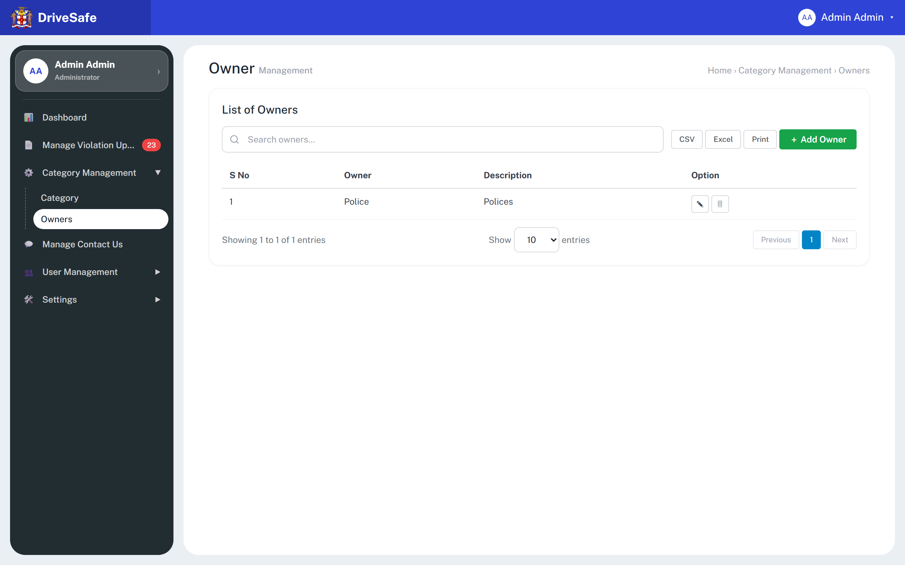
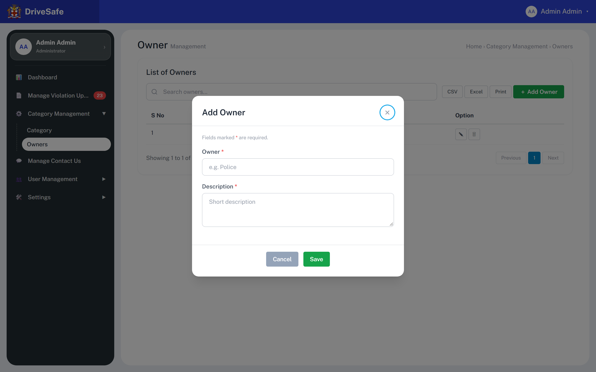
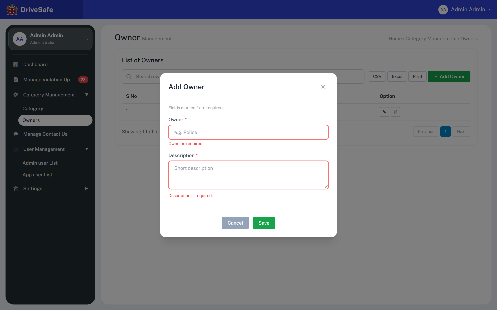

# SCR-11 · Owner management

## Purpose

Maintains the list of category Owners, the agencies responsible for acting on a kind of violation (seed: "Police"). An administrator adds, renames or removes owners here; the owners then become the choices in the Owner select of SCR-10 and in the Owner filter of the violations list.

## Entry and exit

**Reached from:** sidebar group Category Management, link **Owners** (`data-go="owners"`).

**Leaves to:** other sidebar links, incl. Category (SCR-10), Manage Contact Us (SCR-13), Config (SCR-12). Add/Edit open modal `owner-modal`; Delete uses native `confirm()`. Breadcrumb "Home › Category Management › Owners" is plain text.

## States

### Populated

### Add Owner modal (empty)

### Add Owner modal, submitted empty (invalid)

### Edit Owner modal

### Delete confirmation

No screenshot: native `window.confirm()`. Text `Delete owner "<name>"?`. See OQ-11-05.

| State | When | What the user sees |
|---|---|---|
| Populated | at least one owner | rows, info line `Showing 1 to N of N entries` |
| Empty | all owners deleted | **Undefined — OQ-11-02.** Code renders an empty body and "Showing 1 to 0 of 0 entries" |
| Loading / Error | — | none exist (in-memory) |
| Permission denied | — | **Undefined — OQ-11-03** |
| Narrow viewport | content area narrower than the 40 rem table min width | Not captured as a picture (capture is 1440 only). Measured with Playwright: the table scrolls inside `.table-wrap` up to about 728 px viewport width and again from 1024 to about 1052 px; it fits at 768 px and from about 1053 px up |

## State axes

Modal mode only: Add ("Add Owner", blank) vs Edit ("Edit Owner", filled). Both shown above.

## Layout

| # | Region | Content |
|---|---|---|
| 1 | Page head | H1 "Owner" + grey "Management"; breadcrumb text |
| 2 | Card heading | "List of Owners" |
| 3 | Toolbar | Search (placeholder "Search owners…") · CSV · Excel · Print · green "＋ Add Owner" |
| 4 | Table | S No · Owner · Description · Option |
| 5 | Footer | info line · "Show [10] entries" · Previous / 1 / Next |

## Elements

| Element | Type | Behaviour | Requirement |
|---|---|---|---|
| S No | Column | Positional 1-based index, not an id | none |
| Owner | Column | Owner name (seed "Police") | none |
| Description | Column | Seed "Polices" | none |
| Info line | Text | `Showing 1 to N of N entries`, recomputed on add/delete | none |
| Row order | Behaviour | Insertion order, new owner last, no sort | none |

## Actions

| Control | Type | What happens | Goes to | Who may | Disabled when |
|---|---|---|---|---|---|
| Search owners… | Search input | Live case-insensitive substring filter that hides non-matching rows | — | any signed-in user (prototype enforces nothing; Administrator-only is PROPOSED, OQ-11-03) | — |
| CSV / Excel / Print | Buttons | **Wired to nothing** | — | — | — |
| ＋ Add Owner | Button (green) | Opens `owner-modal` titled "Add Owner", blank fields; focus on × | modal `owner-modal` | any signed-in user (prototype enforces nothing; Administrator-only is PROPOSED, OQ-11-03) | — |
| ✎ Edit {owner} (aria-label "Edit Police") | Icon button | Opens `owner-modal` titled "Edit Owner" filled from that row | modal `owner-modal` | any signed-in user (prototype enforces nothing; Administrator-only is PROPOSED, OQ-11-03) | — |
| 🗑 Delete {owner} (aria-label "Delete Police") | Icon button | `confirm('Delete owner "Police"?')`. OK removes the owner from the list and from the Owner selects in SCR-10 and the violations filter; no toast. **Categories already assigned to that owner keep the old owner name** (and if you then press Edit on such a category and Save, its owner is silently blanked: SCR-10 Edit; the select then shows empty, nothing selected) and the table still displays it; the SCR-10 Edit select then cannot show it (it renders empty with no option selected) | native confirm | any signed-in user (prototype enforces nothing; Administrator-only is PROPOSED, OQ-11-03) | — |
| Show [10/25/50] entries | Select | **Wired to nothing** | — | — | — |
| Previous / 1 / Next | Pager | **Wired to nothing**; Previous/Next disabled | — | — | always |
| Owner modal: × / Cancel | Buttons | Close and discard | SCR-11 | any signed-in user (prototype enforces nothing; Administrator-only is PROPOSED, OQ-11-03) | — |
| Owner modal: Save | Button (green) | Validates both fields; on failure shows messages and focuses the first bad field. On success trims, Add appends `{owner, description}`, Edit overwrites; re-renders the table and refreshes Owner selects everywhere; closes; toast `Owner "{owner}" added successfully.` / `Owner "{owner}" updated successfully.` | SCR-11 | any signed-in user (prototype enforces nothing; Administrator-only is PROPOSED, OQ-11-03) | Never disabled |
| Esc / backdrop click | Keyboard / pointer | Closes modal, discards | SCR-11 | — | — |

**Wired to nothing**

**Row buttons, exact labels:** row 1 has **Edit Police** and **Delete Police** (delegated `data-owner-edit="0"` / `data-owner-del="0"`). Later rows follow `Edit {owner}` / `Delete {owner}`. The page-size control's accessible name is **Show 10 25 50 entries** (options 10, 25, 50, no handler).

The current `capture.json` flags **6** dead controls here (CSV, Excel, Print, Previous, 1, Next). The capture script was patched to treat delegated `data-*` handlers as wired, so Edit Police and Delete Police (`data-owner-edit` / `data-owner-del`) no longer count. CSV, Excel, Print, the page-size select (not flagged) and the pager are genuinely unbuilt: OQ-11-04.

## Validation

| Field | Rule | Source | When | Message |
|---|---|---|---|---|
| Owner (`owner-name`) | Required; trimmed; min 1, max 60 characters (`maxlength="60"`) | required: declared (`data-req`); max: declared attribute, unlabelled on screen; min 1 implied | blur, Save | `Owner is required.` |
| Owner uniqueness | Case-insensitive unique | **PROPOSED** | Save | "An owner with this name already exists." (PROPOSED wording) |
| Description (`owner-desc`) | Required; trimmed; min 1, max 150 (`maxlength="150"`) | required: declared; max: declared attribute | blur, Save | `Description is required.` |
| Both | `<` `>` stripped as typed | declared (global filter) | input | silent |
| Search owners (search input) | Free text, min 0, max 100 characters; empty shows all rows. Shell-level rule owned by SCR-10 | **PROPOSED** | input | none |
| Show 10 25 50 entries (page-size select) | One of 10, 25, 50; default 10; no effect today | declared (select options); behaviour OQ-11-04 | change | none |

**Cross-field:** none. **Server-side only (PROPOSED):** uniqueness; block or cascade on delete when categories reference the owner; rename must propagate to categories. **Unruled and undecided:** OQ-11-06. No numeric/date fields, so no min/max owed.

## Screen communication

| Direction | With | What passes | Contract |
|---|---|---|---|
| Sends | SCR-10 Category | Owner names | Options of the category modal Owner select (blank option "No owner") |
| Sends | Violations list | Owner names | Options of the filter "All Category Owners" |
| Receives | SCR-10 | Nothing: categories store the owner as a **name string**, so this screen does not know which categories use an owner | — |
| Owns | Owner master list | — | This screen is the only place owners are created |
| Breaks if changed | SCR-10 and violations filter | Rename or delete of an owner leaves categories pointing at a name that no longer exists. Owner of the rule: undecided, OQ-11-06 | — |

## Acceptance criteria

**ST-SCR-11-01 — List loads**
- Given I choose Category Management > Owners
- Then one row reads "1 Police Polices" and the info line reads "Showing 1 to 1 of 1 entries"

**ST-SCR-11-02 — Add owner**
- Given the Add Owner modal is open
- When I enter "Transport Authority" / "Licensing body" and press Save
- Then row 2 appears, the toast reads `Owner "Transport Authority" added successfully.`, and SCR-10's Owner select now offers it

**ST-SCR-11-03 — Empty submit**
- Given Add Owner is open and blank
- When I press Save
- Then "Owner is required." and "Description is required." show and focus is on Owner

**ST-SCR-11-04 — Edit**
- Given I press ✎ on Police
- Then the modal title is "Edit Owner" with Owner "Police" and Description "Polices"

**ST-SCR-11-05 — Delete cancelled**
- Given I press 🗑 on Police and the confirm reads `Delete owner "Police"?`
- When I choose Cancel
- Then the row stays

**ST-SCR-11-06 — Delete leaves dangling owner**
- Given category "Over-charging fares" has owner Police
- When I delete Police and confirm
- Then the owners table is empty and SCR-10 still shows "Police" in row 1 (finding OQ-11-06)

## Data

- **Reads:** `OWNERS` {owner, description}.
- **Writes:** push / replace / splice on `OWNERS`, in memory only; refreshes owner selects.
- **Services (production):** owner CRUD; reference check against categories.

## Accessibility and keyboard

Same modal pattern as SCR-10: `role="dialog"`, focus starts on × (first focusable), no focus trap, Esc and backdrop close, error text linked via `aria-describedby`, toasts live-announced. Icon buttons labelled "Edit {owner}" / "Delete {owner}".

**Focus after Save.** Add-Save returns focus to the static **＋ Add Owner** button, which survives. Edit-Save does not: the table is re-rendered before the modal closes, so the row button recorded as the opener is detached from the page and focus lands on `<body>` (measured with Playwright on SCR-10; same code path here). A build should return focus to the edited row's button or the table heading.

## Open questions

| ID | Question | Affects | Why it matters |
|---|---|---|---|
| OQ-11-01 | No spec beyond README: are owners meant to be only a name and description (no contact email, no users)? | model | Owners probably need a way to receive reports; none exists |
| OQ-11-02 | Empty/loading/error states undefined | list | Developers invent |
| OQ-11-03 | Which roles may manage owners? | permissions | Only Administrator shown |
| OQ-11-04 | CSV, Excel, Print, page size, pagination in scope? | toolbar | Dead controls |
| OQ-11-05 | Replace native confirm with a designed dialog; warn when categories use the owner? | delete | Data loss |
| OQ-11-06 | Owner delete/rename: block, cascade to categories, or leave dangling? Owner is stored as a name string in categories | data model | Today produces dangling references, and editing then saving an affected category in SCR-10 silently blanks its owner (the Owner select shows empty with no option selected, `selectedIndex` -1, and Save writes owner "") |
| OQ-11-07 | Unique owner names? | validation | Name is the join key |
| OQ-11-08 | List-search max: 100 here and on every list screen, PROPOSED; the rule is stated once on SCR-10 (OQ-10-10) | validation | Same control, two limits |
