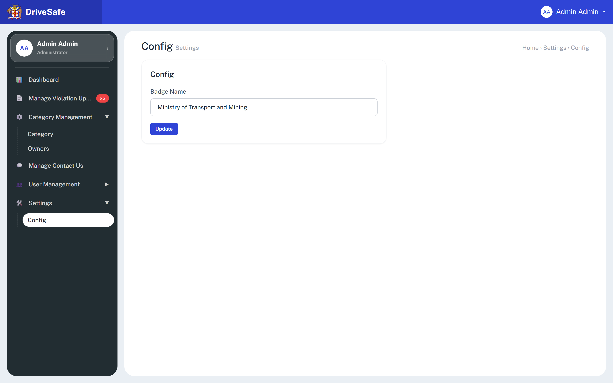

# SCR-12 · Config (badge name)

## Purpose

Holds the one portal setting the prototype has: **Badge Name**, the organisation line that appears under "Admin Portal" on the sign-in, forgot-password and OTP screens. An administrator edits it and presses Update.

## Entry and exit

**Reached from:** sidebar group **Settings** (expands), link **Config** (`data-go="config"`).

**Leaves to:** any sidebar link. No outbound data links.

## States

### Default

| State | When | What the user sees |
|---|---|---|
| Default | Open | Field holds the saved badge name (seed "Ministry of Transport and Mining", or the value restored from `localStorage`) |
| Invalid | Update pressed with empty or blank field | Field gets a red ring and `aria-invalid`. The text "Badge Name is required." is **not visible**: the markup has no `#err-cfg-badge` element, so the message is lost (OQ-12-02). No capture exists of this state |
| Saved | Valid update | Toast `Config updated. Badge Name set to "{value}".`; auth screens show the new text immediately |
| Empty / Loading / Error / Permission | — | None exist; a settings form has no empty state. Permission **undefined**, OQ-12-04 |

## State axes

None. A single field.

## Layout

| # | Region | Content |
|---|---|---|
| 1 | Page head | H1 "Config" + grey "Settings"; breadcrumb "Home › Settings › Config" |
| 2 | Card (max width xl) | H2 "Config" · label "Badge Name" · text input · primary button "Update" |

## Elements

| Element | Type | Behaviour | Requirement |
|---|---|---|---|
| Badge Name | Text input (`cfg-badge`) | Prefilled with saved value | none |
| Auth-screen subtitle (`.badge-name` elements) | Consumer | Show the saved value under "Admin Portal" | none |

## Actions

| Control | Type | What happens | Goes to | Who may | Disabled when |
|---|---|---|---|---|---|
| Update | Button (primary), inside a form with submit suppressed | Trims the field. Empty: sets the invalid ring, stops. Otherwise writes the value into every `.badge-name` element, stores it in the browser's `localStorage` key `drivesafe_badge_name` (this device only), shows the success toast. Verified on the running prototype (Playwright, 2026-10-26): pressing Enter in the field saves exactly as the button does (value stored, toast shown, no page reload; the Update button is the form's default submit button). Pressing Enter on a blank field sets `aria-invalid` and shows nothing else | SCR-12 | any signed-in user (prototype enforces nothing; Administrator-only is PROPOSED, OQ-12-04) | never |

**Wired to nothing:** none. The capture reports zero dead controls here.

## Validation

| Field | Rule | Source | When | Message |
|---|---|---|---|---|
| Badge Name (cfg-badge) | Required, trimmed; min 1, max 100 characters | required: declared (script check on Update, no `data-req`); **max 100 PROPOSED** (no `maxlength` in markup); min 1 implied | Update only (no blur validation, no live clearing because the field has no `aria-describedby`) | `Badge Name is required.` (see invisibility defect) |
| Badge Name characters | `<` `>` stripped as typed | declared (global filter) | input | silent |

**Cross-field:** none. **Server-side only:** persistence of the value for all admins and for the public mobile/auth surfaces (OQ-12-03). **Unruled and undecided:** allowed characters, image/logo (the screen is called Badge but holds text only). No numeric/date fields.

## Screen communication

| Direction | With | What passes | Contract |
|---|---|---|---|
| Sends | Sign-in, Forgot password, OTP screens (auth module) | Badge Name text | All `.badge-name` elements; owner of the value is this screen |
| Receives | Browser `localStorage` | Saved name restored on page load | Per browser, not per organisation |
| Breaks if changed | Auth screens | Layout of the subtitle with long text | — |

## Acceptance criteria

**ST-SCR-12-01 — Seed value**
- Given I open Settings > Config for the first time
- Then Badge Name reads "Ministry of Transport and Mining"

**ST-SCR-12-02 — Update**
- Given I replace the text with "Jamaica Transport Authority" and press Update
- Then a toast reads `Config updated. Badge Name set to "Jamaica Transport Authority".`
- And after signing out the sign-in screen shows that text under "Admin Portal"

**ST-SCR-12-03 — Blank rejected**
- Given I clear the field and press Update
- Then the field is outlined red and the saved value is unchanged
- And a visible "Badge Name is required." message is shown (currently missing in the prototype, see OQ-12-02)

**ST-SCR-12-04 — Persists across reload**
- Given I saved "Test Org"
- When I reload the page and open Config
- Then the field reads "Test Org"

**ST-SCR-12-05 — Whitespace**
- Given I enter only spaces and press Update
- Then it is treated as empty and rejected

## Data

- **Reads:** `localStorage["drivesafe_badge_name"]` on boot.
- **Writes:** same key; text of `.badge-name` elements.
- **Services (production):** a settings API, a public read for the auth screens.

## Accessibility and keyboard

Label is associated with the input. Invalid state sets `aria-invalid` but the missing error element means nothing is announced; success is announced by the toast live region. Tab order: input, Update.

## Open questions

| ID | Question | Affects | Why it matters |
|---|---|---|---|
| OQ-12-01 | No spec: are there other settings planned beyond Badge Name (Settings group suggests more)? | module | One screen, one field today |
| OQ-12-02 | The required message is never displayed (no error element); fix in build? (Enter already submits via the default button.) | validation | Reproducing it ships a silent failure |
| OQ-12-03 | Where is the value stored: localStorage means per browser; production needs a server value visible to unauthenticated users | data | Cannot be per-device |
| OQ-12-04 | Which roles may change it? | permissions | A public-facing label |
| OQ-12-05 | Max length and allowed characters? | validation | Proposed 100 |
