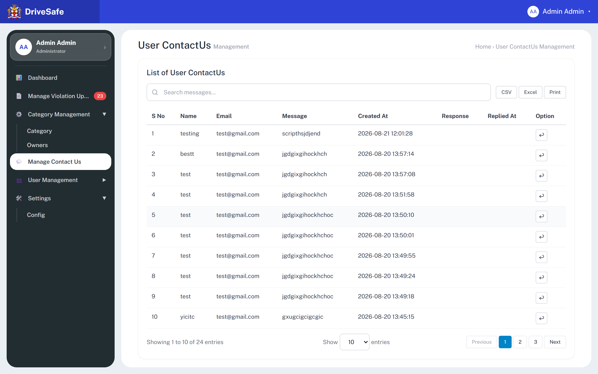
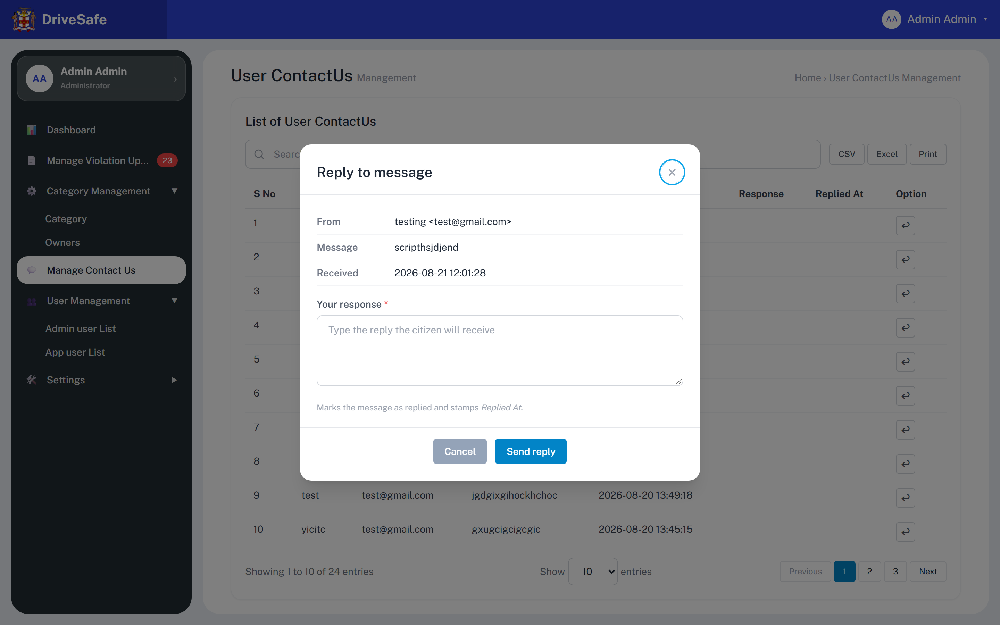

# SCR-13 · Manage Contact Us

## Purpose

Lists the messages citizens send through the app's Contact Us form and lets an administrator answer each one. An administrator opens it, picks a message with the reply arrow, writes a response and sends it, and the row then shows the response and the time it was sent.

## Entry and exit

**Reached from:** sidebar item **Manage Contact Us** (`data-go="contact"`); SCR-05 Dashboard, tile **💬 24 Messages**.

**Leaves to:** other sidebar links only. Reply opens modal `reply-modal`. The breadcrumb "Home › User ContactUs Management" is text.

## States

### Populated, none replied

### Reply modal (unanswered message)

The prototype also has two states without a capture: **reply modal submitted empty** (red ring and "Response is required." under the box, same pattern as the invalid category modal in SCR-10) and **replied row** (Response text truncated at 14 rem with ellipsis, Replied At filled). No screenshot was taken of either; the capture supplies only the two above (OQ-13-08).

| State | When | What the user sees |
|---|---|---|
| Populated | messages exist | 10 rows on page 1; info line fixed text "Showing 1 to 10 of 24 entries" |
| Replied row | after Send reply | Response and Replied At cells filled; row stays in place |
| Empty | no messages | **Undefined — OQ-13-02** |
| Loading / Error | — | none |
| Permission denied | — | **Undefined — OQ-13-03** |
| Narrow viewport | content area narrower than the 54 rem table min width | Not captured as a picture. Measured with Playwright: the table scrolls inside `.table-wrap` at viewport widths up to about 985 px and again from 1024 to about 1292 px (at 1280: 864 px of table in an 850 px wrapper); it fits only between about 985 and 1024 px and from about 1293 px up |

## State axes

None, apart from reply status per row (Unanswered: blank Response/Replied At; Answered: both filled). There is no status column, filter or badge for it.

## Layout

| # | Region | Content |
|---|---|---|
| 1 | Page head | H1 "User ContactUs" + grey "Management"; breadcrumb text |
| 2 | Card heading | "List of User ContactUs" |
| 3 | Toolbar | Search "Search messages…" · CSV · Excel · Print (no Add button) |
| 4 | Table | S No · Name · Email · Message · Created At · Response · Replied At · Option |
| 5 | Footer | "Showing 1 to 10 of 24 entries" · "Show [10] entries" · Previous / 1 / 2 / 3 / Next |

## Elements

| Element | Type | Behaviour | Requirement |
|---|---|---|---|
| S No | Column | Positional 1-based index | none |
| Name | Column | Sender name as typed in the app (e.g. "testing") | none |
| Email | Column | Sender email (all seeds test@gmail.com); shown in full, not masked | none |
| Message | Column | Full message, not truncated | none |
| Created At | Column | `YYYY-MM-DD HH:mm:ss`, newest first in the seed (2026-08-21 12:01:28 on top) | none |
| Response | Column | Reply text, truncated to max-width 14 rem; blank until answered | none |
| Replied At | Column | `YYYY-MM-DD HH:mm:ss` of the last send, blank until answered | none |
| Info line | Text | **Hard-coded** "Showing 1 to 10 of 24 entries"; 24 is `CONTACTS_TOTAL`, only 10 rows exist in the data | none |
| Pager 1, 2, 3 | Buttons | Visually pages 1 to 3 (24 / 10), but no handler | none |

## Actions

| Control | Type | What happens | Goes to | Who may | Disabled when |
|---|---|---|---|---|---|
| Search messages… | Search input | Live filter hiding rows whose text does not contain the query (case-insensitive, any column incl. response). Operates on the 10 loaded rows only | — | any signed-in user (prototype enforces nothing; Administrator-only is PROPOSED, OQ-13-03) | — |
| CSV / Excel / Print | Buttons | **Wired to nothing** | — | — | — |
| ↩ Reply to {name} (row; aria-label "Reply to {name}") | Icon button | Opens `reply-modal`, filling a read-only block (From "{name} <{email}>", Message, Received) and putting the existing response, if any, in the box so a reply can be revised | modal `reply-modal` | any signed-in user (prototype enforces nothing; Administrator-only is PROPOSED, OQ-13-03) | — (also available on answered rows) |
| Reply modal × / Cancel | Buttons | Close, discarding the text | SCR-13 | any signed-in user (prototype enforces nothing; Administrator-only is PROPOSED, OQ-13-03) | — |
| Reply modal: Send reply (primary blue) | Button | Validates Response. On failure: red ring, "Response is required.", focus in the box. On success: trims, stores it as the message's response, stamps Replied At with the current browser time (`now()`), re-renders the table, closes, toast `Reply sent to {name}.`. Resending overwrites the earlier response and time; no history. Nothing is actually emailed in the prototype although the placeholder says "Type the reply the citizen will receive" | SCR-13 | any signed-in user (prototype enforces nothing; Administrator-only is PROPOSED, OQ-13-03) | Never disabled |
| Show [10/25/50] entries | Select | **Wired to nothing** | — | — | — |
| Previous | Button | Disabled; **wired to nothing** | — | — | always |
| 1 | Button | Current page marker | — | — | — |
| 2, 3, Next | Buttons | Clickable-looking, **wired to nothing**: no further messages exist in the data | — | — | — |
| Esc / backdrop click | Keyboard / pointer | Closes modal, discards | SCR-13 | — | — |

**Wired to nothing**

**Row reply buttons, exact labels** (delegated `data-reply="i"`): Reply to testing (row 1), Reply to bestt (row 2), Reply to test (rows 3 to 9, seven rows with the same name, so the label is not unique), Reply to yicitc (row 10). Later rows follow `Reply to {name}`. The page-size control's accessible name is **Show 10 25 50 entries** (options 10, 25, 50, no handler).

The current `capture.json` flags **8** dead controls (CSV, Excel, Print, Previous, 1, 2, 3, Next). The capture script was patched to treat delegated `data-*` handlers as wired, so the 10 Reply arrows (`data-reply`) no longer count. Genuinely dead: CSV, Excel, Print, page-size select, pager buttons 2, 3, Next (and 1, Previous by design). Unbuilt scope: OQ-13-04.

## Validation

| Field | Rule | Source | When | Message |
|---|---|---|---|---|
| Your response (`reply-text`) | Required; trimmed; min 1, max 1000 characters. Textarea has no `maxlength` | required: declared (`data-req`); **max 1000 PROPOSED**; min 1 implied | blur, Send reply | `Response is required.` |
| Your response characters | `<` `>` stripped as typed | declared (global filter) | input | silent |
| Search messages (search input) | Free text, min 0, max 100 characters; empty shows all rows. Shell-level rule owned by SCR-10 (OQ-10-10) | **PROPOSED** | input | none |
| Show 10 25 50 entries (page-size select) | One of 10, 25, 50; default 10; no effect today | declared (select options); behaviour OQ-13-04 | change | none |

**Cross-field:** none. **Server-side only (PROPOSED):** message must still exist; one reply per message or an append-only thread (OQ-13-05). **Unruled and undecided:** who is recorded as replier (none today). No numeric/date input exists, so no min/max owed; the timestamps are system generated.

## Screen communication

| Direction | With | What passes | Contract |
|---|---|---|---|
| Receives | Mobile app Contact Us form (outside the portal) | name, email, message, createdAt | Total shown "24"; this screen is the only reader |
| Sends | Citizen (email address on the message) | The response text | **Not implemented**; delivery channel undefined, OQ-13-05 |
| Shares | Sidebar | Nothing: no unread/unanswered counter badge, unlike Manage Violation Uploads which has the red pending badge | OQ-13-06 |
| Breaks if changed | Nothing else reads CONTACTS | — | — |

## Acceptance criteria

**ST-SCR-13-01 — List loads**
- Given I choose Manage Contact Us
- Then the table shows 10 rows, row 1 reading "testing · test@gmail.com · scripthsjdjend · 2026-08-21 12:01:28"
- And Response and Replied At are blank and the info line reads "Showing 1 to 10 of 24 entries"

**ST-SCR-13-02 — Open reply**
- Given I press ↩ on row 1
- Then the modal "Reply to message" shows From "testing <test@gmail.com>", Message "scripthsjdjend", Received "2026-08-21 12:01:28" and an empty response box

**ST-SCR-13-03 — Empty reply blocked**
- Given the reply modal is open with an empty box
- When I press Send reply
- Then "Response is required." shows and the table is unchanged

**ST-SCR-13-04 — Send**
- Given I type "Thank you, we are looking into it." and press Send reply
- Then the modal closes, row 1 Response shows that text, Replied At shows the current time, and a toast reads "Reply sent to testing."

**ST-SCR-13-05 — Revise**
- Given row 1 has a response
- When I press ↩ on it
- Then the box contains the earlier response and sending a new text replaces it and the time

**ST-SCR-13-06 — Search**
- Given I type "yicitc" in the search box
- Then only row 10 remains visible

**ST-SCR-13-07 — Cancel**
- Given I typed a reply and press Cancel
- Then nothing is saved

## Data

- **Reads:** `CONTACTS` {name, email, message, createdAt, response, repliedAt}; `CONTACTS_TOTAL` 24.
- **Writes:** `response`, `repliedAt` on one message (in memory).
- **Services (production):** paginated messages API, reply endpoint that sends email/push, export.

## Accessibility and keyboard

Modal `role="dialog"`, labelled by "Reply to message", focus starts on × (first focusable), no trap, Esc/backdrop close. Reply buttons labelled "Reply to {name}" though many rows share the name "test", so labels are not unique. Toast announced in the polite live region.

**Focus after Save.** There is no Add flow on this screen. Send reply does not return focus: the table is re-rendered before the modal closes, so the row button recorded as the opener is detached from the page and focus lands on `<body>` (measured with Playwright on SCR-10; same code path here). A build should return focus to the edited row's button or the table heading.

## Open questions

| ID | Question | Affects | Why it matters |
|---|---|---|---|
| OQ-13-01 | No spec: is replying by the admin the whole function, or are status, assignment and deletion needed? | scope | Prototype has no delete/status |
| OQ-13-02 | Empty/loading/error states? | list | Undefined |
| OQ-13-03 | Which roles see this? | permissions | Only Administrator shown |
| OQ-13-04 | CSV/Excel/Print, page size and pagination (24 messages over 3 pages)? | list | Pages 2 and 3 are unreachable; 14 messages cannot be answered |
| OQ-13-05 | How does the reply reach the citizen (email, push, in-app)? One reply or a thread? Is the replying admin recorded? | reply, data model | Placeholder promises delivery; none exists |
| OQ-13-06 | Pending/unanswered counter in the sidebar? | nav | No signal of unanswered work |
| OQ-13-07 | Is the sender email PII to mask like the violations Mobile column? | list | Phone is masked elsewhere, email is not |
| OQ-13-08 | Captures for the empty-submit and replied-row states were not taken; re-run the capture | story | Two states are described without pictures |
| OQ-13-09 | List-search max: 100 here and on every list screen, PROPOSED (see OQ-10-10) | validation | Same control, two limits |
