# Flow charts

Drawn from the delivered stories on 2026-10-26, after every journey was walked hop by hop against the prototype's real links (`prototype/js/app.js`, `index.html`) and run through `journey_check.py`. **10 journeys walked. 3 complete end to end (sign in, sign out, change password). 7 break before they deliver what the business needs** (forgot password, violation review, category and owner setup, admin-user management, app-user maintenance, contact reply, feedback). Every hop between screens exists in the prototype, except the ones drawn in red; the breaks are mostly at the end of a journey, where the prototype stops pretending and the product has no destination.

## How to read this

A solid arrow is a hop a user can press and arrive. A dashed red arrow is a hop that does not work or does not deliver, labelled with the open question that owns it. A dashed red arrow into a red dotted node means there is no screen at all for that step; the node is named so you can see what is missing.

Every node carries its story id (`SCR-nn`, in `screen-stories/`). The global sidebar is not drawn.

## The product in one picture

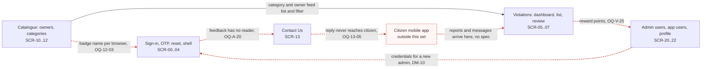

Only one dependency in the product is fully built (the catalogue feeding the violations list). Every other arrow either does not exist yet or is a promise.

## The journeys

### 1. Staff member signs in (works)

Goal: reach the dashboard with a verified identity.

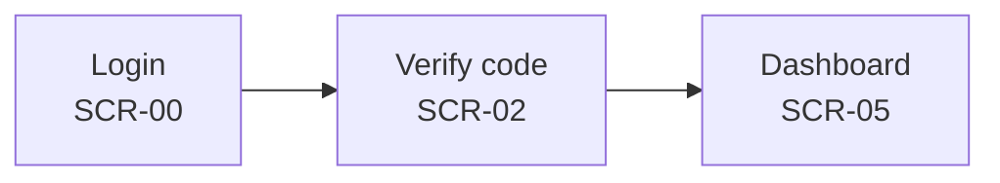

All hops work. Caveat, not a broken hop: the prototype accepts any username, any password and any six digits (OQ-A-01, OQ-A-12, OQ-A-03). The screens are right; the checking behind them is yet to be designed.

Cost: none for navigation. For security, a build that copies the prototype ships a front door that opens for anyone.

### 2. Staff member forgets their password (breaks)

Goal: get back in after losing a password.

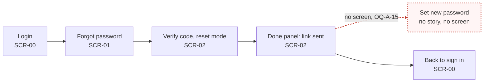

- Missing: the page the reset link opens, where the new password is set (OQ-A-15, blocking). `journey_check` cannot see this: the tool does not capture the sign-in screens, so I confirmed it against `app.js`, where the done panel's only exit is "Back to sign in" and nothing sets a password.

Cost: a locked-out administrator is told a link was sent, goes back to sign in with the same password they forgot, and cannot recover without a developer. Today that is theatre; in production it is a support ticket for every lost password.

### 3. Reviewer decides a violation report (breaks at the result)

Goal: open a reported violation, record Verified or Rejected, and have the dashboard, the reporter and the record reflect it.

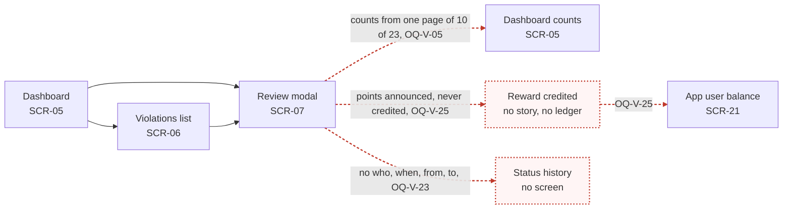

- Broken: after Save, the tiles Verified, Rejected and Under review are recounted from the 10 loaded rows, while Pending adds the 13 unloaded ones (OQ-V-05, OQ-V-07).
- Missing: the reward. The toast says "Reporter awarded reward points" and no points move (OQ-V-25, a business-sponsor decision).
- Missing: a record of who decided what and when; the prototype keeps only the latest "Admin Admin" (OQ-V-23, DM-03).
- Also worth knowing, though the hop works: the tiles open the list unfiltered (OQ-V-04), so "23 Pending" does not take you to the 23.

Cost: the reviewer decides, the dashboard shows a number that is wrong, the citizen is told nothing and paid nothing, and an appealed decision cannot be shown to anyone.

### 4. Administrator sets up owners and categories (hops work, data integrity breaks)

Goal: create an owner (an agency), create the categories it is responsible for, and have reports route to it.

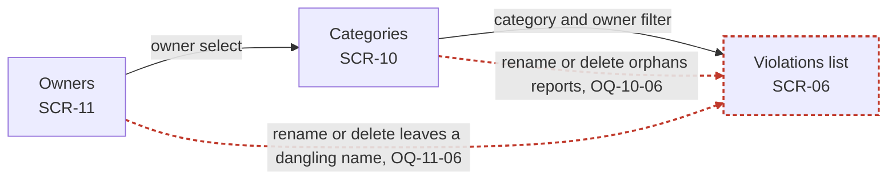

- Broken: every link is a name typed as text. Renaming or deleting an owner or a category silently orphans the reports and categories that point at it (OQ-10-06, OQ-11-06, OQ-V-18, blocking). Deleting "Other" breaks the free-text path (OQ-10-07).
- Note: the journey is only creation-safe. `journey_check` reports `owners -> category -> violations` unbroken, and that is true of the navigation.

Cost: an administrator tidies a name and loses the category on live reports without warning, and the owner agency stops seeing its reports.

### 5. Administrator adds a colleague (breaks)

Goal: give a new staff member access to the portal.

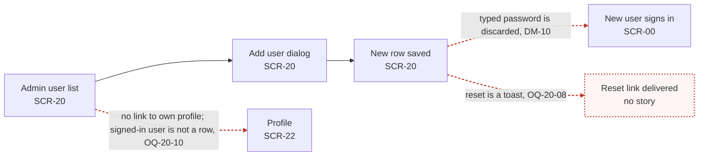

- Broken: the new user cannot sign in. The password the administrator types is validated and thrown away; how a first password is set is undecided (DM-10, OQ-20-05).
- Missing: password reset. The lock icon shows a toast and sends nothing (OQ-20-08).
- Broken: `journey_check` confirms `users -> profile` is not a link (Profile is reached only from the account menu or sidebar card; see journey 8). The signed-in "Admin Admin" is not one of the 8 users in the list (OQ-20-10).
- Not drawn but material: no role is enforced, so any signed-in user can add, edit or delete administrators (OQ-20-02, OQ-A-27).

Cost: the administrator creates an account and the colleague cannot use it. The worse case is the one nobody notices: anyone who can sign in can create an administrator.

### 6. Staff maintain an app user (breaks at the edges)

Goal: find a citizen's app account and correct their details or points.

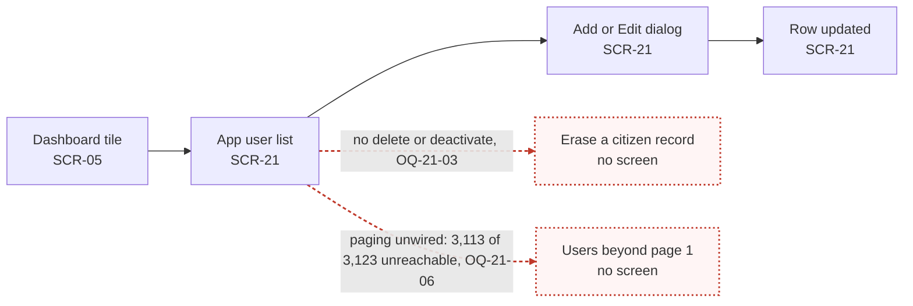

- Missing: any way to erase or deactivate a citizen (OQ-21-03, DM-02).
- Broken in the prototype, fixed by the build: the pager and page-size controls are dead, so only 10 of 3,123 users can ever be reached by browsing (OQ-21-06).
- The dashboard "3,123" is a typed number; adding a user does not change it (OQ-V-07).

Cost: a citizen's request to be forgotten cannot be met inside the product.

### 7. Staff reply to a citizen message (breaks)

Goal: read a message from the public and answer it.

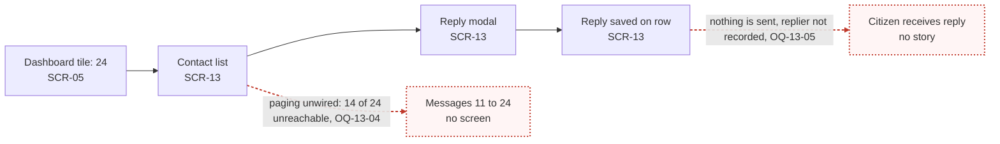

- Missing: delivery. Reply stores a string on the row; the channel (email, push, in-app) is undecided (OQ-13-05, blocking, product owner).
- Broken: 14 of the 24 messages cannot be opened (OQ-13-04).

Cost: the authority tells the public it has answered them and has not. For a public body, that is a complaint waiting to be filed.

### 8. Staff member changes their own password (works)

Goal: replace a password under the 12-128, four-class policy.

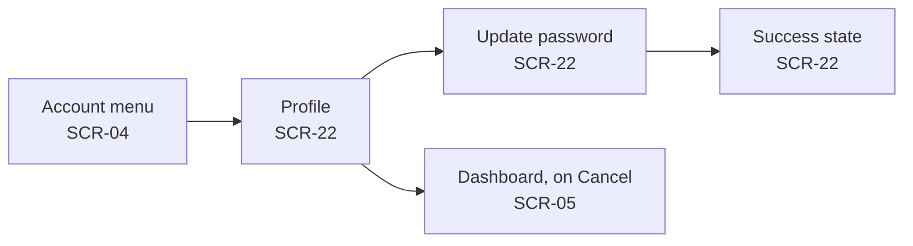

All hops work, entry is through the account menu or sidebar card, not through navigation (confirmed in `app.js`, `data-action="profile"`). Caveats, not hops: the current password is never checked, the details card is hard-coded (OQ-22-02), and other sessions stay signed in (OQ-22-07). `journey_check dashboard -> profile` and `users -> profile` both report no link, and that is expected for header chrome.

Cost: none for navigation; the screen does not yet change a stored password.

### 9. Visitor sends feedback from the sign-in page (breaks)

Goal: a person who cannot sign in tells the authority something.

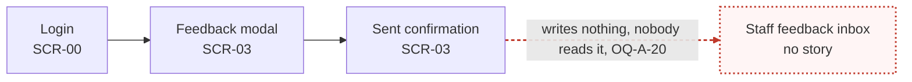

- Missing: a reader. Whether feedback is the same thing as a Contact Us message is undecided (OQ-A-20, DM-12). The sent and error states were never photographed (OQ-A-18).

Cost: feedback is thanked and discarded. It is also the only anonymous write in the product, so it needs abuse protection (OQ-A-19).

### 10. Staff member signs out (works)

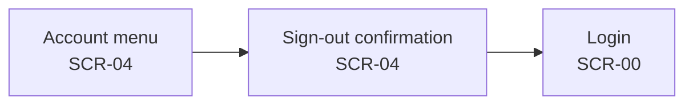

All hops work. Caveat: typed fields and half-entered codes are not cleared (OQ-A-07, OQ-A-26), and there is no real session to end (OQ-A-23).

## What this shows

Navigation is sound: every hop that exists is real, and 3 of 10 journeys complete. The seven that break all break the same way: the prototype lets a user start a task and stops short of the outcome the business needs (a reset password, a reward, a delivered reply, a usable new account, a reader for feedback, an unorphaned record). The first decision a sponsor should make is which of those outcomes are in the first release, because each is a missing screen or a missing service that no story can supply.
