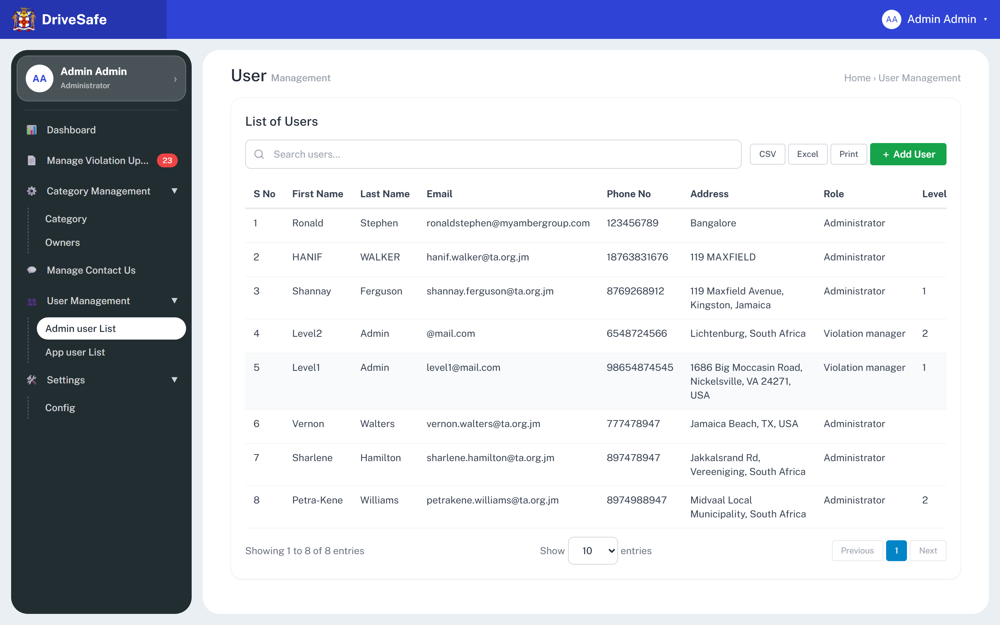
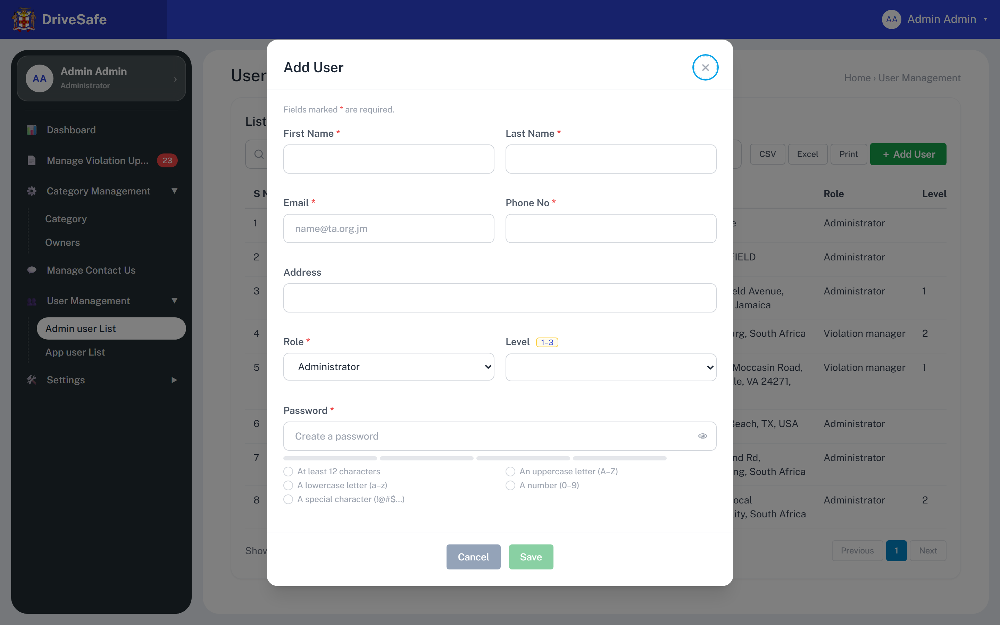
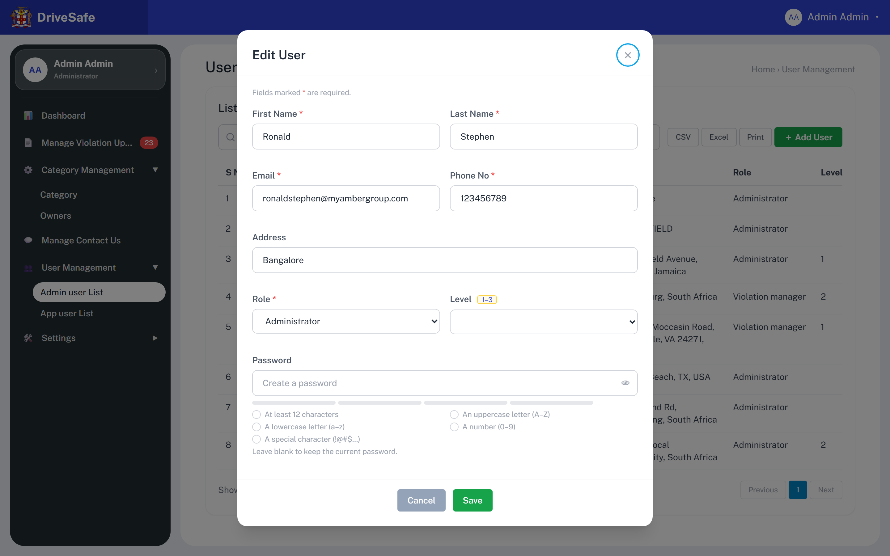

# SCR-20 · Admin user list (with Add/Edit User dialog)

## Purpose

Lets a portal Administrator see every back-office (portal) account, add a new one, edit one, delete one and trigger a password reset. It is the only place portal accounts are created. The reader leaves having changed the set of people who can sign in to the portal and what Role and Level they hold. App (citizen) users are a different population, see SCR-21.

Source note: everything below is read from `index.html` / `js/app.js` / `js/data.js`. The capture's `wiring: none` flags on the row icons (Edit, Delete, Reset password) are false positives: they are wired by delegated click listener on `data-user-edit`, `data-user-del`, `data-user-lock`. CSV, Excel, Print, the page-size select and pagination buttons are genuinely wired to nothing (see Actions).

## Entry and exit

**Reached from:** [SCR-05](../02-violations/SCR-05-dashboard.md) Dashboard tile **Portal users** (`data-go="users"`; its number, 8, is hard-coded and not updated by Add or Delete here; owner unowned); sidebar group "User Management" (expands automatically when this screen is shown) → item "Admin user List" (`data-go="users"`); that item is highlighted white-pill with `aria-current="page"`. The prototype's default landing is login, then the dashboard; there is no deep-link router (screens are swapped by `go(id)`).

**Leaves to:** SCR-21 App user list (sidebar item "App user List"); any other sidebar item (Dashboard, Manage Violation Uploads, Category, Owners, Manage Contact Us, Config); SCR-22 My Profile (sidebar profile card, or header avatar menu → Profile). All of those are shell navigation, owned by the shell story. Leaving the screen while the Add/Edit User dialog is open closes the dialog and discards its input (`go()` calls `closeAnyModal()`).

## States

### Populated (the only list state the prototype renders)

The capture is full-page at 1440×900 viewport; `users--fold.png` is the same render cropped and is not a separate state.

### Add User dialog — pristine (Save disabled)

Opened by **+ Add User**. Title "Add User". Role is preset to "Administrator" (the "Select role" placeholder option exists in the markup but the add flow overwrites it), Level blank, Password required (red asterisk), no hint text under the password. **Save is disabled** (`disabled` attribute, pale green) until every rule is satisfied, so the user cannot trigger an error summary by pressing Save. The first focusable element in DOM order is the **×** close button, so that is what receives focus on open (the cyan ring in the capture), not First Name.

### Add User dialog — "invalid" capture

This is the capture the tool labelled "invalid". It shows **no red error text and no red field rings**: because Save is disabled while the form is invalid, the submit-time error path (`validateFields`) is unreachable by mouse, and inline errors only appear on **blur** of a touched field (see Validation). So the "invalid" state a developer must build is: Save disabled, and the per-field error appears under a field only after the user leaves it. The capture differs from the pristine shot only in that the × button does not carry a focus ring.

### Edit User dialog

Opened by the ✎ icon on a row. Title "Edit User", fields pre-filled from that row. Password is **optional**: asterisk hidden, hint "Leave blank to keep the current password." shown under the checklist. Save is enabled when the pre-filled values are valid (Ronald's are). A row whose stored data is invalid keeps Save disabled until fixed; seed row 4 (Level2 Admin, email `@mail.com`) is such a row, and its Email would show "Please enter a valid email address." once the field is blurred.

### Delete confirmation (native)

There is no capture: the prototype uses the browser's native `window.confirm`, which is not part of the page render. Text: `Delete user {firstName} {lastName}?` with the browser's OK/Cancel. OK removes the row (array splice by index) and re-renders; there is **no toast** on delete (unlike add/edit). Cancel changes nothing.

### Password reset toast

Pressing 🔒 shows the success toast "Password reset link sent (concept)." (green left border, ✓ badge, top-right container (`right-4 top-4`), `role="status"`, announced through the live region, auto-dismiss after 3.5 s, dismissible with ×). No confirmation, no data change.

### Other states

| State | When | What the user sees |
|---|---|---|
| Populated | 1–n users | Table as above; footer `Showing 1 to {n} of {n} entries` |
| Search no match | text typed that matches no row text | Every row hidden, header row stays, **no "No results" message** and the footer text is not updated (still "Showing 1 to 8 of 8 entries"). Undefined — OQ-20-06 |
| Empty | every user deleted | Empty tbody, footer reads `Showing 1 to 0 of 0 entries` (literal template text), no empty-state message. Undefined — OQ-20-06 |
| Loading | n/a | Data is an in-memory array; no loading state exists. Undefined — OQ-20-07 |
| Error | n/a | No load or save failure path exists; every save succeeds. Undefined — OQ-20-07 |
| Permission denied | n/a | The role of the signed-in user is never checked; "Violation manager" accounts would see this screen identically. Undefined — OQ-20-02 |

### Captures not shown

| Capture | Why it is not embedded |
|---|---|
| `users--fold.png` | a crop of the same render as `users.png`, embedded above; adds no state |

## State axes

None found. There is no tab, role switch or URL filter on this screen. The only variants are the dialog's Add versus Edit mode (shown above) and the live search text (an input state, not a render variant).

## Layout

| # | Region | Content |
|---|---|---|
| 1 | Page head | H1 "User" with grey sub-word "Management"; right-aligned breadcrumb text "Home › User Management" (plain text, not links) |
| 2 | Card heading | H2 "List of Users" |
| 3 | Toolbar | Search box (magnifier icon, placeholder "Search users…", aria-label "Search users"); right group: **CSV**, **Excel**, **Print** (grey outline), **＋ Add User** (green) |
| 4 | Table (declared min width 60 rem; scrolls horizontally inside its `.table-wrap` container, see Responsive behaviour below) | Columns in order: S No · First Name · Last Name · Email · Phone No · Address · Role · Level · Option |
| 5 | Footer | Left: "Showing 1 to 8 of 8 entries"; centre: "Show [10 ▾] entries"; right: Previous · 1 · Next |
| 6 | Dialog (modal overlay) | Add/Edit User, see States |

**Responsive behaviour (measured with Playwright, viewport heights 900)**

The table sits in `.table-wrap` and scrolls horizontally inside it whenever its content is wider than the container. Measured content width is 1,139 px (columns size to their text, which exceeds the 60 rem minimum), so:

| Viewport width | Sidebar | Table |
|---|---|---|
| 390 | off-canvas (opened by ☰) | scrolls (container 300 px, content 1,107 px) |
| 768 | off-canvas | scrolls (646 < 1,139) |
| 1024 | permanent | scrolls (610 < 1,139) |
| 1280 | permanent | scrolls (850 < 1,139) |
| 1440 | permanent | scrolls (1,010 < 1,139): Level is the last visible column and Option is off-screen to the right, as in `users.png` |
| 1560 | permanent | still scrolls (last width measured scrolling, 10 px steps) |
| 1570 and wider | permanent | fits, no scrollbar |

So the Option column (Edit, Delete, Reset password) is not visible without horizontal scrolling at any width below about 1,570 px, including the 1440 px capture. PROPOSED: pin the Option column or shrink the Address column (OQ-20-13).

## Elements

| Element | Type | Behaviour | Requirement |
|---|---|---|---|
| S No | Cell | Row position `index + 1` in the in-memory array. Not an identifier: it renumbers after a delete | — (no spec) |
| First Name / Last Name | Cell | Text as stored (seed shows "HANIF" / "WALKER" upper-case: case is preserved) | — |
| Email | Cell | Plain text, not a mailto link | — |
| Phone No | Cell | Plain text, **not masked** (contrast SCR-21, which masks) | — |
| Address | Cell | Free text, wraps; may be empty | — |
| Role | Cell | "Administrator" or "Violation manager" | — |
| Level | Cell | "1", "2", "3" or blank | — |
| Option | Cell | Three icon buttons per row, see Actions | — |
| Row hover | Style | Row background goes light slate on hover | — |
| Entries label | Text | `Showing 1 to {n} of {n} entries`; recomputed after add/delete/edit; **not** recomputed by search | — |
| Page head, breadcrumb | Text | Static | — |
| Toast container | Overlay | Success toast after add/edit/reset; see Actions | — |
| Seed data (8 rows) | Data | Ronald Stephen (Admin, no level), HANIF WALKER (Admin), Shannay Ferguson (Admin, level 1), Level2 Admin (Violation manager, level 2, email `@mail.com`), Level1 Admin (Violation manager, 1), Vernon Walters (Admin), Sharlene Hamilton (Admin), Petra-Kene Williams (Admin, level 2) | — |

## Actions

| Control | Type | What happens | Goes to | Who may | Disabled when |
|---|---|---|---|---|---|
| Search users | Search input (`data-filter="users-body"`) | Client-side, as you type and on the native clear (✕): lower-cases the query and hides every row whose whole text (all columns incl. S No, Role, Level) does not contain it as a substring; shows rows that do. Only the 8 rows in memory are searched. Does not touch the footer count | — | any signed-in user (prototype enforces nothing; Administrator-only is **PROPOSED**, OQ-20-02) | — |
| CSV | Button | **Wired to nothing** (no listener, no data attribute). Clicking does nothing visible | — | — | never |
| Excel | Button | **Wired to nothing** | — | — | never |
| Print | Button | **Wired to nothing** | — | — | never |
| ＋ Add User | Button (primary, green) `data-action="user-add"` | Shows the Add User dialog with every field blank, Role preset Administrator, Password required, Save disabled; focus moves to the dialog's × button | dialog `user-modal` | any signed-in user (prototype enforces nothing; Administrator-only **PROPOSED**, OQ-20-02) | never |
| ✎ (row) aria-label "Edit {firstName}" | Icon button `data-user-edit` | Shows the Edit User dialog filled from that row; Password optional | dialog `user-modal` | any signed-in user (prototype enforces nothing; Administrator-only **PROPOSED**, OQ-20-02) | never |
| 🗑 (row) aria-label "Delete {firstName}" | Icon button `data-user-del` (hover turns red) | Raises the native confirm `Delete user {first} {last}?`. OK removes that user from the list immediately and re-renders (S No renumbers, footer updates); no toast. Cancel does nothing. No protection against deleting yourself, the last Administrator, or a seed row | — | any signed-in user (prototype enforces nothing; Administrator-only **PROPOSED**, OQ-20-02) | never |
| 🔒 (row) aria-label "Reset password for {firstName}" | Icon button `data-user-lock` | Shows the toast "Password reset link sent (concept)." and does nothing else: no email, no flag on the row, no confirmation, and the toast does not name the user | — | any signed-in user (prototype enforces nothing; Administrator-only **PROPOSED**, OQ-20-02) | never |
| Show [10 ▾] entries | Select, options 10, 25 | **Wired to nothing**: changing it does not alter the table (all 8 rows always show) | — | — | never |
| Previous | Pagination button | Rendered `disabled` | — | — | always (page 1) |
| 1 | Pagination button | Marks current page (`aria-current="page"`, blue); no handler | — | — | — |
| Next | Pagination button | Rendered `disabled` | — | — | always (single page) |
| × (dialog) aria-label "Close dialog" | Icon button | Closes the dialog and discards everything typed, no confirmation | — | — | never |
| Cancel (dialog) | Button (grey) | Same as ×: closes, discards | — | — | never |
| Save (dialog) | Button (green) `data-action="save-user"` | Validates all marked fields; if the Password is filled and fails the policy, shows "Password does not meet all the requirements." under it and focuses it; otherwise builds the user from the trimmed values, appends it (Add) or replaces that row (Edit), re-renders the table, closes the dialog, and shows the toast `User "{first} {last}" added successfully.` or `… updated successfully.` **The Password value is not stored anywhere** (the user object has no password field) | back to this list | any signed-in user (prototype enforces nothing; Administrator-only **PROPOSED**, OQ-20-02) | form invalid (see Validation); recomputed on every keystroke |
| 👁 / 🙈 (Password) aria-label "Show password" / "Hide password" | Toggle button `data-pw-toggle="u-pass"` | Switches the password input between masked and plain text and flips `aria-pressed`. The state is **not reset** when the dialog is reopened (a password left revealed stays revealed) | — | any | never |
| Backdrop click | Gesture | `mousedown` on the dim area closes the dialog and discards input | — | — | — |
| Esc | Key | Closes the dialog (or the account menu, or the sidebar, in that priority) | — | — | — |

**Per-row controls, literal labels (one row per seeded user)**

| Control label | Row | What happens |
|---|---|---|
| Edit Ronald | 1 | Shows the Edit User dialog for row 1 (same as ✎ above) |
| Delete Ronald | 1 | Native confirm, then removes row 1 (same as 🗑 above) |
| Reset password for Ronald | 1 | Toast "Password reset link sent (concept)." (same as 🔒 above) |
| Edit HANIF | 2 | Shows the Edit User dialog for row 2 (same as ✎ above) |
| Delete HANIF | 2 | Native confirm, then removes row 2 (same as 🗑 above) |
| Reset password for HANIF | 2 | Toast "Password reset link sent (concept)." (same as 🔒 above) |
| Edit Shannay | 3 | Shows the Edit User dialog for row 3 (same as ✎ above) |
| Delete Shannay | 3 | Native confirm, then removes row 3 (same as 🗑 above) |
| Reset password for Shannay | 3 | Toast "Password reset link sent (concept)." (same as 🔒 above) |
| Edit Level2 | 4 | Shows the Edit User dialog for row 4 (same as ✎ above) |
| Delete Level2 | 4 | Native confirm, then removes row 4 (same as 🗑 above) |
| Reset password for Level2 | 4 | Toast "Password reset link sent (concept)." (same as 🔒 above) |
| Edit Level1 | 5 | Shows the Edit User dialog for row 5 (same as ✎ above) |
| Delete Level1 | 5 | Native confirm, then removes row 5 (same as 🗑 above) |
| Reset password for Level1 | 5 | Toast "Password reset link sent (concept)." (same as 🔒 above) |
| Edit Vernon | 6 | Shows the Edit User dialog for row 6 (same as ✎ above) |
| Delete Vernon | 6 | Native confirm, then removes row 6 (same as 🗑 above) |
| Reset password for Vernon | 6 | Toast "Password reset link sent (concept)." (same as 🔒 above) |
| Edit Sharlene | 7 | Shows the Edit User dialog for row 7 (same as ✎ above) |
| Delete Sharlene | 7 | Native confirm, then removes row 7 (same as 🗑 above) |
| Reset password for Sharlene | 7 | Toast "Password reset link sent (concept)." (same as 🔒 above) |
| Edit Petra-Kene | 8 | Shows the Edit User dialog for row 8 (same as ✎ above) |
| Delete Petra-Kene | 8 | Native confirm, then removes row 8 (same as 🗑 above) |
| Reset password for Petra-Kene | 8 | Toast "Password reset link sent (concept)." (same as 🔒 above) |

**Wired to nothing**

`capture.json` counts **6** dead controls on this screen: **CSV, Excel, Print, Previous, 1, Next**. (After the coordinator's fix the row icons and Search are no longer counted.) The "Show [10 ▾] entries" select is also unwired but is a select, not counted by the capture. Previous and Next are rendered `disabled`; "1" is the current-page marker with no handler.

Verified by reading `bind()` in app.js: no handler exists for these.

| Control | Verdict | Question |
|---|---|---|
| CSV, Excel, Print | Unbuilt scope signalled by the prototype (same trio appears on every list). Recommend: decide whether exports of portal-user PII are wanted at all | OQ-20-03 |
| Show entries select | Unbuilt; with 8 rows it is invisible, with real data it is the paging control | OQ-20-04 |
| Previous / 1 / Next | Static decoration; correct for one page, unbuilt otherwise | OQ-20-04 |

The three row icons and the Search box are flagged `none`/`native` by the capture but are wired; they are not findings.

## Validation

Declared = stated by the DOM or by a constant in app.js. PROPOSED = the prototype is silent and the analyst has decided. Messages are exact strings from `fieldError()` / `saveUser()`.

| Field | Rule | Source | When | Message |
|---|---|---|---|---|
| Search users | Free text; substring match; empty shows all rows; max 100 characters (same PROPOSED list-search limit as SCR-06/10/11/13; see OQ-20-12) | **PROPOSED** (control declares `type="search"` only) | on input | — |
| Show 10 25 entries | Closed set: 10 or 25, default 10; currently wired to nothing | declared (select options) | on change | — |
| First Name | Required (trimmed; whitespace-only is empty). Max 60 characters after trim; Unicode letters, space, hyphen, apostrophe (O'Brien, Müller, Petra-Kene must pass) | declared (`data-req`) for required; **PROPOSED** for max 60 and character set | blur; Save | "First Name is required." / **PROPOSED** "First Name must be 60 characters or fewer." |
| Last Name | Required (trimmed). Max 60, same character set | declared (`data-req`); **PROPOSED** for max 60 | blur; Save | "Last Name is required." / **PROPOSED** "Last Name must be 60 characters or fewer." |
| Email | Required (trimmed); must match `^\S+@\S+\.\S+$` (`type="email"` plus regex in `fieldError`). Max 254 characters, stored lower-cased; unique among portal users, case-insensitive (server-side only) | declared (`data-req`, regex); **PROPOSED** for max, case, uniqueness | blur; Save (uniqueness on save) | "Email is required." / "Please enter a valid email address." / **PROPOSED** "Email must be 254 characters or fewer." / **PROPOSED** "A user with this email already exists." (OQ-20-05) |
| Phone No | Required (trimmed); digits only `^[0-9]+$` (no +, spaces, hyphens; `inputmode="numeric"`). Min 7, max 15 digits (E.164 maximum; shortest seed here is 9) | declared (`data-req`, `data-pattern="digits"`); **PROPOSED** for 7–15 | blur; Save | "Phone No is required." / "Phone No must be digits only." / **PROPOSED** "Phone No must be 7 to 15 digits." |
| Address | Optional free text, trimmed; max 200 characters | declared (no `data-req`); **PROPOSED** for max 200 | blur | **PROPOSED** "Address must be 200 characters or fewer." |
| Role | Required; exactly one of **Administrator**, **Violation manager**; placeholder "Select role" is not a valid value | declared (select + `data-req`) | blur; Save | "Role is required." |
| Level | Optional; one of blank, **1**, **2**, **3** (the label carries a yellow "1–3" chip: the prototype itself marks this as PROPOSED/concept) | declared (select options); meaning **PROPOSED** | — | — |
| Password | Required on Add (`data-req` added in `openUser(-1)`; blur skipped for this field; "Password is required." is effectively never seen because Save is disabled while empty); optional on Edit (blank keeps the current password, hint text). When filled: min 12 and max 128 characters (UTF-16 units; "Maximum 128 characters." shown red when exceeded); at least one uppercase A–Z, one lowercase a–z, one digit, and one symbol from `! @ # $ % ^ & * ( ) _ + - = [ ] { } \| ; ' : " , . < > ?` (all ASCII-only; space, backtick, tilde, slash, backslash do **not** count; the UI shows only "(!@#$…)" so the permitted set is invisible). All five met and not over 128 enables Save; otherwise "Password does not meet all the requirements." Not equal to name/email, not on a breached list, not equal to the last N passwords | declared (constants `PASSWORD_MIN=12`, `PASSWORD_MAX=128`, `PASSWORD_RULES`, `evaluatePassword.allMet`); **PROPOSED** (not built) for name/breach/history, server-side, OQ-20-08 | live on every keystroke; Save | rows "At least 12 characters", "An uppercase letter (A–Z)", "A lowercase letter (a–z)", "A number (0–9)", "A special character (!@#$…)"; "Maximum 128 characters."; "Password does not meet all the requirements." |

All text inputs except Password and numbers: `<` and `>` are silently stripped as typed (XSS defence in depth), no message. Declared (capture-phase input listener); applies to every field above.

**Password checklist and strength meter (Add and Edit)**

- Five rows in a two-column grid, order: At least 12 characters · An uppercase letter (A–Z) · A lowercase letter (a–z) · A number (0–9) · A special character (!@#$…). Unmet: grey text and empty grey circle. Met: green text, green circle with ✓.
- Four-segment meter above them. Segments lit = number of rules met, capped at 4. Colour by count: 1 red, 2 amber, 3 lime, 4 green. Label (right, `aria-live="polite"`): 0 rules met but text present "Very weak"; 1 "Weak"; 2 "Fair"; 3 "Good"; 4 or 5 "Strong". Empty field: no label, all grey.
- **Defect to carry as a finding, not to copy:** four of five rules met already reads "Strong" with a full green meter while Save stays disabled. Meter (4 steps) and rules (5) disagree. OQ-20-09.

**Cross-field**

- Level versus Role: nothing links them. Seed data has Administrators with Level 1 or 2 and Violation managers with Level 1 or 2. Whether Level only applies to Violation managers is undecided (OQ-20-02).
- Save-enabled rule: Save is enabled only when every `data-req`, `data-pattern` and `data-min` field passes, AND the password (if typed) meets all five rules, AND on Add the password is non-empty. Recomputed on every `input` event anywhere in the page.

**Server-side only**

- Email uniqueness, duplicate-person detection, "cannot delete yourself / last Administrator", password-reset email delivery, and password hashing are things only a back end can do; the prototype does none of them.
- Client validation is a courtesy only: it is trivially bypassed, so every rule above must be repeated server-side.

**Unruled and undecided**

| Field | What is missing | Open question |
|---|---|---|
| Level | Meaning (what does Level 1/2/3 permit, does it gate violation review severity 0–3 on the Violations screen) | OQ-20-02 |
| Phone No | No country-code rule although seeds mix local and full international numbers (`123456789` vs `18763831676`) | OQ-20-05 |

## Screen communication

| Direction | With | What passes | Contract |
|---|---|---|---|
| Receives | Login (auth) | Nothing: the signed-in identity "Admin Admin" is hard-coded in the header and is **not a row in this list** | OQ-20-10 |
| Sends | Violations screen (review modal) | Implicit only: "Status Updated By" is hard-coded to "Admin Admin"; the user list is never read by it | Owner of the rule: none. If Level is to gate review, Violations needs it, OQ-20-02 |
| Shares | SCR-22 Profile | Profile shows the signed-in admin's email `itdept@ta.org.jm` and phone `+1 876 555 0100`, which are not in this list; the same person edited here would not update Profile | Unowned seam, OQ-20-10 |
| Shares | Password policy (12–128, five classes) | Same constants `PASSWORD_RULES`, `evaluatePassword`, `renderPwChecklist` drive this dialog and SCR-22 Change password | Owner: this story (SCR-20) defines it, SCR-22 must stay identical. Changing it changes both; the login/forgot-password screens do not use it (they accept any code) |
| Shares | Shell toast and live region | Success toasts via `announce()` | Owned by the shell |
| Breaks if changed | SCR-22 | Removing or editing the policy constants alters Change password too; changing `ADMIN_USERS` field names breaks only this screen |  |

## Acceptance criteria

**ST-SCR-20-01 — List renders the eight seed users**
- Given I am signed in and open Admin user List
- When the page loads
- Then the table lists 8 rows with S No 1 to 8, the first row reads Ronald / Stephen / ronaldstephen@myambergroup.com / 123456789 / Bangalore / Administrator
- And the footer reads "Showing 1 to 8 of 8 entries" and Previous and Next are disabled

**ST-SCR-20-02 — Search filters rows as I type**
- Given the list shows 8 rows
- When I type "level" into Search users
- Then only the Level2 Admin and Level1 Admin rows remain visible
- And clearing the box with the ✕ shows all 8 rows again

**ST-SCR-20-03 — Add dialog starts invalid**
- Given I press ＋ Add User
- When the dialog appears
- Then the title is "Add User", Role reads Administrator, all other fields are empty and Save is disabled
- And the five password rules are unticked and the meter is grey

**ST-SCR-20-04 — Password checklist turns green rule by rule**
- Given the Add User dialog is open
- When I type the password "Abcdefghijk1!" in the Password field
- Then all five rules are ticked green, the label reads "Strong", and (once the other required fields are valid) Save becomes enabled
- And typing "abcdefghijkl" instead leaves Save disabled with only "At least 12 characters" and "A lowercase letter (a–z)" ticked

**ST-SCR-20-05 — Add a user**
- Given the Add User dialog holds First "Test", Last "User", Email "test.user@ta.org.jm", Phone "8761234567", Role Violation manager, Level 2 and a policy-compliant password
- When I press Save
- Then the dialog closes, a 9th row "Test User" appears, the footer reads "Showing 1 to 9 of 9 entries"
- And a toast reads `User "Test User" added successfully.`

**ST-SCR-20-06 — Field errors appear on blur**
- Given the Add User dialog is open
- When I focus Email, type "abc" and tab away
- Then "Please enter a valid email address." shows under Email with a red ring
- And typing in the field removes that message immediately

**ST-SCR-20-07 — Edit keeps the password when left blank**
- Given I press ✎ on the Ronald row
- When the dialog opens
- Then the title is "Edit User", fields hold Ronald's values, the Password asterisk is hidden and the hint reads "Leave blank to keep the current password."
- And changing Address to "Kingston" and pressing Save updates that row and shows `User "Ronald Stephen" updated successfully.`

**ST-SCR-20-08 — Delete asks the browser to confirm**
- Given the list shows 8 rows
- When I press 🗑 on Vernon and accept the browser prompt "Delete user Vernon Walters?"
- Then the row disappears, the remaining rows renumber 1 to 7 and the footer reads "Showing 1 to 7 of 7 entries"
- And dismissing the prompt instead leaves all 8 rows

**ST-SCR-20-09 — Reset password is a toast only**
- Given the list is shown
- When I press 🔒 on any row
- Then a toast reads "Password reset link sent (concept)."
- And no row data changes

**ST-SCR-20-10 — Escape and backdrop discard the dialog**
- Given the Edit User dialog has an unsaved change
- When I press Esc
- Then the dialog closes and reopening the same row shows the original values

## Data

- **Reads:** `ADMIN_USERS[]` — firstName, lastName, email, phone, address, role (`Administrator` | `Violation manager`), level (`""` | `"1"` | `"2"` | `"3"` as strings). In production: all portal users; no scoping, no paging (the prototype lists all).
- **Writes:** Add appends one object; Edit replaces the object at that array index; Delete splices by index. Nothing is persisted: a page reload restores the seed. Password is read for validation and thrown away.
- **Services required:** user CRUD API; password hashing and policy enforcement; email delivery for password reset (currently a toast only); uniqueness check; audit trail (none in prototype, OQ-20-08); export (if CSV/Excel/Print are kept).

## Accessibility and keyboard

- Dialog: `role="dialog"`, `aria-modal="true"`, `aria-labelledby` the title. Initial focus goes to the first `input, select, textarea, button` in DOM order, which is the × button. Esc and backdrop `mousedown` close it. On close from × / Cancel, focus returns to the control that opened it; on close by Esc or backdrop (`closeAnyModal`) focus is **not** returned. There is no focus trap: Tab leaves the dialog into the dimmed page. Findings for the builder.
- **Focus after Save.** Add-Save: `closeModal` returns focus to the recorded opener, the static **＋ Add User** button (verified on the running prototype: `BUTTON user-add`). Edit-Save: the table is re-rendered *before* the dialog closes, so the recorded opener (the row's ✎ button) is detached and focus is lost to `BODY` (verified: `BODY`). Keyboard and screen-reader users land at the top of the document and must tab back to the row. Build: restore focus to the re-rendered ✎ of the same row (OQ-20-13).
- Required fields: red `*` (aria-hidden) plus `aria-required="true"`; errors in `
` linked with `aria-describedby`, `aria-invalid="true"` and a red ring; the first invalid field is focused on submit. Error text is **not** inside an `aria-live` region, so a screen reader hears it only on focus.
- Strength label is `aria-live="polite"`; the checklist itself is not.
- Table has a `sr-only` caption "Portal users", `th scope="col"`. Row icons carry `aria-label` and `title`; labels use first name only, so two users named alike are indistinguishable to a screen reader.
- Toasts: `role="status"`, announced via the shared `#live-region`.
- No hover-only controls. Search box is `type="search"`.

## Open questions

| ID | Question | Affects | Why it matters |
|---|---|---|---|
| OQ-20-01 | No specification was supplied. Is the portal-user model (name, email, phone, address, role, level) the intended one, and are these the only two roles? | whole screen | Without a spec the prototype is the requirement; two roles and an optional Level are easy to under-build |
| OQ-20-02 | What does Role grant, and what does Level (1–3) mean? Is Level only for Violation managers? Does Level relate to the violation Level 0–3 on the review modal? Can a Violation manager open this screen at all? | Role, Level, access control | The prototype never checks the signed-in role. Seed data pairs Administrators with levels and managers with levels, so the intent is unreadable; a wrong guess is a security defect |
| OQ-20-03 | Are CSV, Excel and Print wanted on a list of staff personal data? If so: what columns, who may export, and is it audited? | toolbar | Three dead buttons render on every list; building them silently creates a PII export |
| OQ-20-04 | Server-side paging and the "Show entries" select (10, 25 here; 10/25/50/100 on app users): why do they differ, and what is the real page size? | footer | Prototype shows all rows; a real list will page |
| OQ-20-05 | Email and Phone uniqueness, case rule, international phone format (seed mixes `123456789` and `18763831676`) | Email, Phone | Duplicate accounts and unreachable phones; the PROPOSED 7–15 digit rule rejects nothing in the seed but is a guess |
| OQ-20-06 | Empty and no-match states: what message, and should the footer count follow the search? | table | Currently a blank table and a stale "Showing 1 to 8 of 8" |
| OQ-20-07 | Loading and error states for list and save (network failure, server validation rejection)? | all | The prototype cannot fail, so no failure UI exists |
| OQ-20-08 | Reset password: who receives the link, what expiry, is it audited, is confirmation required? And should Delete be a soft delete, with an audit entry and protection against deleting yourself or the last Administrator? | 🔒 and 🗑 | One click sends a reset (toast says "concept") and a native confirm deletes an account irreversibly |
| OQ-20-09 | Strength label disagrees with the rules (4 of 5 rules = "Strong" but Save disabled). Should the meter have five steps or only be "Strong" when all rules are met? | password meter | User is told "Strong" yet blocked |
| OQ-20-10 | The signed-in "Admin Admin" (header, Profile: itdept@ta.org.jm) is not a row in this list. Where does the signed-in identity come from, and may a user edit or delete their own row? | Profile, header | Two sources of truth for the same person |
| OQ-20-11 | Seed row 4 has email `@mail.com`, which the declared regex rejects. Is invalid legacy data to be migrated, or is the regex too strict? | Email, Edit | Editing that user is blocked until the email is changed |
| OQ-20-12 | Maximum length of the list Search box: SCR-06/10/11/13 propose 100 and this story uses the same 100 (the source states none). Who owns one product-wide value? | Search | Identical controls with different limits make the data dictionary show a conflict |
| OQ-20-13 | Option column is off-screen below ~1,570 px and focus is lost to BODY after Edit-Save. Pin the Option column / return focus to the row's ✎? | Table, dialog | Primary row actions are hidden on a 1440 px laptop; keyboard users lose their place |
