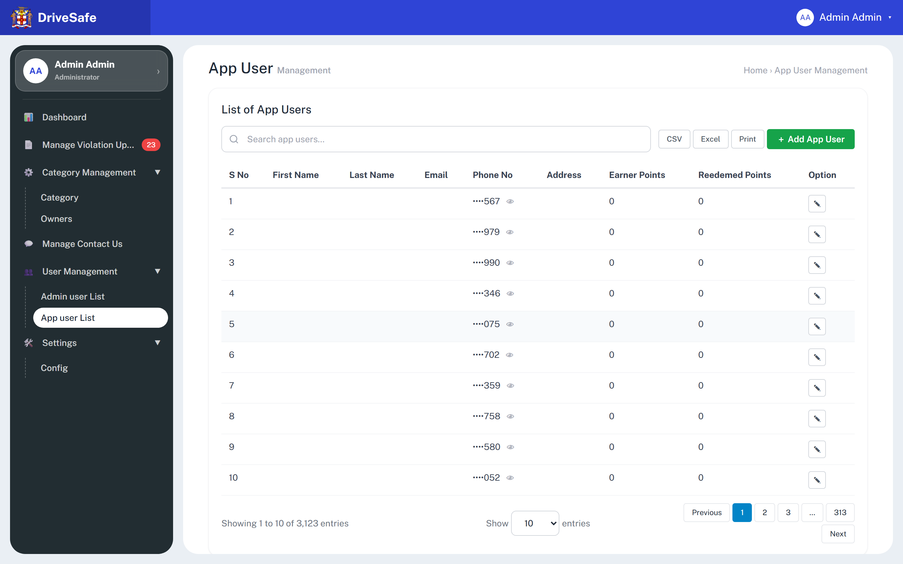
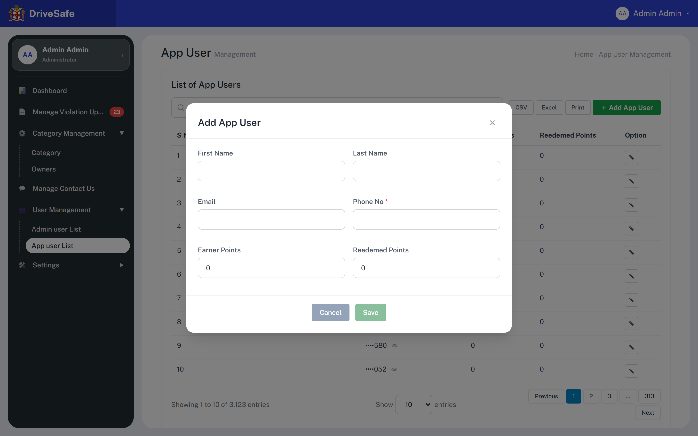
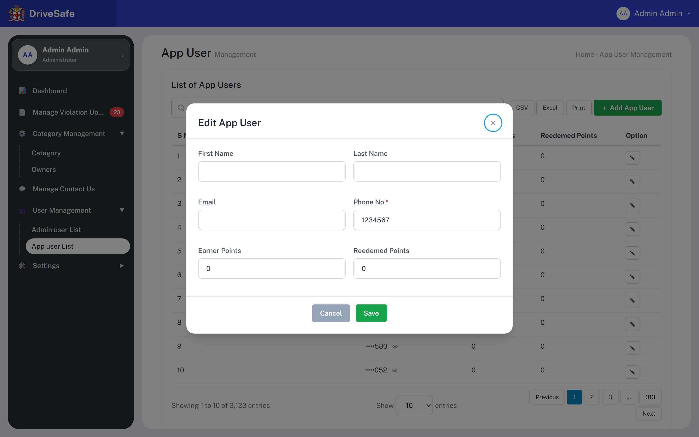

# SCR-21 · App user list (with Add/Edit App User dialog)

## Purpose

Shows the citizens registered in the DriveSafe mobile app (3,123 of them in the prototype data), and lets an Administrator correct a record or add one by hand. App users are the people who report violations and earn reward points; they are not portal staff (see SCR-20). The reader leaves having looked a person up by phone number or adjusted their name, email or points balance.

Source note: the capture flags the eye toggles and the ✎ buttons `wiring: none`; both are wired through delegated listeners (`data-mobile-toggle`, `data-app-edit`). CSV, Excel, Print and the pagination buttons are genuinely unwired.

## Entry and exit

**Reached from:** [SCR-05](../02-violations/SCR-05-dashboard.md) Dashboard tile **App users** (`data-go="appusers"`; its number, 3,123, is hard-coded, see Screen communication); sidebar group "User Management" → "App user List" (`data-go="appusers"`); the group auto-expands and the item is highlighted. (The Violations screen shows a reporter's phone but does not link to the app user).

**Leaves to:** SCR-20 Admin user list (sidebar "Admin user List"); any other sidebar item; SCR-22 My Profile (sidebar profile card or avatar menu → Profile). Leaving with the dialog open discards its input (`go()` closes any modal).

## States

### Populated

`appusers--fold.png` is the same render cropped; not a separate state. Observe what the picture shows: for all ten seed users First Name, Last Name, Email and **Address** are blank, because the seed data holds only a phone number. The **Address** column is a header with no data source at all: the user object has no address, the Add/Edit dialog has no address field, and the cell is always empty (OQ-21-04).

### Add App User dialog

Opened by **＋ Add App User**. Title "Add App User". Only Phone No is required. Points start at 0. **Save is disabled** until Phone No is valid. There is no "Fields marked * are required" note (unlike SCR-20), no Password and no Role. Focus lands on the × button (first focusable element in DOM order), shown with the cyan ring.

### Add App User dialog — "invalid" capture

The tool's "invalid" capture shows no red messages. As on SCR-20, Save is disabled while Phone No is empty or non-digit, so the submit-time error path cannot be reached by mouse; the inline message "Phone No is required." / "Phone No must be digits only." appears when the user blurs Phone No. The only visual difference to the pristine shot is the missing focus ring on ×.

### Edit App User dialog

Opened by ✎ on a row. Title "Edit App User". The Phone No field shows the **full unmasked number** (1234567) although the table masks it. Save is enabled because the stored phone is valid.

### Other states

| State | When | What the user sees |
|---|---|---|
| Populated | 10 loaded rows of 3,123 | As above |
| After Add | a user is saved | New row appended at the **end of the in-memory page** (row 11), footer becomes "Showing 1 to 11 of 3,123 entries" (the total is a constant and is **not** incremented) |
| Search no match | text matches no row | All rows hidden, no message, footer unchanged. Undefined — OQ-21-06 |
| Empty | no users | Not reachable (no delete exists). Undefined — OQ-21-06 |
| Loading / Error | — | None exist; data is a hard-coded array. Undefined — OQ-21-07 |
| Permission denied | — | No role check anywhere. Undefined — OQ-21-02 |
| Phone revealed | 👁 pressed on a row | Cell shows full number, icon turns 🙈, `aria-pressed="true"`, aria-label "Hide full phone number"; revealed state is lost on any re-render (after Add or Edit all rows re-mask) |

### Captures not shown

| Capture | Why it is not embedded |
|---|---|
| `appusers--fold.png` | a crop of the same render as `appusers.png`, embedded above; adds no state |

## State axes

None. No tab, role, scope or URL filter. Per-row mask on/off is a local toggle; Add versus Edit is the dialog's mode.

## Layout

| # | Region | Content |
|---|---|---|
| 1 | Page head | H1 "App User" + grey "Management"; breadcrumb text "Home › App User Management" |
| 2 | Card heading | H2 "List of App Users" |
| 3 | Toolbar | Search box (placeholder "Search app users…"), CSV, Excel, Print, green **＋ Add App User** |
| 4 | Table (declared min width 60 rem; scrolls horizontally inside `.table-wrap`, see Responsive behaviour below) | S No · First Name · Last Name · Email · Phone No · Address · Earner Points · Reedemed Points · Option (spelling "Reedemed" is the prototype's; it appears in the header and the dialog label) |
| 5 | Footer | "Showing 1 to 10 of 3,123 entries" · "Show [10 ▾] entries" (10, 25, 50, 100) · Previous · **1** · 2 · 3 · … · 313 · Next (wraps to two lines at this width: Next drops under) |
| 6 | Dialog | Add/Edit App User |

**Responsive behaviour (measured with Playwright, viewport heights 900)**

Measured content width is 960 px (the 60 rem minimum), so the table scrolls inside `.table-wrap` whenever the container is narrower:

| Viewport width | Sidebar | Table |
|---|---|---|
| 390 | off-canvas | scrolls (container 300 px, content 960 px) |
| 768 | off-canvas | scrolls (646 < 960) |
| 1024 | permanent | scrolls (610 < 960) |
| 1280 | permanent | scrolls (850 < 960) |
| 1380 | permanent | last width measured scrolling (10 px steps) |
| 1390 and wider, incl. 1440 | permanent | fits, no scrollbar (the 1440 px capture shows all nine columns) |

Footer pagination (Previous · 1 · 2 · 3 · … · 313 · Next) wraps onto two lines at 1440 px, with Next dropping beneath, as in `appusers.png`.

## Elements

| Element | Type | Behaviour | Requirement |
|---|---|---|---|
| S No | Cell | Array position + 1, not an id | — |
| First Name, Last Name, Email | Cells | Free text, empty for every seed row | — |
| Phone No | Masked cell | Shows `•` for every digit except the last 3 (`maskMobile`: splits on spaces, masks the last group); 1234567 → `····567`. Eye button beside it toggles reveal | — |
| Address | Cell | Always empty (no source) | derived/invented column, OQ-21-04 |
| Earner Points | Cell | Integer as stored | — |
| Reedemed Points | Cell | Integer as stored | — |
| Entries label | Text | `Showing 1 to {rows loaded} of {3,123} entries` using `toLocaleString()`; total is a fixed constant | — |
| Page numbers 1 2 3 … 313 | Static pagination | 3,123 ÷ 10 = 313 pages; decorative | — |

## Actions

| Control | Type | What happens | Goes to | Who may | Disabled when |
|---|---|---|---|---|---|
| Search app users | Search input | Client-side substring filter on each row's rendered text, across the 10 loaded rows only. Because phones are masked in the text, searching a full phone number finds nothing; only the last 3 digits (or a revealed number) match. Does not search the other 3,113 users | — | any signed-in user (prototype enforces nothing) | — |
| CSV / Excel / Print | Buttons | **Wired to nothing** | — | — | never |
| ＋ Add App User | Button (primary) `data-action="app-add"` | Shows the Add App User dialog, blank, points 0, Save disabled | dialog `app-modal` | any signed-in user (prototype enforces nothing; Administrator-only **PROPOSED**, OQ-21-02) | never |
| 👁 (phone cell) aria-label "Show full phone number" | Toggle `data-mobile-toggle` | Reveals the whole number in that row; second press re-masks; label flips to "Hide full phone number" | — | any signed-in user (prototype enforces nothing) | never |
| ✎ (row) aria-label "Edit app user {full phone}" | Icon button `data-app-edit` | Shows the Edit dialog with that row's values. The aria-label and title contain the **unmasked phone number**, defeating the masking for screen readers and DOM inspection | dialog `app-modal` | any signed-in user (prototype enforces nothing) | never |
| Show [10 ▾] entries | Select 10/25/50/100 | **Wired to nothing** | — | — | never |
| Previous, 1, 2, 3, …, 313, Next | Pagination buttons | **Wired to nothing**; Previous looks enabled although page 1 is current | — | — | never (should be Previous on page 1) |
| × / Cancel / Esc / backdrop | Dismiss | Close the dialog and discard typed input, no confirmation | — | — | never |
| Save | Button (green) `data-action="save-app"` | Re-validates Phone No, builds the user from trimmed text and `Number(points) \|\| 0`, appends (Add) or replaces that array row (Edit), redraws the table, closes the dialog and toasts `App user {phone} added successfully.` or `App user {phone} updated successfully.` (the toast shows the **full phone**) | back to this list | any signed-in user (prototype enforces nothing) | Phone No empty or non-digits (recomputed on every keystroke) |

There is **no Delete, no deactivate/block and no password** for an app user. Whether that is deliberate is OQ-21-03.

**Per-row controls, literal labels (one row per loaded user)**

| Control label | Row | What happens |
|---|---|---|
| Edit app user 1234567 | 1 | Shows the Edit App User dialog for row 1 (same as ✎ above) |
| Edit app user 4822979 | 2 | Shows the Edit App User dialog for row 2 (same as ✎ above) |
| Edit app user 8921990 | 3 | Shows the Edit App User dialog for row 3 (same as ✎ above) |
| Edit app user 7004346 | 4 | Shows the Edit App User dialog for row 4 (same as ✎ above) |
| Edit app user 2377075 | 5 | Shows the Edit App User dialog for row 5 (same as ✎ above) |
| Edit app user 4144702 | 6 | Shows the Edit App User dialog for row 6 (same as ✎ above) |
| Edit app user 2017359 | 7 | Shows the Edit App User dialog for row 7 (same as ✎ above) |
| Edit app user 3994758 | 8 | Shows the Edit App User dialog for row 8 (same as ✎ above) |
| Edit app user 2885580 | 9 | Shows the Edit App User dialog for row 9 (same as ✎ above) |
| Edit app user 5434052 | 10 | Shows the Edit App User dialog for row 10 (same as ✎ above) |

**Wired to nothing**

`capture.json` counts **10** dead controls on this screen: **CSV, Excel, Print, Previous, 1, 2, 3, …, 313, Next**. The "Show [10 ▾] entries" select is also unwired but is a select, not counted by the capture. Previous looks enabled although page 1 is current.

| Control | Verdict | Question |
|---|---|---|
| CSV, Excel, Print | Unbuilt scope (also on SCR-20) — export of citizen phone numbers is a data-protection decision | OQ-21-05 |
| Page-size select, Previous/1/2/3/…/313/Next | Unbuilt; with 3,123 users this is the only way to reach 99.7% of the data | OQ-21-06 |

The eye toggles and ✎ buttons the capture marked dead are wired and are not findings.

## Validation

| Field | Rule | Source | When | Message |
|---|---|---|---|---|
| Search app users | Free text; substring match on the rendered (masked) row text; empty shows all rows; max 100 characters (same PROPOSED list-search limit as SCR-06/10/11/13; see OQ-21-12) | **PROPOSED** (control declares `type="search"` only) | on input | — |
| Show 10 25 50 100 entries | Closed set: 10, 25, 50 or 100, default 10; currently wired to nothing | declared (select options) | on change | — |
| First Name | Optional free text, trimmed; max 60 characters; Unicode letters, space, hyphen, apostrophe | declared (no `data-req`); **PROPOSED** for max 60 | blur | **PROPOSED** "First Name must be 60 characters or fewer." |
| Last Name | Optional, trimmed; max 60, same set | declared; **PROPOSED** for max 60 | blur | **PROPOSED** "Last Name must be 60 characters or fewer." |
| Email | Optional; if present must match `^\S+@\S+\.\S+$` (`type="email"`). **Checked on blur only: not on Save and not in the Save-enabled test** (the field carries none of `data-req`/`data-pattern`/`data-min`, which both checks scan), so an invalid email can be saved after the message appears (defect, OQ-21-08). Max 254 characters; unique among app users, case-insensitive (server-side) | declared (regex, blur behaviour); **PROPOSED** for max and uniqueness | blur only | "Please enter a valid email address." / **PROPOSED** "Email must be 254 characters or fewer." / **PROPOSED** "An app user with this email already exists." |
| Phone No | Required (trimmed); digits only `^[0-9]+$` (`inputmode="numeric"`). Min 7, max 15 digits (seed values are all 7 digits; the masking function assumes at least 4). Unique among app users (the de facto identifier; the Edit button is labelled by it; server-side) | declared (`data-req`, `data-pattern="digits"`); **PROPOSED** for 7–15 and uniqueness | blur; Save-enabled | "Phone No is required." / "Phone No must be digits only." / **PROPOSED** "Phone No must be 7 to 15 digits." / **PROPOSED** "That phone number is already registered." (OQ-21-09) |
| Earner Points | Whole number, minimum 0 (declared), default 0; maximum 1,000,000 and integers only (no decimals). Empty or non-numeric saves as 0 (`Number(v) \|\| 0`) | declared (`type="number" min="0"`, fallback); **PROPOSED** for the maximum and integer rule | native spinner only (declared); on change (proposed) | **PROPOSED** "Enter a whole number from 0 to 1,000,000." |
| Reedemed Points | Whole number, minimum 0 (declared), default 0; maximum 1,000,000; must not exceed Earner Points | declared (`min="0"`); **PROPOSED** for maximum and the cross-field rule | native spinner only (declared); on change/save (proposed) | **PROPOSED** "Redeemed points cannot exceed earned points." |

All text inputs: `<` and `>` are stripped as typed, silently. Declared (global listener); applies to every text field above.

Note on the declared `min="0"`: the inputs are not inside a `<form>`, so the browser never enforces `min` on Save, and `Number("-5")` passes through. A negative balance can be saved. The PROPOSED rule above is what closes it.

**Cross-field**

- Redeemed Points ≤ Earner Points — **PROPOSED**; the prototype never relates them (OQ-21-10). Owner of the points economy: unassigned; the Violations review modal says Verified "credits reward points to the reporter (concept)" but no number is defined anywhere.

**Server-side only**

- Phone/email uniqueness, SMS ownership verification, and audit of manual point edits. Client rules are a courtesy only.

**Unruled and undecided**

| Field | What is missing | Open question |
|---|---|---|
| Earner / Reedemed Points | Whether an admin may edit points at all (they are normally derived from verified reports and redemptions) | OQ-21-10 |
| Address | Column with no field or data | OQ-21-04 |

## Screen communication

| Direction | With | What passes | Contract |
|---|---|---|---|
| Receives | Mobile app / violation reports (not in prototype) | App users register themselves; points rise when a report is Verified | Not built; OQ-21-10 |
| Shares | Violations list and Review modal | A violation's Mobile (e.g. `+1 876 3125290`, masked the same way with the same eye toggle via the shared `maskMobile`/`mobileCell` helpers) is the reporter's app-user phone. **Formats differ**: here digits only (`1234567`), there `+1 876 …` with spaces; no link between the two | Owner: none. If formats must match, a rule is needed (OQ-21-09) |
| Shares | Masking rule (last 3 digits visible) | Same helper as the Violations Mobile column | Owner: Violations story; changes there change this screen |
| Shares | SCR-20 | Nothing: separate arrays, separate people | — |
| Sends | Toast | Full phone number in the success text | Conflicts with the masking intent |
| Breaks if changed | `APP_USERS` field names | Only this screen reads them |  |
| Shares | SCR-05 Dashboard tile "App users" | The tile shows a hard-coded 3,123: equal to `APP_USERS_TOTAL` but a separate literal in markup, and not updated by Add here (nor is this screen's own footer total) | Owner: unowned (OQ-V-07); a fix needs one server count read by both |

## Acceptance criteria

**ST-SCR-21-01 — List shows 10 of 3,123**
- Given I open App user List
- When the page loads
- Then 10 rows show with S No 1 to 10, phones `····567`, `····979`, `····990`, `····346`, `····075`, `····702`, `····359`, `····758`, `····580`, `····052`
- And the footer reads "Showing 1 to 10 of 3,123 entries" and every Earner and Reedemed cell reads 0

**ST-SCR-21-02 — Reveal and re-mask a phone**
- Given row 1 shows `····567`
- When I press its eye icon
- Then the cell reads 1234567 and the icon's label becomes "Hide full phone number"
- And pressing again returns `····567`

**ST-SCR-21-03 — Add dialog opens with Save disabled**
- Given I press ＋ Add App User
- When the dialog appears
- Then the title is "Add App User", Earner and Reedemed Points read 0, Phone No is empty and Save is disabled

**ST-SCR-21-04 — Phone must be digits**
- Given the Add dialog is open
- When I type "12ab" into Phone No and tab away
- Then "Phone No must be digits only." shows beneath it and Save stays disabled
- And replacing it with "8761234567" clears the message and enables Save

**ST-SCR-21-05 — Add an app user**
- Given the Add dialog holds Phone "8761234567", First "Ann", Last "Lee"
- When I press Save
- Then the dialog closes, an 11th row appears with the phone masked `•••••••567` (seven dots for the ten digits, last three visible), and a toast reads "App user 8761234567 added successfully."
- And the footer reads "Showing 1 to 11 of 3,123 entries"

**ST-SCR-21-06 — Edit shows the unmasked phone**
- Given I press ✎ on row 1
- When the dialog opens
- Then the title is "Edit App User", Phone No holds 1234567 and Save is enabled

**ST-SCR-21-07 — Edit points**
- Given the Edit dialog for row 1 is open
- When I set Earner Points to 50 and press Save
- Then row 1 shows Earner Points 50 and the toast reads "App user 1234567 updated successfully."
- And every row's phone is masked again

**ST-SCR-21-08 — Search matches on visible text only**
- Given the list is shown
- When I type "567" into Search app users
- Then only row 1 stays visible
- And typing "1234567" shows no rows, because the text on screen is `····567`

**ST-SCR-21-09 — Dead controls do nothing**
- Given the list is shown
- When I press CSV, Excel, Print, page 2 or change "Show" to 50
- Then nothing changes on screen (prototype behaviour to be replaced, see OQ-21-05, OQ-21-06)

## Data

- **Reads:** `APP_USERS[]` — firstName, lastName, email, phone (digit string), earnerPoints, redeemedPoints; `APP_USERS_TOTAL = 3123` (a constant standing in for a server count). Production: one page per request, with total count.
- **Writes:** Add appends; Edit replaces the object at the array index. Not persisted; reload restores seeds. The total is never updated.
- **Services required:** paged, searchable app-user API (server-side search on the unmasked phone); unmasking policy and audit; export if wanted.

## Accessibility and keyboard

- Dialog `role="dialog"`, `aria-modal`, `aria-labelledby` the title; initial focus the × button; Esc/backdrop close without returning focus; × and Cancel return focus to the opener; no focus trap.
- **Focus after Save.** Add-Save: focus returns to the static **＋ Add App User** button (verified on the running prototype: `BUTTON app-add`). Edit-Save: the table is re-rendered before the dialog closes, so the recorded opener (the row's ✎) is detached and focus is lost to `BODY` (verified: `BODY`). Build: restore focus to the same row's ✎ (OQ-21-13).
- Phone No is `aria-required` with `aria-describedby` to an error paragraph. First Name, Last Name, Earner and Reedemed have no error element at all. Email has one.
- Eye toggle has `aria-pressed` and a dynamic aria-label; the ✎ label embeds the full phone (privacy finding).
- Table `sr-only` caption "App users". Pagination `nav aria-label="Pagination"`, current page has `aria-current="page"`.
- Toast `role="status"` through the live region.

## Open questions

| ID | Question | Affects | Why it matters |
|---|---|---|---|
| OQ-21-01 | No spec: what is an app user's full record (the live portal shows name, email, phone, address, points)? Which fields come from the app and which may admins edit? | whole screen | Prototype seeds hold only phone numbers |
| OQ-21-02 | Which roles may view or edit app users (Violation manager too)? | access | No role check exists |
| OQ-21-03 | Why is there no Delete, block or deactivate? Are admin-created app users meant to exist? Data-subject erasure requests need a path | actions | Absence is either scope or an omission |
| OQ-21-04 | The Address column has no field and no data. Remove it, or add the field to the dialog and the record? | table, dialog | A permanently empty column |
| OQ-21-05 | Are CSV/Excel/Print wanted for citizen phone numbers, and who may unmask? | toolbar | Dead buttons today; building them creates a PII export |
| OQ-21-06 | Real paging, page-size options and search over 3,123 users (search currently covers 10 rows and cannot match masked phones). Empty/no-match messages? | footer, search | Without it 99.7% of the users are unreachable |
| OQ-21-07 | Loading and error states for list and save? | all | The prototype cannot fail |
| OQ-21-08 | Email is validated on blur but not on Save. Intended? Should Email be required? | Email | Invalid emails can be stored |
| OQ-21-09 | Phone format: digits only here, `+1 876 …` on Violations. Country code rule, uniqueness, and is phone the identifier? | Phone, SCR Violations | The same person appears in two formats |
| OQ-21-10 | May admins edit points? Max points? Must redeemed be ≤ earned? How are points awarded when a report is Verified (and how many)? | points fields | Points are money-like; negatives and decimals can be saved today |
| OQ-21-11 | The ✎ aria-label and the success toast reveal the full phone number although the table masks it. Intentional? | privacy | Masking is defeated |
| OQ-21-12 | Maximum length of the list Search box: SCR-06/10/11/13 propose 100 and this story uses the same 100 (the source states none). Who owns one product-wide value? | Search | Identical controls with different limits make the data dictionary show a conflict |
| OQ-21-13 | Focus is lost to BODY after Edit-Save. Return focus to the row's ✎ (or the row)? | Dialog | Keyboard and screen-reader users lose their place in a 3,123-row list |
