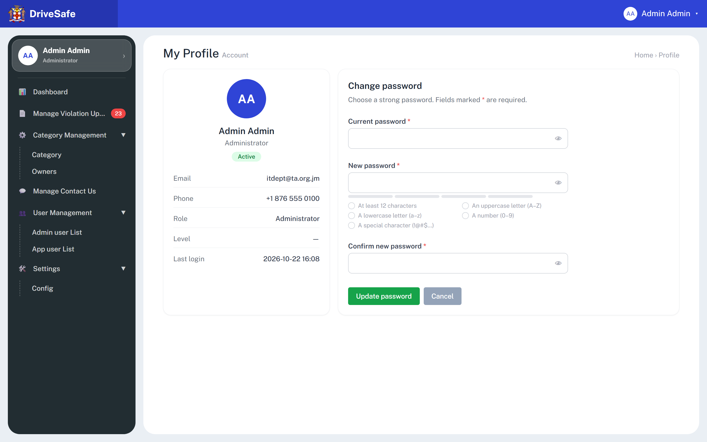
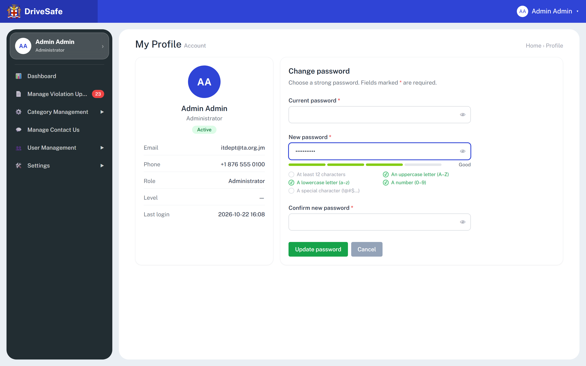
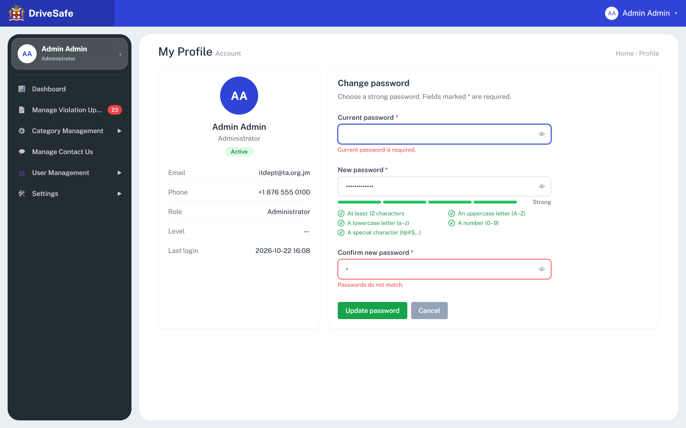
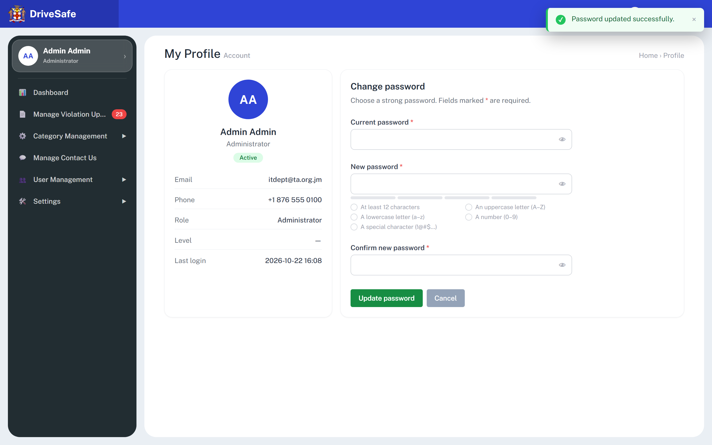
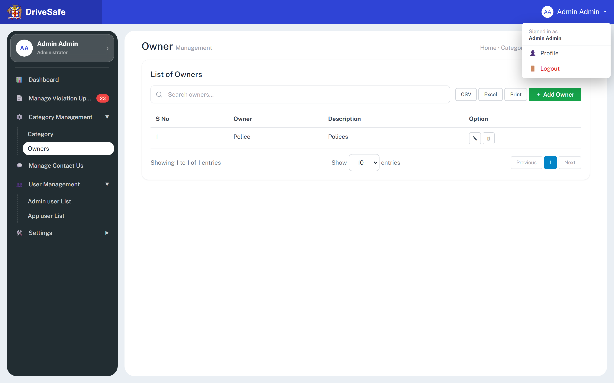

# SCR-22 · My Profile and Change password

> The states below the default one (partial password, errors, success) were driven by the analyst on the running prototype with the real controls, 1440×900 at 2× scale; they are supplementary to the manifest capture `profile.png`.

## Purpose

Shows the signed-in portal user their own account summary and lets them change their own password. It is the only self-service screen in the portal. The user opens it from the sidebar profile card or the avatar menu, and leaves either with a new password accepted (toast) or unchanged.

## Entry and exit

**Reached from:** (a) the avatar button in the header ("Admin Admin ▾") opens a menu; its item **Profile** (`data-action="profile"`) closes the menu and shows this screen; (b) the profile card at the top of the sidebar (`title="Open my profile"`, shows "Admin Admin / Administrator ›") — same action. The shell, not this story, owns both. No sidebar nav item is highlighted while here (`NAV_MAP` has no `profile`), and the sidebar submenus collapse state is left as it was.

**Leaves to:** SCR Dashboard via **Cancel** (`data-go="dashboard"`); any sidebar item; **Logout** in the avatar menu opens the shell's sign-out confirmation (see `modal-logout.png`, owned by the shell story). There is no Back link and no "Edit profile".

## States

### Default (fields empty)

Every time the screen is entered, `resetChangePassword()` clears the three fields, makes them masked, clears errors, resets the eye toggles and redraws the checklist unticked. Typed-but-unsaved input is therefore lost if the user navigates away and back.

### Typing a new password — partial

The checklist and meter update on every keystroke in New password (`#cp-new`). "Abcdefghij1" is 11 characters with upper, lower and digit: three of five rules met, label "Good", three segments lime.

### Validation errors

Pressing **Update password** validates all three fields at once, shows every error simultaneously, and focuses the first invalid field (the blue ring on Current password). Errors clear per field as soon as the user types in that field.

### Success

On success the fields reset and the toast "Password updated successfully." appears (3.5 s, dismissible ×, `role="status"`). The user stays on this screen; they are **not** signed out and no other session is affected.

### Account menu that leads here

This capture is of the shell menu (over a different screen); it is embedded because it is the entry control.

### Captures not shown

| Capture | Why it is not embedded |
|---|---|
| `profile--fold.png` | a crop of the same render as `profile.png`, embedded above as the default state; adds no state |

### Other states

| State | When | What the user sees |
|---|---|---|
| Populated | always | The details card is hard-coded text: nothing is read from data |
| Empty / loading / error (load) | n/a | None exist. Undefined — OQ-22-02 |
| Save failure | wrong current password, network | Cannot occur: the current password is never checked. Undefined — OQ-22-03 |
| Permission denied | n/a | Every role sees the same hard-coded "Admin Admin / Administrator". Undefined — OQ-22-02 |

## State axes

None. (The details card would differ by role and Level in production; the prototype renders one fixed person.)

## Layout

| # | Region | Content |
|---|---|---|
| 1 | Page head | H1 "My Profile" + grey "Account"; breadcrumb text "Home › Profile" |
| 2 | Details card (measured: stacked above the form at 390 and 768 px; side by side from 1024 px, where it is 207 px wide against 429 px for the form, 287/589 at 1280, 340/696 at 1440) | Blue circle "AA" (80 px); name "Admin Admin"; "Administrator"; green pill "Active"; definition rows Email `itdept@ta.org.jm`, Phone `+1 876 555 0100`, Role `Administrator`, Level `—`, Last login `2026-10-22 16:08` |
| 3 | Change password card (two thirds) | H2 "Change password"; line "Choose a strong password. Fields marked * are required."; form max width 28 rem: Current password, New password (with meter and checklist), Confirm new password; buttons **Update password** (green) and **Cancel** (grey) |

## Elements

| Element | Type | Behaviour | Requirement |
|---|---|---|---|
| Avatar "AA" | Static | Initials hard-coded | — |
| Name, role, "Active" pill | Static | Hard-coded; "Active" is the only status value ever shown, no other exists | — |
| Email, Phone, Role, Level, Last login | Read-only text | Hard-coded. **Do not match** the signed-in identity's row in SCR-20 (there is none) or any seed user. Level `—` means blank. Last login is a fixed string, not updated by login | OQ-22-02 |
| Strength meter | 4 segments (`aria-hidden`) | 1 segment red, 2 amber, 3 lime, 4 green; segments lit = rules met capped at 4 | — |
| Strength label | Text, `aria-live="polite"` | "" / Very weak / Weak / Fair / Good / Strong, as SCR-20 | — |
| Rules checklist | List of 5 | Same five rules and tick styling as SCR-20 | — |
| "Maximum 128 characters." | Red hint | Shown only when the New password is longer than 128 | — |
| Inline errors | Red `
` under each field | Described in Validation | — |
| Toast | Overlay | "Password updated successfully." | — |

## Actions

| Control | Type | What happens | Goes to | Who may | Disabled when |
|---|---|---|---|---|---|
| Avatar menu → Profile | Menu item | Closes the menu and displays this screen with cleared fields | this screen | any signed-in user | never |
| Sidebar profile card | Button | Same as above, no menu | this screen | any signed-in user | never |
| 👁 / 🙈 on Current, New, Confirm | Toggle buttons `data-pw-toggle`, aria-label "Show password" / "Hide password", `aria-pressed` | Swaps that one field between masked and plain text. Reset to masked every time the screen is entered or a save succeeds | — | any | never |
| Update password | Button (green) `data-action="save-change-password"` | Runs the validation below. If all pass: clears all fields, resets toggles and checklist, shows the toast. **Nothing is sent or stored**: no current-password check, no new-password store, no sign-out of other sessions, no email notice | stays here | any signed-in user, own account only | never (always pressable). Exercised on the running prototype (Playwright): with valid Current, New and Confirm values, pressing Enter in Confirm shows the toast "Password updated successfully." and clears the fields; with Current empty and New "abc", pressing Enter in Current shows "Current password is required." and, under New password, "Password does not meet all the requirements.". The untyped button is the form's default submit button, so Enter fires the same handler as a click; the `onsubmit="return false"` form never navigates |
| Cancel | Button (grey) `data-go="dashboard"` | Leaves for the dashboard; typed values are not saved and are wiped on the next entry | Dashboard | any | never |

No dead controls on this screen. 

## Validation

Messages are exact strings from `saveChangePassword()`. Timing: **on submit only**; unlike SCR-20 there is no on-blur validation here (the `focusout` handler only checks `data-req` / `data-pattern` / `data-min` / `type=email`, none of which these inputs carry). Errors clear on typing in that field.

| Field | Rule | Source | When | Message |
|---|---|---|---|---|
| Current password (`cp-current`) | Required (truthy value; **not trimmed**, so a single space passes) | declared (code) | Update | "Current password is required." |
| Current password | Must equal the account's existing password; locked out after N failed attempts | **PROPOSED**, server-side only (prototype never checks) | Update | "Current password is incorrect." |
| Current password | Max 128 characters (no point accepting more than a new password can be) | **PROPOSED** | on input | none (silently capped) |
| New password (`cp-new`) | Required | declared | Update | "New password is required." |
| New password | Min 12 characters | declared (`PASSWORD_MIN`) | live checklist; Update | row "At least 12 characters"; on submit "Password does not meet all the requirements." |
| New password | Max 128 characters | declared (`PASSWORD_MAX`; "Maximum 128 characters." hint) | live; Update | hint, then "Password does not meet all the requirements." |
| New password | At least one of each: uppercase A–Z, lowercase a–z, digit 0–9, and a symbol from `! @ # $ % ^ & * ( ) _ + - = [ ] { } \| ; ' : " , . < > ?` (ASCII only; space, `~`, `` ` ``, `/`, `\` do not count; the UI says only "(!@#$…)") | declared (`PASSWORD_RULES`) | live; Update | as above |
| New password | Must differ from Current password (exact string compare) | declared | Update, only after all other fields pass | "New password must be different from the current one." (shown under New password) |
| New password | Must not contain the user's name or email; not in a common/breached list; not equal to the last N passwords; maximum age / expiry | **PROPOSED** (not built) | Update, server-side | OQ-22-04 |
| Confirm new password (`cp-confirm`) | Required | declared | Update | "Please confirm your new password." |
| Confirm new password | Must equal New password exactly | declared | Update | "Passwords do not match." |
| All three | Inputs are `type=password` with `autocomplete` `current-password` / `new-password` / `new-password` (password managers supported). `<`/`>` stripping does **not** apply to password inputs | declared | — | — |

**Cross-field**

- New ≠ Current and Confirm = New, as above; order of evaluation: required checks and policy and match first, difference check last (so a user who types identical current and new passwords that also fail the policy sees the policy error, not the difference error).
- The five rules and the 12–128 limits are **the same constants as SCR-20's password**. Owner of the policy: SCR-20 story (defined once in code, `PASSWORD_RULES`). Login and Forgot-password flows apply no policy (they accept any 6-digit code and take no password).

**Server-side only**

- Verification of the current password, hashing, history, breach checks, session invalidation, rate limiting, notification email. Client rules are a courtesy.

**Unruled and undecided**

| Field | What is missing | Open question |
|---|---|---|
| Password expiry and history | No policy stated | OQ-22-04 |
| Profile details | No edit capability; may a user change their own phone/email? | OQ-22-02 |

## Screen communication

| Direction | With | What passes | Contract |
|---|---|---|---|
| Receives | Shell avatar menu / sidebar card | The user's intent to see their own profile; **no identity is passed** | The displayed person is hard-coded; OQ-22-02 |
| Shares | SCR-20 password policy | Constants for length, character classes, strength labels and checklist | Owner SCR-20; both must change together |
| Shares | SCR-20 user records | Profile's email `itdept@ta.org.jm`, phone `+1 876 555 0100` and Level `—` do not exist in SCR-20's list | Unowned seam, OQ-22-02 |
| Shares | Shell | Header and sidebar show "Admin Admin / Administrator" — also hard-coded | Owned by shell |
| Sends | Dashboard | Nothing (Cancel) | — |
| Sends | Toast / live region | "Password updated successfully." | Shell |
| Breaks if changed | Login/Forgot password | Not coupled; a new policy would not apply to the forgot-password reset, which sets no password in the prototype | OQ-22-05 |

## Acceptance criteria

**ST-SCR-22-01 — Open Profile from the avatar menu**
- Given I am signed in on any screen
- When I press the "Admin Admin ▾" avatar and choose Profile
- Then My Profile shows with Email itdept@ta.org.jm, Phone +1 876 555 0100, Role Administrator, Level — and Last login 2026-10-22 16:08
- And the three password fields are empty and masked

**ST-SCR-22-02 — Checklist follows typing**
- Given I am on My Profile
- When I type "Abcdefghij1" into New password
- Then "An uppercase letter", "A lowercase letter" and "A number" are ticked green, "At least 12 characters" and "A special character" are not
- And the label reads "Good"

**ST-SCR-22-03 — Strong password lights everything**
- Given I am on My Profile
- When I type "Abcdefghijk1!" into New password
- Then all five rules are ticked, four segments are green and the label reads "Strong"

**ST-SCR-22-04 — Submit with problems shows all errors**
- Given Current password is empty, New password is "Abcdefghijk1!" and Confirm is "x"
- When I press Update password
- Then "Current password is required." shows under Current password and "Passwords do not match." under Confirm
- And focus moves to Current password and no toast appears

**ST-SCR-22-05 — Weak new password rejected**
- Given Current "OldPassw0rd!x", New "abc", Confirm "abc"
- When I press Update password
- Then "Password does not meet all the requirements." shows under New password and the fields keep their values

**ST-SCR-22-06 — New must differ from current**
- Given Current, New and Confirm all hold "Abcdefghijk1!"
- When I press Update password
- Then "New password must be different from the current one." shows under New password

**ST-SCR-22-07 — Successful change**
- Given Current "OldPassw0rd!x", New "Abcdefghijk1!", Confirm "Abcdefghijk1!"
- When I press Update password
- Then all three fields empty, the checklist returns to unticked, and a toast reads "Password updated successfully."
- And I remain on My Profile, still signed in

**ST-SCR-22-08 — Reveal toggle is per field**
- Given I am on My Profile
- When I press the eye in New password
- Then only New password shows plain text and its label reads "Hide password"; the other two stay masked

**ST-SCR-22-09 — Cancel leaves without saving**
- Given I typed a value in New password
- When I press Cancel
- Then the Dashboard shows, and re-opening Profile shows empty fields

## Data

- **Reads:** nothing; every value on the details card is a literal in `index.html` (name, role, status, email, phone, level, last login). Production: the signed-in user's account record.
- **Writes:** none. Success only resets the form and toasts.
- **Services required:** authenticated "change own password" endpoint (current + new), password hashing and policy, session handling after change, audit log, notification email.

## Accessibility and keyboard

- Each input has a `<label for>` and `aria-describedby` to its error `
`; errors set `aria-invalid="true"`; first invalid field is focused on failed submit. Errors are not in an `aria-live` region.
- Eye toggles have `aria-label` and `aria-pressed`. They are `type=button` and sit inside the input's relative box, reachable by Tab right after the field.
- Strength label is `aria-live="polite"`; meter is `aria-hidden`; the checklist has no live announcement.
- Enter in any of the three fields runs Update password (verified on the running prototype). Esc does nothing on this screen except close the open account menu.
- Toast `role="status"` through the live region. No hover-only controls.

## Open questions

| ID | Question | Affects | Why it matters |
|---|---|---|---|
| OQ-22-01 | No spec: is Profile intended to be read-only plus password change only, or should users edit name, phone and email? | whole screen | Any edit capability needs fields, validation and an audit story that do not exist |
| OQ-22-02 | Where do the displayed values come from? The details are hard-coded and match no row in SCR-20 (the person "Admin Admin" is not in the 8 seed users). What are the real source, the "Active" states, and what is "Last login" (UTC or local)? | details card, header, sidebar | Three places show the same hard-coded identity |
| OQ-22-03 | Failure states: wrong current password, lockout after repeated failures, network error, session expiry mid-submit | Update password | The prototype cannot fail, so no failure UI is designed |
| OQ-22-04 | Password policy: confirm 12–128 and five classes; add history, expiry, breached-list, no-name rules? Is the symbol set the stated one, and should non-ASCII letters count? | New password, SCR-20 | A policy in only the client is not a policy; the user sees a symbol list they cannot read in full |
| OQ-22-05 | Forgot-password and login set no password in the prototype. Does the same policy apply to reset? Is a new password forced on first login for accounts created in SCR-20? | auth flow, SCR-20 | A reset path that skips the policy undermines it |
| OQ-22-06 | The extra states (partial password, errors, success) are analyst re-captures not listed in `capture.json`; add them to the manifest or accept them as supplementary | capture set | Automated screenshot checks cannot trace them |
| OQ-22-07 | Should success sign other sessions out and send a notification email? Enter submits the form (verified); confirm that is intended | Update password | Security hygiene; a failed Enter submit gives errors with no toast |
