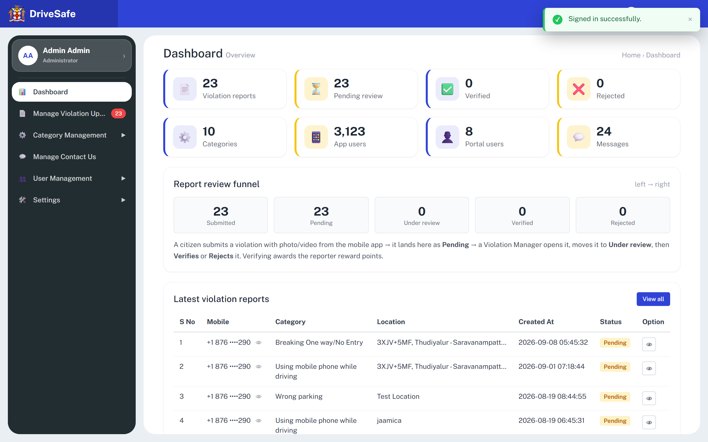

# SCR-05 · Dashboard

## Purpose
Landing screen after sign-in. Gives a portal user the headline counts, explains the review lifecycle, and shows the five newest violation reports so a reviewer can jump straight into one.

## Entry and exit
**Reached from:** SCR-02 OTP (login mode) **Verify**; sidebar **Dashboard** (highlighted when active); the Dashboard link target is also the breadcrumb "Home › Dashboard" (plain text, not a link).

**Leaves to:** SCR-06 Violations list via tiles Violation reports, Pending review, Verified, Rejected and via **View all**; [SCR-10](../03-catalogue/SCR-10-category-list.md) via tile Categories; [SCR-21](../05-users/SCR-21-app-user-list.md) via tile App users; [SCR-20](../05-users/SCR-20-admin-user-list.md) via tile Portal users; [SCR-13](../04-contact/SCR-13-contact-us.md) via tile Messages; SCR-07 Review modal via a row's eye-in-box button.

## States
### Populated (only state captured, 1440 px)

| State | When | What the user sees |
|---|---|---|
| Populated | Always in the prototype | Figures as in the capture; a toast "Signed in successfully." from the login for 3.5 s |
| Empty | Zero violations | **Undefined, OQ-V-01**: table body would be blank, tiles 0, pending badge hidden |
| Loading | Counts in flight | **Undefined, OQ-V-02** |
| Error | Counts fail | **Undefined, OQ-V-02** |
| Permission denied | Role lacks access | **Undefined, OQ-V-03**; both roles see the same screen |

The grid has 4 columns at lg, 2 on narrow screens and 8 columns at 2560 px; tile row wraps accordingly. The capture's `--fold` crop is the same render and is not shown separately.

## Layout
| # | Region | Content |
|---|---|---|
| 1 | Page head | "Dashboard" + "Overview"; breadcrumb "Home › Dashboard" |
| 2 | KPI grid | Eight tiles, alternating blue / yellow left border |
| 3 | Card "Report review funnel" | Five boxes Submitted, Pending, Under review, Verified, Rejected; hint "left → right"; explanatory paragraph |
| 4 | Card "Latest violation reports" | "View all" button; 7-column table of 5 rows |

## Elements
| Element | Type | Behaviour | Requirement |
|---|---|---|---|
| Tile **Violation reports** 23 | KPI link `#k-total` | Value = `VIOLATIONS_TOTAL` (23, from the live portal) | none |
| Tile **Pending review** 23 | KPI link `#k-pending` | = Pending rows among the 10 loaded + (23 − 10) rows not loaded, which are assumed Pending | none |
| Tile **Verified** 0 | KPI link `#k-verified` | Count of Verified among the 10 loaded rows only | none |
| Tile **Rejected** 0 | KPI link `#k-rejected` | Count of Rejected among the 10 loaded rows only | none |
| Tile **Categories** 10 | KPI link | Hard-coded 10 (matches data.js category count today but does not update on add or delete) | none |
| Tile **App users** 3,123 | KPI link | Hard-coded; equals `APP_USERS_TOTAL` | none |
| Tile **Portal users** 8 | KPI link | Hard-coded 8; does not update on add or delete | none |
| Tile **Messages** 24 | KPI link | Hard-coded; equals `CONTACTS_TOTAL` | none |
| Funnel **Submitted** 23 | Box `#f-sub` | = total | none |
| Funnel **Pending** 23 | Box `#f-pend` | Same as Pending tile | none |
| Funnel **Under review** 0 | Box `#f-rev` | Under review among loaded 10 | none |
| Funnel **Verified** 0 | Box `#f-ver` | As tile | none |
| Funnel **Rejected** 0 | Box `#f-rej` | As tile | none |
| Funnel paragraph | Text | "A citizen submits a violation with photo/video from the mobile app → it lands here as **Pending** → a Violation Manager opens it, moves it to **Under review**, then **Verifies** or **Rejects** it. Verifying awards the reporter reward points." | none |
| Table columns | Header | S No · Mobile · Category · Location · Created At · Status · Option | none |
| Status chip | Badge | Pending amber, Under review sky blue, Verified green, Rejected red | none |
| Location cell | Text | Truncated with ellipsis at 18 rem | none |
| Mobile cell | Masked text | Area code kept, last 3 digits kept, rest dots, e.g. "+1 876 ····290" | none |
| Sidebar badge (shell) | Red pill on Manage Violation Uploads | Same number as Pending tile; hidden at 0 | none |

Rows listed (S No 1-5): the five latest by array order: 1 Breaking One way/No Entry 2026-09-08 05:45:32; 2 Using mobile phone while driving 2026-09-01 07:18:44; 3 Wrong parking 2026-08-19 08:44:55; 4 Using mobile phone while driving 2026-08-19 06:45:31; 5 Using mobile phone while driving 2026-08-19 06:44:37. All Pending, all mobile +1 876 3125290.

## Actions
| Control | Type | What happens | Goes to | Who may | Disabled when |
|---|---|---|---|---|---|
| Tile Violation reports | Link (`data-go`) | Switches to the violations list, no filter carried | SCR-06 | any signed-in user (prototype enforces nothing; Administrator-only is PROPOSED, OQ-A-27) | never |
| Tile Pending review | Link | Same as above; does **not** pre-filter by Pending (there is no status filter on SCR-06), OQ-V-04 | SCR-06 | any signed-in user (prototype enforces nothing; Administrator-only is PROPOSED, OQ-A-27) | never |
| Tile Verified | Link | Same; no filter carried | SCR-06 | any signed-in user (prototype enforces nothing; Administrator-only is PROPOSED, OQ-A-27) | never |
| Tile Rejected | Link | Same; no filter carried | SCR-06 | any signed-in user (prototype enforces nothing; Administrator-only is PROPOSED, OQ-A-27) | never |
| Tile Categories | Link | Switches to the Category list and expands the sidebar Category Management group | [SCR-10](../03-catalogue/SCR-10-category-list.md) Category list | any signed-in user (prototype enforces nothing; Administrator-only is PROPOSED, OQ-A-27) | never |
| Tile App users | Link | Switches to App user List, expanding User Management | [SCR-21](../05-users/SCR-21-app-user-list.md) App user List | any signed-in user (prototype enforces nothing; Administrator-only is PROPOSED, OQ-A-27) | never |
| Tile Portal users | Link | Switches to Admin user List | [SCR-20](../05-users/SCR-20-admin-user-list.md) Admin user List | any signed-in user (prototype enforces nothing; Administrator-only is PROPOSED, OQ-A-27) | never |
| Tile Messages | Link | Switches to Manage Contact Us | [SCR-13](../04-contact/SCR-13-contact-us.md) Manage Contact Us | any signed-in user (prototype enforces nothing; Administrator-only is PROPOSED, OQ-A-27) | never |
| View all | Button | Switches to the violations list | SCR-06 | any signed-in user (prototype enforces nothing; Administrator-only is PROPOSED, OQ-A-27) | never |
| 👁 beside a mobile number (`aria-label` "Show full phone number") | Icon toggle | Replaces the masked number with the full number in that row and flips its label to "Hide full phone number" and icon to 🙈; press again to mask. Per row, in-place, not persisted, not audited | — | any signed-in user (prototype enforces nothing; Administrator-only is PROPOSED, OQ-A-27) | never |
| 👁 in Option column (`aria-label` "Review report 1" through "Review report 5", one per row) | Icon button | Shows the Review modal for that report | SCR-07 | any signed-in user (prototype enforces nothing; Administrator-only is PROPOSED, OQ-A-27) | never |
| Sidebar, header, account menu | Shell | See SCR-04 | — | — | — |

**Exact tile labels as captured** (the label is icon + number + caption): "📄 23 Violation reports", "⏳ 23 Pending review", "✅ 0 Verified", "❌ 0 Rejected", "⚙️ 10 Categories", "📱 3,123 App users", "👤 8 Portal users", "💬 24 Messages". Each is one link, destinations as in the table above.

**Wired to nothing**
The current `capture.json` reports **0** dead controls on this screen. The capture script was patched to treat delegated `data-*` handlers as wired (see `tools/CAPTURE-PATCHES.md`); the first capture had marked 10 controls dead: five "Show full phone number" and the five review buttons "Review report 1", "Review report 2", "Review report 3", "Review report 4", "Review report 5". They are wired by one delegated `document` click listener keyed on `data-mobile-toggle` and `data-review`, confirmed in app.js `bind()`, so no genuinely dead control exists on this screen. Note instead that the four status tiles all go to the same unfiltered list, see OQ-V-04.

## Validation
No inputs on this screen; the only controls are links, buttons and toggles.

| Field | Rule | Source | When | Message |
|---|---|---|---|---|
| (none) | No input fields | n/a | n/a | n/a |
| Latest reports | Exactly 5 rows, newest Created At first | **PROPOSED** (prototype takes the first 5 array items), OQ-V-06 | on load | — |

**Cross-field:** Pending + Under review + Verified + Rejected should equal Submitted. As built they do: Pending absorbs the 13 not-loaded rows. This is a coincidence of the assumption, see OQ-V-05.

**Server-side only:** all counts. The client must not compute them from one loaded page.

**Unruled and undecided:** time window for "Latest" (prototype uses first 5 array items, which happen to be descending by Created At; sort order is not declared), OQ-V-06.

## Screen communication
| Direction | With | What passes | Contract |
|---|---|---|---|
| Receives | SCR-07 Review modal | Saving a review re-renders both tables and recalculates Pending/Verified/Rejected tiles, funnel and sidebar badge in-place | Owner of status values and counts: SCR-06/SCR-07 |
| Receives | SCR-10 Category list | None. Dashboard rows show the report's own category string and no Owner column; SCR-10 changes affect only SCR-06's derived Category Owner column | — |
| Sends | SCR-06 | Navigation only | — |
| Sends | SCR-07 | Report id in `data-review` | `id` integer |
| Shares | Sidebar pending badge | Same value as the Pending tile | Owner: `updateStats()` in this module; must be one service count in production |
| Shares | Hard-coded tiles | Categories, App users, Portal users, Messages; owners are SCR-10, SCR-21, SCR-20 and SCR-13 respectively | Currently unlinked, OQ-V-07 |

## Acceptance criteria
**ST-SCR-05-01 — Tiles on arrival**
- Given I just signed in
- When the Dashboard loads
- Then the tiles read Violation reports 23, Pending review 23, Verified 0, Rejected 0, Categories 10, App users 3,123, Portal users 8, Messages 24

**ST-SCR-05-02 — Funnel**
- Given the same data
- Then the funnel reads Submitted 23, Pending 23, Under review 0, Verified 0, Rejected 0

**ST-SCR-05-03 — Latest five**
- Given the same data
- Then the table lists exactly five rows S No 1 to 5 with columns S No, Mobile, Category, Location, Created At, Status, Option

**ST-SCR-05-04 — Phone masked**
- Given row 1 shows "+1 876 ····290"
- When I press its eye icon
- Then it reads "+1 876 3125290" and the icon becomes 🙈
- And pressing again returns to the masked text

**ST-SCR-05-05 — Review from dashboard**
- Given row 1 is listed
- When I press its Option eye button
- Then the modal "Violation #1 — Breaking One way/No Entry" shows

**ST-SCR-05-06 — Counts follow a review**
- Given I saved report 1 as Verified (SCR-07)
- When I return to the Dashboard
- Then Pending reads 22, Verified reads 1, the sidebar badge reads 22 and row 1 shows a green Verified chip

**ST-SCR-05-07 — Tile navigation**
- Given the Dashboard
- When I press the Violation reports tile
- Then the list "User uploaded Violations" shows and the sidebar item Manage Violation Uploads is highlighted

## Data
- **Reads:** total violations count, per-status counts, the five most recent violations (id, mobile, category, location, createdAt, status), counts of categories, app users, portal users, messages.
- **Writes:** none.
- **Services required:** aggregation by status across the whole table (not a page), latest-N query, entity counts.

## Accessibility and keyboard
- Tiles are `<a>` elements without `href` (so not keyboard focusable by default) carrying `data-go`; they have `focus-ring` styling but Tab does not reach them, Enter does not activate: OQ-V-08.
- Table has a screen-reader caption "Latest violation reports" and `scope=col` headers.
- Mask toggle sets both `aria-pressed` and a changing `aria-label`; how screen readers announce the combination was not tested (OQ-V-08).
- Modal opened from here follows SCR-07 rules. On Close, × the focus returns to the Review button; on **Save review** it does not (the table is rebuilt first, so the recorded button is detached) and Escape/backdrop never restore it; see OQ-A-21 (builder requirement).

## Open questions
| ID | Question | Affects | Why it matters |
|---|---|---|---|
| OQ-V-00 | No spec beyond README; what are the intended roles and what does each see? | Whole module | Roles Administrator and Violation manager exist as data but gate nothing |
| OQ-V-01 | Empty dashboard (no violations)? | Table | Not built |
| OQ-V-02 | Loading and error states for counts? | Tiles | Not built |
| OQ-V-03 | Does a Violation manager at level 1/2/3 see all reports or only theirs? Level exists on users and reports | Dashboard, SCR-06 | Scope of every count depends on it |
| OQ-V-04 | Should Pending/Verified/Rejected tiles pre-filter the list by status? SCR-06 has no status filter | Tiles | Users expect the tile number to match the list |
| OQ-V-05 | Verified/Rejected/Under review counts cover only the loaded page, while Pending adds the unloaded 13. Real counts must be server-side | Tiles, funnel | Numbers wrong for any non-first-page data |
| OQ-V-06 | Which five are "Latest" and by which field? | Table | Unspecified sort |
| OQ-V-07 | Four tiles are hard-coded numbers | Tiles | Stale after any add or delete elsewhere |
| OQ-V-08 | Make tiles keyboard-operable | Tiles | Accessibility |
