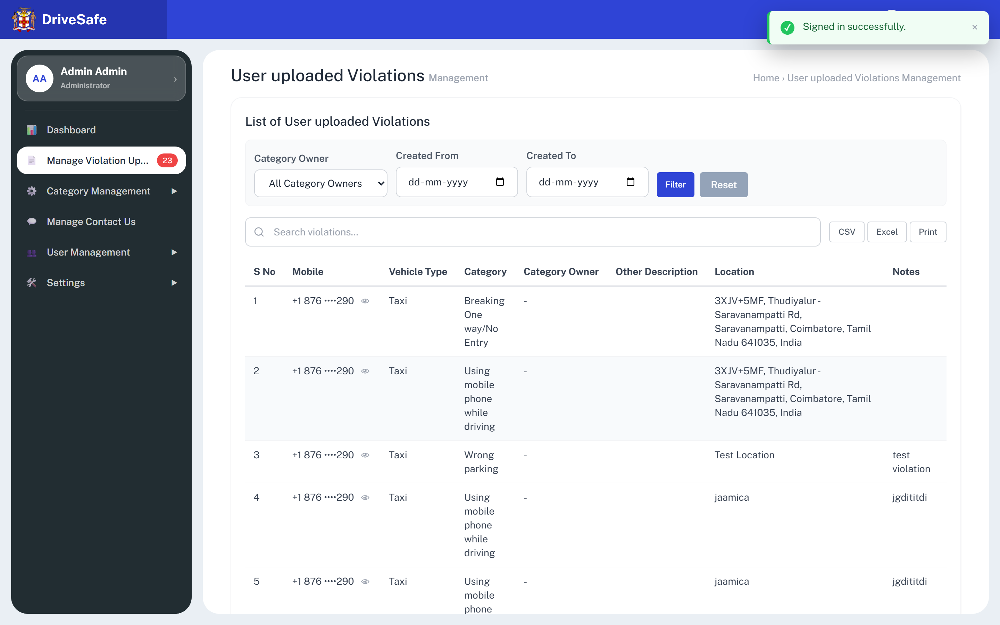

# SCR-06 · User uploaded Violations (list)

## Purpose
The working list for reviewers: every violation report citizens uploaded from the mobile app, with the reporter's masked phone, category, location, status and severity level. A reviewer narrows the list by category owner or date, finds a report and opens it for review (SCR-07).

## Entry and exit
**Reached from:** sidebar **Manage Violation Uploads** (with red pending badge, "23" in the capture); SCR-05 tiles Violation reports, Pending review, Verified, Rejected and **View all**.

**Leaves to:** SCR-07 Review modal via a row's **View / review report N** button; any shell destination through the sidebar (see SCR-04 for the header).

## States
### Populated, first page, filters empty

| State | When | What the user sees |
|---|---|---|
| Populated | Default | 10 rows, info text "Showing 1 to 10 of 23 entries", pager Previous 1 2 3 Next |
| Filtered | Filter pressed | Non-matching rows hidden; info text "Showing N of 10 entries" (N = rows shown) |
| Filtered to nothing | Filter matches no row (e.g. owner Police: no loaded violation's category has that owner) | Table body blank and "Showing 0 of 10 entries"; **no empty-state message**, OQ-V-09 |
| Stale count after a re-render | A review is saved (SCR-07) or a category is saved or deleted | The table body is rebuilt and shows all rows, but `#viol-info` keeps its previous filtered text, e.g. "Showing 2 of 10 entries", and the filter and search inputs keep their values, OQ-V-15 |
| Reset with search text | Reset pressed while the search box holds text | Rows the search had hidden are shown again, but the search box keeps its text, OQ-V-15 |
| Searching | Text typed in the search box | Rows whose text contains the query (case-insensitive, matched against the visible row text, so the masked mobile unless that row is revealed) remain; info text is **not** updated |
| Masked | Default | Mobile shows "+1 876 ····290" |
| Revealed | Eye pressed in a row | That row shows "+1 876 3125290" |
| Loading / error | Data in flight / failed | **Undefined, OQ-V-02** |
| Narrow and mid-width viewports | Measured with Playwright | The table has a minimum width of 72 rem (about 1150 px plus padding) inside a horizontally scrolling `.table-wrap`. The wrapper scrolls at every viewport width tested from 390 up to 2400 px (e.g. 390: 300 px visible of 1604; 1440: 1010 of 1656; 1920: 1466 of 1656) and fits only at about 2560 px. The scroll is not limited to phones. Below 1024 px the sidebar also becomes an off-canvas drawer (SCR-04), OQ-V-10 |

Only the first page (10 of 23) exists in the prototype; pages 2 and 3 are not built.

## Layout
| # | Region | Content |
|---|---|---|
| 1 | Page head | "User uploaded Violations" + "Management"; breadcrumb "Home › User uploaded Violations Management" |
| 2 | Card heading | "List of User uploaded Violations" |
| 3 | Filter bar (grey box) | Category Owner select, Created From, Created To, Filter, Reset |
| 4 | Toolbar | Search violations… box; CSV, Excel, Print |
| 5 | Table | 14 columns (below) |
| 6 | Footer row | Count text · "Show [10] entries" · pager |

Columns in order: **S No**, **Mobile**, **Vehicle Type**, **Category**, **Category Owner**, **Other Description**, **Location**, **Notes**, **Registration No**, **Created At**, **Status**, **Level**, **Status Updated By**, **Option**. The columns Registration No, Created At, Status, Level, Status Updated By and Option fall off-screen to the right in the 1440 px capture (horizontal scroll); the fold capture shows the same.

## Elements
| Element | Type | Behaviour | Requirement |
|---|---|---|---|
| S No | Integer | The violation id (1..10 on page 1), displayed as "serial number" | none |
| Mobile | Masked text | `+<cc> <area> <digits>`; masks all but the last 3 digits of the final group: "+1 876 ····290" | none |
| Vehicle Type | Text | Values seen: Taxi, Truck | none |
| Category | Text | Category name copied onto the report (name string, not id) | none |
| Category Owner | Text | Derived: owner of the matching category, "-" when none | none |
| Other Description | Text | Free text used when category is Other; blank otherwise | none |
| Location | Text | Address or plus-code, min width 16 rem, wraps | none |
| Notes | Text | Reporter notes | none |
| Registration No | Text | Vehicle plate; often blank | none |
| Created At | Text | `YYYY-MM-DD HH:mm:ss`, no wrap | none |
| Status | Chip | Pending amber, Under review sky, Verified green, Rejected red | none |
| Level | Integer | 0-3 severity (data.js marks as PROPOSED); all 0 in data | none |
| Status Updated By | Text | Name of portal user who last saved a review; "-" when never reviewed | none |
| Row hover | Style | Row background highlights | none |
| Sidebar pending badge | Red pill | Pending count (23) | none |
| Count text `#viol-info` | Text | See states above | none |
| Table caption | Screen reader only | "User uploaded violations" | none |
| Header cells | Header | Styled with pointer cursor, but sorting is **not implemented** (no handler), OQ-V-11 | none |

Real rows on page 1: ids 1-10, all mobile +1 876 3125290 and all Pending. Vehicle types Taxi (ids 1-9) and Truck (id 10). Categories: Breaking One way/No Entry (1), Using mobile phone while driving (2, 4, 5), Wrong parking (3, 6, 7, 8, 9), Breaking traffic signal (10). Created At runs 2026-09-08 05:45:32 down to 2026-07-10 09:12:04. Registration numbers present: ABC123 (3), lhckyfuo (4, 5), puguog (6, 7, 8). Category Owner is "-" in every row (only Over-charging fares is assigned to Police, and no report uses it). Locations include "Test Location", "jaamica", "jamaica" (test data).

## Actions
| Control | Type | What happens | Goes to | Who may | Disabled when |
|---|---|---|---|---|---|
| Category Owner | Select | Chooses the owner to filter by; options: "All Category Owners" (empty) plus every owner (today: Police). Takes effect only when Filter is pressed | — | any signed-in user (prototype enforces nothing; Administrator-only is PROPOSED, OQ-A-27) | — |
| Created From | Date input | Lower bound on the date part of Created At, inclusive | — | any signed-in user (prototype enforces nothing; Administrator-only is PROPOSED, OQ-A-27) | — |
| Created To | Date input | Upper bound on the date part, inclusive | — | any signed-in user (prototype enforces nothing; Administrator-only is PROPOSED, OQ-A-27) | — |
| Filter | Button (blue) | Hides every loaded row failing owner **and** date tests (all three AND-ed); sets count text "Showing N of 10 entries". Acts on the 10 loaded rows only, not on pages 2 and 3 | — | any signed-in user (prototype enforces nothing; Administrator-only is PROPOSED, OQ-A-27) | never |
| Reset | Button (grey) | Clears the three filter inputs, un-hides every row, sets count text "Showing 1 to 10 of 23 entries". Does **not** clear the search box | — | any signed-in user (prototype enforces nothing; Administrator-only is PROPOSED, OQ-A-27) | never |
| Search violations… | Search input | Hides rows whose text does not contain the typed text (case-insensitive) on every keystroke and when the native ✕ clears; searches visible text only (the masked mobile, not the full number) | — | any signed-in user (prototype enforces nothing; Administrator-only is PROPOSED, OQ-A-27) | — |
| CSV | Button | **Wired to nothing.** Intended: download rows as CSV | — | any signed-in user (prototype enforces nothing; Administrator-only is PROPOSED, OQ-A-27) | never |
| Excel | Button | **Wired to nothing.** | — | any signed-in user (prototype enforces nothing; Administrator-only is PROPOSED, OQ-A-27) | never |
| Print | Button | **Wired to nothing.** | — | any signed-in user (prototype enforces nothing; Administrator-only is PROPOSED, OQ-A-27) | never |
| 👁 beside mobile ("Show full phone number") | Icon toggle | Shows/hides the full number for that row; reflects `aria-pressed`; reset by any table re-render | — | any signed-in user (prototype enforces nothing; Administrator-only is PROPOSED, OQ-A-27) | never |
| 👁 Option ("View / review report N") | Icon button | Shows the Review modal for report N, with the modal's fields pre-filled from the row | SCR-07 | any signed-in user (prototype enforces nothing; Administrator-only is PROPOSED, OQ-A-27) | never |
| Show [10 / 25 / 50 / 100] entries | Select | Lets the user pick 10, 25, 50 or 100; **no handler**: choosing changes nothing | — | any signed-in user (prototype enforces nothing; Administrator-only is PROPOSED, OQ-A-27) | — |
| Previous | Pager button | **Wired to nothing**; also never disabled even on page 1 (other list screens disable it) | — | any signed-in user (prototype enforces nothing; Administrator-only is PROPOSED, OQ-A-27) | never |
| 1 | Pager button (current) | Marks the current page (`aria-current=page`); inert | — | any signed-in user (prototype enforces nothing; Administrator-only is PROPOSED, OQ-A-27) | — |
| 2 | Pager button | **Wired to nothing.** Page 2 holds rows 11-20, not built | — | any signed-in user (prototype enforces nothing; Administrator-only is PROPOSED, OQ-A-27) | never |
| 3 | Pager button | **Wired to nothing.** Page 3 holds rows 21-23 | — | any signed-in user (prototype enforces nothing; Administrator-only is PROPOSED, OQ-A-27) | never |
| Next | Pager button | **Wired to nothing** | — | any signed-in user (prototype enforces nothing; Administrator-only is PROPOSED, OQ-A-27) | never |

**Per-row buttons, exact labels:** "View / review report N" for N = 1 to 10 (View / review report 1, View / review report 2, View / review report 3, View / review report 4, View / review report 5, View / review report 6, View / review report 7, View / review report 8, View / review report 9, View / review report 10), each showing the Review modal for that report id. Page-size control, exact captured label: "Show 10 25 50 100 entries" (the select between the count text and the pager).

**Wired to nothing**
The current `capture.json` reports **8** dead controls on this screen: CSV, Excel, Print, Previous, 1, 2, 3, Next. The capture script was patched to treat delegated `data-*` handlers as wired (`tools/CAPTURE-PATCHES.md`); the first capture had flagged 28. Source check (app.js `bind()`) confirms the split:
- **Wired by delegation (capture cannot see):** all 10 "Show full phone number" buttons and all 10 "View / review report N" buttons (`data-mobile-toggle`, `data-review`, one document-level click listener). Not dead.
- **Genuinely unwired (unbuilt scope):** CSV, Excel, Print (OQ-V-12), the page-size select (OQ-V-13), Previous, 1, 2, 3, Next (OQ-V-13). The same three export buttons repeat on five other list screens.
The data (VIOLATIONS_TOTAL 23) says three pages exist; only one is loaded, so the pager describes data the prototype does not contain.

## Validation
| Field | Rule | Source | When | Message |
|---|---|---|---|---|
| Category Owner (`vf-owner`) | Single select, closed set: "" (All Category Owners) plus each Owner name from SCR-11 (today: Police); default empty; refreshes when owners change | declared (select, filled from OWNERS) | on Filter | — |
| Created From (`vf-from`) | Optional date, ISO `yyyy-mm-dd` from the native picker (declared, no bound declared). Bounds min 2020-01-01, max today | declared type; bounds **PROPOSED** | on Filter / on change | "Choose a date between 1 Jan 2020 and today." |
| Created To (`vf-to`) | Optional date (declared, no bound declared). Bounds min = Created From (or 2020-01-01), max today | declared type; bounds **PROPOSED** | on Filter / on change | same |
| Search violations | Free text, 0-100 characters, `<` `>` stripped as typed (stripping declared). The 100 limit and trimming of leading/trailing spaces are **PROPOSED**: the prototype has no maxlength and does not trim (two leading spaces before "parking" return 0 rows). All six list screens (SCR-06, 10, 11, 13, 20, 21) propose the same 100, OQ-V-26 | stripping declared; limit and trim **PROPOSED** | on input | — |
| Show 10 25 50 100 entries | One of 10, 25, 50, 100; default 10 (declared select options); no handler as built | declared (select) | — | — |

**Cross-field**
- Created From must be on or before Created To; either may be empty and both empty means no date limit. The prototype does not enforce this: reversed dates silently return zero rows. **PROPOSED**: show "From must not be after To." and do not run the filter, OQ-V-14.
- Search and Filter are independent in the UI but both hide rows through the same mechanism; clearing or typing in Search can un-hide rows that Filter hid, and vice versa. Production must apply both together (AND), OQ-V-15.

**Server-side only:** filtering, searching, sorting and paging must run on the full 23-row set, not on the loaded page.

**Unruled and undecided**

| Field | What is missing | Open question |
|---|---|---|
| Level | Meaning of 0, 1, 2, 3 and who sets it | OQ-V-16 |
| Date range | Time zone of Created At and of the date filter | OQ-V-17 |

## Screen communication
| Direction | With | What passes | Contract |
|---|---|---|---|
| Receives | SCR-05 Dashboard | Navigation only (no status filter carried) | — |
| Receives | SCR-07 Review modal | Updated status, level and Status Updated By ("Admin Admin") for the row; table re-renders, so any active filter/search hiding is lost visually while the inputs keep their values | Owner of status values: SCR-07 |
| Receives | Owners screen | Owner list for the filter; deleting an owner is not checked against categories that use it | Owner: Owners screen |
| Receives | Category screen | Category Owner column is derived by matching the report's category **name** to the category list; renaming or deleting a category makes its reports show "-" | Owner: Category screen; OQ-V-18 |
| Sends | SCR-05 | Pending/Verified/Rejected changes alter tiles, funnel, sidebar badge | Owner: `updateStats()` |
| Sends | SCR-21 [App user List](../05-users/SCR-21-app-user-list.md) | Verified status "awards reward points" to the reporter; prototype changes no points | OQ-V-25 |
| Shares | Mobile masking | Same masking function is used on the App user List; Owner: this module | Any change to mask length changes both |

## Acceptance criteria
**ST-SCR-06-01 — Page load**
- Given I open Manage Violation Uploads
- Then the table shows 10 rows with S No 1 to 10, every Status chip reads Pending
- And the count text reads "Showing 1 to 10 of 23 entries"

**ST-SCR-06-02 — Masked phone**
- Given row 1
- Then Mobile reads "+1 876 ····290"
- When I press the eye beside it
- Then it reads "+1 876 3125290"

**ST-SCR-06-03 — Date filter**
- Given Created From 2026-09-01 and Created To 2026-09-30
- When I press Filter
- Then only rows 1 and 2 remain and the count text reads "Showing 2 of 10 entries"

**ST-SCR-06-04 — Owner filter with no matches**
- Given Category Owner "Police"
- When I press Filter
- Then no rows show and the count text reads "Showing 0 of 10 entries" (no empty message, OQ-V-09)

**ST-SCR-06-05 — Reset**
- Given a filter is active
- When I press Reset
- Then the three inputs are empty, all 10 rows show and the text reads "Showing 1 to 10 of 23 entries"

**ST-SCR-06-06 — Search**
- Given the table is unfiltered
- When I type "parking"
- Then only rows 3, 6, 7, 8 and 9 remain

**ST-SCR-06-07 — Review button**
- Given row 3
- When I press its Option button
- Then the modal "Violation #3 — Wrong parking" shows

**ST-SCR-06-08 — Unbuilt controls**
- Given the page
- When I press CSV, Excel, Print, Next or page 2
- Then nothing happens (as built; flagged OQ-V-12, OQ-V-13)

## Data
- **Reads:** violations (id, mobile, vehicleType, category, otherDescription, location, notes, registrationNo, createdAt, status, level, statusUpdatedBy), derived category owner, owners list for the filter, total 23.
- **Writes:** none directly; row edits happen in SCR-07.
- **Services required:** paged, filterable, sortable query over violations; export (CSV, Excel, print view); owner lookup via category.

## Accessibility and keyboard
- Table caption, `scope=col` headers; search box has `aria-label` "Search violations"; pager `nav` labelled "Pagination", current page `aria-current`.
- Icon buttons carry `aria-label` and `title`.
- The Mobile toggle updates its `aria-label` (Show/Hide full phone number) and `aria-pressed`.
- No keyboard shortcut for search.
- The modal it opens traps nothing (see SCR-07).

## Open questions
| ID | Question | Affects | Why it matters |
|---|---|---|---|
| OQ-V-09 | Empty-result message for filters/search | Table | Blank table looks broken |
| OQ-V-10 | Mobile layout: horizontal scroll at 72 rem table width or a card layout? | Table | No mobile capture |
| OQ-V-11 | Which columns sort and what is the default order? Headers look sortable | Headers | Developers will skip or invent |
| OQ-V-12 | CSV, Excel, Print: should they export filtered rows, current columns, full phone numbers or masked? Exporting unmasked numbers defeats masking | Toolbar | PII leak risk |
| OQ-V-13 | Server paging and page size (10/25/50/100); is "Previous" disabled on page 1? | Footer | Three pages implied, one built |
| OQ-V-14 | Reversed date range behaviour | Filter | Silent empty result |
| OQ-V-15 | Search and Filter should combine; as built they overwrite each other | Filter, Search | Users see hidden rows reappear |
| OQ-V-16 | Level 0-3: meaning, who sets it, relation to admin-user level 1-3 | Level column | Drives data model and permissions |
| OQ-V-17 | Time zone of Created At | Date filter | Boundary rows |
| OQ-V-18 | Category is stored as a name string on the report: rename/delete orphans reports. Use an id? | Category column, data model | Referential integrity |
| OQ-V-19 | Who may reveal full phone numbers, and is each reveal audited? Prototype lets anyone, unlogged | Mask toggle | Privacy compliance |
| OQ-V-26 | Search box: confirm one maximum (100, PROPOSED) and whether to trim, for all six list screens; the prototype does neither | Search boxes on all lists | One rule, one owner (SCR-06 states it) so the six lists cannot drift |
| OQ-V-20 | Evidence (photo/video) is mentioned in the README and SCR-07 placeholder but the list has no media indicator | Table | Reviewers cannot see which reports have media |
