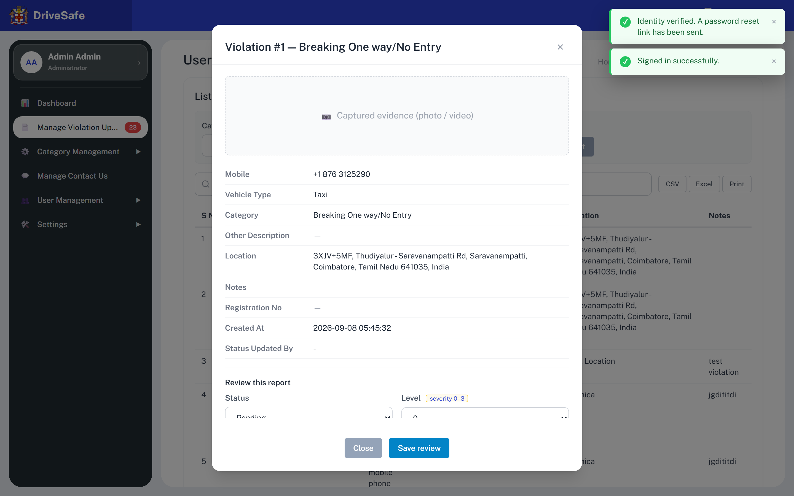

# SCR-07 · Violation review modal

## Purpose
Where a reviewer decides a report. It shows everything the citizen submitted and lets the reviewer set Status (Pending, Under review, Verified, Rejected) and Level (0-3). Saving stamps the report as updated by the signed-in user and updates the counts everywhere.

## Entry and exit
**Reached from:** SCR-06 row Option button "View / review report N"; SCR-05 latest-reports row Option button "Review report N".

**Leaves to:** back to the screen it was opened from via **Save review**, **Close**, **×**, Escape or backdrop mouse-down.

## States
### Opened for report 1

*Capture note: the image also shows two stale toasts at top right ("Identity verified. A password reset link has been sent." and "Signed in successfully.") left over from earlier steps of the capture session. They are not part of the modal; each toast lasts 3.5 s in the live prototype.*

| State | When | What the user sees |
|---|---|---|
| Open, unchanged | On open | Title `Violation #<id> — <category>`; Status and Level preset to the report's current values; Reviewer note empty |
| Saved | Save review | Modal closes; list and dashboard refresh; toast "Report N updated to <status>." plus " Reporter awarded reward points." when status is Verified |
| Verified (no points) | Save with Verified | Toast promises points but **no points are changed anywhere**, OQ-V-25 |
| Unsaved changes | Close/×/Escape/backdrop | Edits discarded silently, no confirm |
| Loading / error | Save in flight/failed | **Undefined, OQ-V-02** |
| Evidence missing | Always | The area is a dashed placeholder "📷 Captured evidence (photo / video)"; no media exists in the data, OQ-V-20 |

Scrolling: the modal body scrolls inside a card limited to 90% of viewport height; the capture shows it clipped.

## Layout
| # | Region | Content |
|---|---|---|
| 1 | Head | Title and × (`aria-label` "Close dialog") |
| 2 | Evidence | Dashed box 9 rem high "Captured evidence (photo / video)" |
| 3 | Detail list | Nine rows, label column 10 rem wide |
| 4 | Review block | Heading "Review this report"; Status select, Level select (with amber note "severity 0–3"); Reviewer note textarea (2 rows, placeholder "Why this decision?") |
| 5 | Footnote | "Setting status to **Verified** credits reward points to the reporter (concept). *Status Updated By* is recorded as **Admin Admin**." |
| 6 | Footer | Close (grey), Save review (blue) |

Detail rows in order: **Mobile** (shown in full, **unmasked**, e.g. +1 876 3125290), **Vehicle Type**, **Category**, **Other Description**, **Location**, **Notes**, **Registration No**, **Created At**, **Status Updated By**. Empty values show "—".

## Elements
| Element | Type | Behaviour | Requirement |
|---|---|---|---|
| Title | Heading | `Violation #<id> — <category>` | none |
| Mobile row | Text | Full number, no mask and no toggle, even though lists mask it, OQ-V-19 | none |
| Detail rows | Read-only text | As listed | none |
| "severity 0–3" tag | Amber pill | Marks Level as PROPOSED by the prototype author | none |
| Footnote | Text | See Layout 5 | none |
| Toast | Success | 3.5 s, dismissible | none |

Fields shown are not editable here: reporter, category, location, notes and so on cannot be corrected by the reviewer.

## Actions
| Control | Type | What happens | Goes to | Who may | Disabled when |
|---|---|---|---|---|---|
| × | Icon button | Closes the modal, discarding Status, Level and note changes; focus returns to the row button (the table is not rebuilt) | origin screen | any signed-in user (prototype enforces nothing; Administrator-only is PROPOSED, OQ-A-27) | never |
| Status | Select | Choose one of Pending, Under review, Verified, Rejected; no ordering or transition rule | — | any signed-in user (prototype enforces nothing; Administrator-only is PROPOSED, OQ-A-27) | — |
| Level severity 0–3 (label "Level" plus the amber tag "severity 0–3") | Select | Choose 0, 1, 2 or 3; the tag marks the field as the prototype author's PROPOSED concept (README and data.js: "severity 0–3 (PROPOSED)") | — | any signed-in user (prototype enforces nothing; Administrator-only is PROPOSED, OQ-A-27) | — |
| Reviewer note | Textarea | Free text; **never saved or shown anywhere** | — | any signed-in user (prototype enforces nothing; Administrator-only is PROPOSED, OQ-A-27) | — |
| Close | Button (grey) | Same as ×, discards changes | origin screen | any signed-in user (prototype enforces nothing; Administrator-only is PROPOSED, OQ-A-27) | never |
| Save review | Primary button | Writes Status and Level to the report, sets Status Updated By to "Admin Admin" (hard-coded), re-renders both tables (this clears any filter or search hiding and any revealed phone number), updates tiles, funnel, sidebar badge, closes the modal and raises the toast. Does not save the note. It is **always enabled**: unlike the user and app-user Save buttons (which `refreshSaveButtons` disables until valid), this form has no required field | origin screen | any signed-in user (prototype enforces nothing; Administrator-only is PROPOSED, OQ-A-27) | never |
| Escape | Keyboard | Closes the modal, discarding changes | origin screen | any signed-in user (prototype enforces nothing; Administrator-only is PROPOSED, OQ-A-27) | — |
| Backdrop | Mouse-down on dark area | Closes the modal, discarding changes, no confirmation | origin screen | any signed-in user (prototype enforces nothing; Administrator-only is PROPOSED, OQ-A-27) | — |

**Wired to nothing:** none (verified in source). The Reviewer note textarea is wired to nothing at all: nothing reads it. That is unbuilt scope, OQ-V-21.

## Validation
| Field | Rule | Source | When | Message |
|---|---|---|---|---|
| Status | One of: Pending, Under review, Verified, Rejected (default = current status) | declared (select) | — | — |
| Status | Allowed transitions: Pending → Under review → Verified or Rejected; moving a Verified or Rejected report back needs a reason | **PROPOSED**; prototype allows any change, OQ-V-22 | on save | "That status change is not allowed." |
| Level severity 0–3 | One of 0, 1, 2, 3 (min 0, max 3, integer, default = current) | declared (select) plus data.js comment "severity 0–3 (PROPOSED)" | — | — |
| Level | Must be ≥ 1 when Status is Verified | **PROPOSED**, OQ-V-16 | on save | "Set a severity level before verifying." |
| Reviewer note | Optional free text, trimmed, 0-500 chars, `<` `>` stripped; required when Status is Rejected | **PROPOSED** (no maxlength declared; stripping is declared) | on save | "Give a reason for rejecting this report." |

**Cross-field:** Status/Level and Status/Note rules above, all **PROPOSED**.

**Server-side only:** who may change status for which Level (OQ-V-03); concurrent edit by two reviewers (last write wins in the prototype; proposed: reject with "This report was updated by someone else."); reward point crediting.

**Unruled and undecided:** the allowed transitions, point values, level meaning.

## Screen communication
| Direction | With | What passes | Contract |
|---|---|---|---|
| Receives | SCR-06 / SCR-05 | Report id | `data-review` integer |
| Sends | SCR-06 / SCR-05 | New Status, Level, Status Updated By | Owner of status values: this screen |
| Sends | SCR-05 | Changes the Pending/Verified/Rejected/Under review counts and the sidebar badge | Owner: `updateStats()` |
| Sends | [SCR-21](../05-users/SCR-21-app-user-list.md) App user List | Verified is meant to credit reward points (earner points); not implemented | OQ-V-25 |
| Receives | Session | Reviewer name "Admin Admin" | Hard-coded, OQ-A-23 |

If the status list changes, SCR-05 funnel, tile set and the chip colours on SCR-05/06 change with it.

## Acceptance criteria
**ST-SCR-07-01 — Content for report 1**
- Given I press the Option button of report 1
- Then the title reads "Violation #1 — Breaking One way/No Entry"
- And Mobile reads "+1 876 3125290", Vehicle Type Taxi, Created At 2026-09-08 05:45:32, Status Updated By "-"
- And Status reads Pending and Level reads 0

**ST-SCR-07-02 — Verify a report**
- Given the modal is open for report 1
- When I choose Status Verified and press Save review
- Then the modal closes and the list row 1 shows a green Verified chip and Status Updated By "Admin Admin"
- And a toast reads "Report 1 updated to Verified. Reporter awarded reward points."

**ST-SCR-07-03 — Counts follow**
- Given report 1 was just verified
- Then the Dashboard Pending tile reads 22 and Verified reads 1 and the sidebar badge reads 22

**ST-SCR-07-04 — Set level**
- Given the modal is open
- When I set Level 2 and save
- Then the Level cell of that row reads 2

**ST-SCR-07-05 — Close discards**
- Given I changed Status to Rejected
- When I press Close
- Then the row still shows its previous status

**ST-SCR-07-06 — Escape and backdrop**
- Given the modal is open
- When I press Escape (or press the dark area)
- Then the modal closes with no change

**ST-SCR-07-07 — Reopen is fresh**
- Given I typed a Reviewer note and saved
- When I reopen the same report
- Then the note is empty (it was never kept)

## Data
- **Reads:** one violation (all nine detail fields plus status, level).
- **Writes:** `status`, `level`, `statusUpdatedBy` (and `statusUpdatedAt`: proposed, not in the prototype). Note text and reward points are described but not written.
- **Services required:** update with optimistic concurrency, audit log of status changes, reward points award, notification to the reporter (proposed).

## Accessibility and keyboard
- `role=dialog`, `aria-modal=true`, `aria-labelledby` the title.
- On open focus goes to the first focusable control (the × button) after 30 ms; Tab is not trapped and may reach the page behind; on Close and × focus returns to the row button; on **Save review** it is lost (the table is rebuilt before the modal closes, so the recorded button is detached), and Escape and backdrop never restore it. Builder requirement under OQ-A-21 (see SCR-03).
- Escape closes. Toast is polite live.
- The Level pill "severity 0–3" is plain text next to the label.

## Open questions
| ID | Question | Affects | Why it matters |
|---|---|---|---|
| OQ-V-25 | Verified credits points (toast says so, footnote says "concept"): how many, to which App user, once or on each re-save? Full mobile shown unmasked here | Save, Mobile row | Points could be awarded twice; PII exposure |
| OQ-V-21 | Reviewer note: store, show, make mandatory on Rejected? | Note | A decision with no recorded reason |
| OQ-V-22 | Allowed status transitions and who may reverse a decision | Status | Prototype lets anyone set anything |
| OQ-V-23 | Audit: record who/when/old-value/new-value; prototype only keeps latest "Admin Admin" | Data model | Compliance |
| OQ-V-24 | Evidence photo/video: type, size, viewer, retention | Evidence box | Placeholder only |
